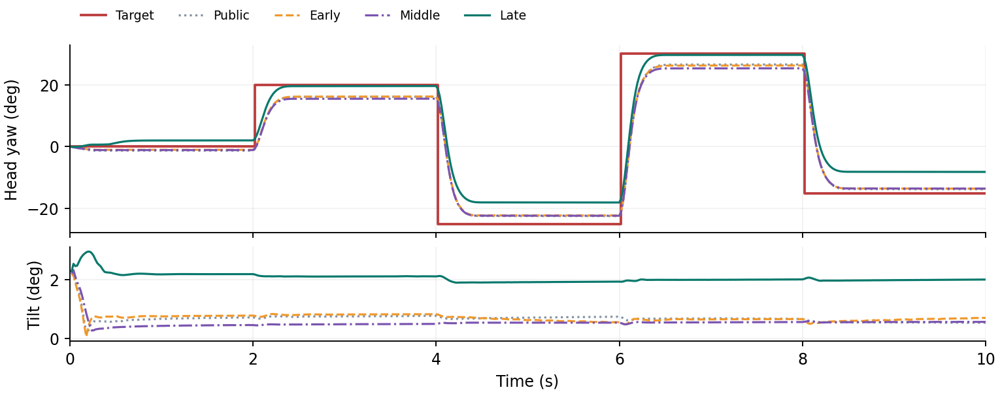

# Microduck Lab · 제자리에서 균형을 잡고 머리 돌리기

세인티 2026 · Day 1 · MuJoCo 모델 해석과 전신 PPO

**수업 목표**　Microduck에 앞뒤·좌우·회전 속도 0을 명령한다. 목표가 바뀔 때 머리는 좌우로 돌리고 몸통은 두 발 위에서 균형을 유지해야 한다. 수강생은 10초 기립률과 머리 각도 오차를 함께 측정해 자신의 정책을 판정한다.

## 1. 실습 순서와 준비물

새 PC는 `02_Microduck/실습배포/install_day1_models.sh`로 먼저 Day 1 자료를 설치한다. 아래 명령은 WSL2 Ubuntu의 같은 터미널에서 실행한다.

```bash
cd ~/sainty/day1/microduck_lab
uv sync --locked
bash prepare_balance.sh
PY=~/sainty/day4/microduck_rl_training/.venv/bin/python
B=results/head_balance
export LD_LIBRARY_PATH="/usr/lib/wsl/lib:${LD_LIBRARY_PATH:-}"
```

| 순서 | 열거나 실행할 파일 | 학생이 확인할 것 |
|---|---|---|
| ① 모델 구조 | 2~4장의 MJCF, xacro, `inspect_model.py` | 머리 yaw 관절과 서보 이름, 센서와 관절 좌표 |
| ② 공개 정책 | 5장의 `evaluate_balance.py` | 제공된 정책이 두 발로 선 채 방향을 바꾸는지 |
| ③ PPO 미세조정 | 6장의 `train_balance.py` | 같은 전신 actor가 달라지는 목표를 받으며 업데이트되는지 |
| ④ 단계별 평가 | 7장의 평가·녹화 명령 | 같은 시드를 사용한 기립률, RMSE, 동시 통과율 |
| ⑤ 결과 해석 | 8장의 표와 추종 곡선 | 평균 보상으로 가려질 수 있는 실패를 찾아 설명하기 |

**두 Python 환경**　2~4장의 XML 실습은 Day 1의 `uv run`을 사용한다. 5장부터는 공식 저장소의 고정 커밋과 잠금 파일로 설치한 Python 3.12인 `"$PY"`를 쓴다. 최초 설치에는 인터넷 연결이 필요하다. 강의 시간이 짧으면 배포된 체크포인트와 MP4로 ②·④를 먼저 진행한다.

<!-- pagebreak -->

## 2. mjcf_examples · native.xml 하나가 구 세 개가 되는 과정

| 읽을 파일 | 역할 | 어디를 먼저 볼까? |
|---|---|---|
| `native.xml` | MuJoCo에 직접 전달하는 장면 | include → frame → replicate → 개별 geom |
| `sizes.xml` | 공통 기본값 | `class="marker"`, `type="sphere"`, `size="0.03"` |
| `read_sizes.py` | 컴파일된 모델과 세계 좌표 출력 | `sys.argv[1]`, `geom_size`, `geom_xpos` |
| `two_sizes.xml.xacro` | 전처리로 MJCF를 만드는 별도 예제 | property·macro의 정의와 두 번의 호출 |

먼저 `native.xml`을 연다. `<include file="sizes.xml"/>`을 만나면 같은 폴더의 `sizes.xml`로 이동한다. 안쪽 `<default class="marker">`는 marker라는 이름으로 sphere와 반지름 0.03 m를 묶는다. 다시 native.xml로 돌아와 어떤 geom이 이 class를 쓰는지 표시한다.

```xml
<frame pos="0 0 0.1">
  <replicate count="2" offset="0.2 0 0">
    <geom name="small" class="marker"/>
  </replicate>
  <geom name="large" class="marker" size="0.06" pos="0 0.2 0"/>
</frame>
```

`frame`이 세 구 전체를 z방향으로 0.1 m 옮긴다. `replicate`가 small을 두 개 만들어 두 번째 것만 x방향으로 0.2 m 더 옮긴다. large는 marker의 구 모양을 받아오면서 반지름은 0.06 m로 직접 지정한다. 위쪽의 `custom/numeric`인 radius_hint=0.09는 사용자 데이터다. 이 장면에는 이를 geom 크기에 대입하는 코드가 없다.

```bash
uv run mjcf_examples/read_sizes.py mjcf_examples/native.xml
```

```text
small0 radius 0.03 world xyz [0.  0.  0.1]
small1 radius 0.03 world xyz [0.2 0.  0.1]
large  radius 0.06 world xyz [0.  0.2 0.1]
```

**Python 해석**　`sys.argv[1]`은 명령 끝의 XML 경로다. `MjModel.from_xml_path()`가 include와 복제를 반영한 모델을 만든다. `MjData(model)`에 대해 `mj_forward()`를 호출하면 시간을 진행시키지 않고 세계 좌표를 계산한다. 반복문이 모델의 `geom_size[i,0]`와 데이터의 `geom_xpos[i]`를 함께 출력한다. 구에서 첫 번째 size는 반지름이다.

**확인 문제**　기본 반지름만 0.04로 바꾼다면? small0·small1만 0.04가 되고 large는 0.06이다. `read_sizes.py` 실행에는 항상 XML 경로 인수를 넣는다.

<!-- pagebreak -->

## 3. mjcf_examples · xacro로 크기 두 개 계산하기

이번에는 `two_sizes.xml.xacro`를 연다. 이 파일에서 xacro가 먼저 식을 계산하고, 이어서 MuJoCo가 완성된 XML을 읽는다. 앞 장의 `native.xml`과 독립적으로 실행할 수 있다.

| 원문에서 찾을 표현 | 이번 예제에서 하는 일 |
|---|---|
| `xmlns:xacro` | xacro가 해석할 태그의 이름 공간을 선언한다. |
| `xacro:property name="radius" value="0.03"` | 기본 반지름을 한 곳에 정의한다. |
| `xacro:macro name="marker" params="label x r"` | 이름·x좌표·반지름을 인자로 받아 sphere geom 하나를 만드는 틀이다. |
| 첫 호출 `label="small" x="0" r="${radius}"` | 이름 small, 반지름 0.03, 원점의 구를 만든다. |
| 둘째 호출 `label="large" x="0.2" r="${2 * radius}"` | 같은 매크로로 반지름을 두 배로 계산하고 x를 0.2 m 옮긴다. |

### 실행 순서를 바꾸면 왜 안 될까?

```bash
# 수업 PC에 설치된 ROS 2 Humble의 xacro를 사용한다.
source /opt/ros/humble/setup.bash
mkdir -p results
xacro mjcf_examples/two_sizes.xml.xacro -o results/two_sizes.xml
uv run mjcf_examples/read_sizes.py results/two_sizes.xml
```

```text
small radius 0.03 world xyz [0. 0. 0.]
large radius 0.06 world xyz [0.2 0.  0. ]
```

`results/two_sizes.xml`을 열어 두 geom의 size에 숫자가 들어갔는지 확인한다. 생성물의 z좌표가 0인 이유는 이 템플릿에 앞 장의 frame이 없기 때문이다. xacro를 실행하기 전에 MuJoCo에 템플릿을 직접 주면 xacro 태그가 전개되지 않는다.

**학생 실험**　템플릿을 `results/trial.xml.xacro`로 복사해 radius를 0.04로 바꾼다. 이 복사본을 xacro에 넣어 `results/trial.xml`을 생성한 다음 `read_sizes.py`로 읽는다. 예상 반지름은 0.04와 0.08이다. native 실험의 large와 달리 이 예제의 large도 함께 바뀌는 이유를 작성한다.

**구분할 이름**　앞 장의 marker는 MuJoCo 기본값 클래스이고, 이 장의 marker는 xacro 매크로다. 이 네 파일은 모델 구성 방법을 익히는 작은 실험이다. 다음 장에서 실제 로봇을 열 때는 제공된 `scene_walk.xml`을 읽는다.

<!-- pagebreak -->

## 4. inspect_model.py · 머리 관절에서 모터까지 추적하기

```bash
uv run inspect_model.py
```

`standing_model()`은 스크립트 기준으로 `../sources/microduck_rl/src/mjlab_microduck/robot/microduck/scene_walk.xml`을 연다. 모델 구조인 MjModel과 현재 상태인 MjData를 만들고, 이름이 STAND인 keyframe을 적용한 뒤 `mj_forward()`로 파생값을 갱신한다.

| 실측 출력 | 해석 |
|---|---|
| `nq=21 nv=20 nu=14 dt=0.002` | 위치 좌표 21개, 속도 좌표 20개, 모터 명령 14개, 물리 계산 간격 2 ms |
| `STAND root xyz + wxyz: [0. 0. 0.12 1. 0. 0. 0.]` | 몸통 초기 위치 3개와 방향 쿼터니언 4개. 부유 몸체의 속도에는 6개 성분이 쓰인다. |
| `7 head_yaw -> head_yaw 14 13 0.0 0.0` | 모터 인덱스 7, 관절 위치 주소 14, 속도 주소 13, 초기 각도와 모터 목표 모두 0 |
| `sensor orientation address 0 width 4` | 감지값 배열의 시작 주소와 폭. 이것은 센서 번호와 별도로 읽는다. |

반복문에서 `actuator_trnid[i,0]`로 모터가 연결된 관절을 찾고 `jnt_qposadr`, `jnt_dofadr`를 따라간다. 모터 번호 7을 그대로 qpos 인덱스로 쓰면 왼쪽 엉덩이 yaw 값을 읽게 된다. 환경 코드는 이 혼동을 피하려고 `data.joint("head_yaw")`로 이름을 지정한다.

### 선택 실습 · 공개 보행 정책의 가중치 읽기

```bash
uv run inspect_weights.py
uv run measure_policies.py --output results/model_scale.json
```

`inspect_weights.py`는 `../policies/alpha_walking.onnx`의 초기화 텐서에서 이름이 .weight로 끝나는 2차원 행렬을 골라 크기·최솟값·최댓값·표준편차를 출력한다. 실측 행렬은 **512×61, 256×512, 128×256, 14×128**, 원소 합은 **196,864개**다. 이 수에는 편향이 포함되지 않는다.

`measure_policies.py`는 설치된 실습 폴더에서 ONNX와 SB3 ZIP을 찾아 actor의 행렬 및 편향을 따로 세고, CPU 입력 한 건·스레드 한 개에서 100회 예열 후 1,000회의 중앙값과 p95를 측정한다. 측정값은 그 PC의 정책 호출 시간이다. 수업 중 실행하는 MuJoCo 물리·뷰어 표시·센서 획득 시간은 별도로 든다.

**토의**　`head_yaw` 하나의 위치만 관측하는 로봇과, 몸통 각속도·중력 방향·다리 각도도 관측하는 로봇을 생각해 보자. 앞으로 기울 때 어느 관측에서 변화를 먼저 찾을 수 있으며, 어느 관절을 움직여야 균형을 회복할 수 있을까?

<!-- pagebreak -->

## 5. 공개 정책에 제자리 머리 명령 보내기

평지 속도 추종 과제 `Mjlab-Velocity-Flat-MicroDuck`가 이번 학습의 바탕이다. 출발 가중치는 Pollen Robotics가 **다른 공식 변형**인 `Mjlab-Velocity2-Rough-Backlash-MicroDuck`에서 훈련한 3750번 체크포인트다. 공개 `alpha_walking.onnx`와 같은 actor로 시작하므로, 미세조정 이전 실력을 먼저 측정할 수 있다.

```bash
"$PY" evaluate_balance.py --policy ../policies/alpha_walking.onnx \
  --episodes 1 --viewer --out "$B/view_reference"
```

| 정책 입력 | 차원 | 균형·추종에 쓰이는 정보 |
|---|---:|---|
| 몸통 각속도, 몸통 좌표의 중력 방향 | 3 + 3 | 기울어지는 방향과 속도 |
| 기준 대비 관절각, 관절 속도, 직전 행동 | 14 + 14 + 14 | 머리·다리의 실제 자세와 제어 이력 |
| 속도, 머리 자세, 몸통 자세 명령 | 3 + 4 + 6 | 몸통 속도는 0, 머리 명령 중 yaw만 변경 |

**명령이 움직임이 되는 과정**　`evaluate_balance.py`에서 `head_offset[2]`에 목표를 라디안으로 넣는다. 공식 `PolicyInference`의 `new_cmd_obs=True` 경로가 이를 관측에 포함한다. `infer()`가 61개 입력으로 14개 관절 행동을 구하고 `apply_action()`이 기준 자세에 더한 관절 목표를 BAM 서보 모델에 전달한다. 물리 시뮬레이션이 발 접촉과 몸통 운동을 계산하면 다음 20 ms 주기에서 정책이 새 관측을 읽는다.

**머리는 어느 기준에서 도는가?**　측정값은 목 기구의 `head_yaw` 관절각이다. 여기서 목표 +20°는 기준 자세에서 이 관절을 +20° 돌리라는 뜻이다. 세계 좌표에서 카메라가 바라보는 방위각과는 몸통 회전만큼 차이가 날 수 있다. 몸통이 출발점에서 얼마나 밀렸는지도 CSV의 `drift_m`에서 따로 확인한다.

<!-- pagebreak -->

## 6. GPU에서 전신 PPO 미세조정하기

`classroom_cfg()`는 공식 평지 과제 설정을 읽고 속도 명령 범위를 전부 0으로 둔다. 목·머리 네 목표 중 yaw만 −30°~+30°에서 균일하게 뽑아 1.5~2.5초마다 바꾼다. 몸통 자세 명령은 0이다. 원래 커리큘럼이 명령 범위를 덮어쓰지 않도록 해당 항목을 제거한다. 다리·머리의 14개 행동, BAM 구동기, 원본의 몸통 기립·속도·머리 추종 보상은 계속 사용한다.

```bash
"$PY" -c 'import torch, warp as w; print(torch.cuda.is_available(), w.get_devices())'
"$PY" train_balance.py --warmstart "$B/warmstart.pt" \
  --envs 32 --iterations 25 --seed 7 --out "$B/my_run"
```

**숫자를 읽는 법**　actor는 61 → 512 → 256 → 128 → 14 구조다. 공개 체크포인트에서 actor와 그 관측 정규화를 불러온다. 이번 과제의 미래 보상을 추정할 critic과 optimizer는 새로 시작한다. 각 반복에서 환경 32개가 24스텝씩 움직여 경험 768개를 모은다. 25회면 총 19,200개다. `--warmstart`를 생략하면 무작위 가중치에서 시작하므로 같은 반복 수에서 같은 성과를 기대할 근거가 없다.

**한 번의 업데이트**　RSL-RL의 `runner.learn()`이 관측·행동·보상·종료를 모은다. critic 예측과 보상으로 GAE를 계산하고, PPO는 이전 행동 확률과 새 확률의 비율을 제한한 목적함수로 actor를 갱신한다. critic은 수익 예측 오차를 줄인다. 미니배치 4개를 5회 순회하며 역전파와 Adam을 적용한다. 미세조정 학습률은 고정 `1e-5`다. 몸통이 60° 한계를 넘으면 해당 환경이 종료된다.

**CUDA 확인**　위 진단에서 PyTorch가 `True`이고 Warp 목록에 `cuda:0`가 있어야 한다. 이 PC는 WSL의 `/usr/lib/wsl/lib`를 라이브러리 탐색 경로 앞에 두어 Warp가 NVIDIA 드라이버를 찾도록 했다. 첫 실행에서 CUDA 커널 컴파일에 시간이 든다. 추론 평가에서는 CPU ONNX Runtime과 CPU MuJoCo를 사용한다.

<!-- pagebreak -->

## 7. 세 체크포인트를 같은 시험으로 평가하기

`model_0.pt`, `model_12.pt`, `model_24.pt`는 각각 1·13·25회 업데이트 후의 actor·critic·학습 상태다. 같은 이름의 ONNX는 해당 시점의 추론 모델이다. 배포 예시는 `$B/classroom`, 직접 훈련한 예시는 `$B/my_run`에 있다. 1장의 셸 변수 설정 후 다음 명령을 실행한다.

```bash
RUN="$B/my_run"                 # 배포 모델은 RUN="$B/classroom"
for n in 0 12 24; do
  MUJOCO_GL=egl "$PY" evaluate_balance.py --policy "$RUN/model_$n.onnx" \
    --out "$RUN/eval_$n" --episodes 10 --seed 100 --record
done
"$PY" evaluate_balance.py --policy "$RUN/model_24.onnx" \
  --episodes 1 --seed 100 --viewer --out "$B/view_late"
```

매 2초 목표가 **0° → +20° → −25° → +30° → −15°**로 바뀐다. 홀수 시드에서는 부호를 반전한다. 시드 100~109는 시작 몸통 피치를 ±3° 범위에서 달리한다. 평가 중 외부 밀기는 없다. 빨간 세로선은 영상 위 눈금의 목표각, 흰 점은 실제 관절각이다. `--record`는 첫 시드를 녹화하고 모든 시드의 숫자는 같은 폴더에 저장한다.

| 지표·파일 | 계산과 판정 |
|---|---|
| 10초 기립률 | 5 ms마다 몸통을 검사한다. 60° 이상 또는 비정상 상태면 즉시 실패. 10초를 마친 횟수 / 전체 시행 수 |
| yaw RMSE (도) | 유효한 기립 샘플마다 (실제각 − 목표각)²을 더해 샘플 수로 나누고 제곱근. 목표 전환 직후도 포함 |
| 동시 통과율 | 각 시행이 10초 기립하고 그 시행의 RMSE가 10° 이하인 경우만 1회 통과. 수업용 기준 |
| 결과 확인 | `metrics.json`은 전체·시드별 지표, `trace.csv`는 시간·목표·실제각·몸통 기울기·수평 이동, `replay.mp4`는 첫 시행 |

한 시행이 일찍 넘어지면 남은 시간의 오차를 0으로 채우지 않는다. 따라서 RMSE가 낮아도 넘어졌다면 그 시행은 실패다. 10초를 버텨도 한 방향만 추종하는 정책은 각도 기준에서 탈락할 수 있다.

<!-- pagebreak -->

## 8. 실측 결과로 수업 목표 판정하기

아래는 배포 파일을 같은 시드 100~109에서 평가한 기록이다. 초기·중기·말기는 공개 actor를 이어받아 수업 과제를 미세조정한 시점이다.

| 모델 | 10초 기립 | yaw RMSE | 동시 통과 | 최댓값 · 수평 이동 |
|---|---:|---:|---:|---:|
| 공개 정책 | 10/10 | 8.00° | 10/10 | 0.67 cm |
| 초기 · 1회 | 10/10 | 8.01° | 10/10 | 0.64 cm |
| 중기 · 13회 | 10/10 | 8.09° | 10/10 | 0.65 cm |
| 말기 · 25회 | 10/10 | 8.65° | 10/10 | 1.21 cm |



**그림 읽기**　위 그래프에서 붉은 계단은 명령이다. 목표가 바뀌는 순간과 그 직후의 추종 지연도 RMSE에 포함된다. 아래 그래프는 같은 시간의 몸통 기울기를 보여 준다. 그래프는 시드 100의 한 시행이고 표는 10개 시행의 집계다.

공개 정책의 RMSE는 8.00°, 말기 정책은 8.65°였다. 같은 목표에서도 초기 가중치의 성능과 추가 학습의 효과를 구분하려면 공개 정책 행을 기준으로 읽는다. 이 시험은 평지·초기 피치 ±3°·10초 조건의 시뮬레이션이다.

**비교 실습**　예전 `head_env.py`는 머리 한 축만 제어했고 몸통 기울기를 관측하지 않았다. 당시 말기 정책은 10회 모두 넘어졌다. 전신 실습은 다리 행동, 관측, 서보 모델, 초기화와 보상이 함께 달라졌다. 두 과제의 누적 보상 숫자를 직접 비교하면 어떤 변경의 효과인지 알 수 없다.

**CSV 읽기 예시**　공개 정책의 시드 100에서 6초에 목표가 −25°에서 +30°로 바뀌었다. 6.20초의 실제각은 +16.67°, 6~8초의 최대 몸통 기울기는 0.73°였다. 서 있으면서 머리가 따라가는 데 걸리는 시간이 숫자로 드러난다.

**제출물**　말기 정책에서도 같은 구간을 선택하자. 목표 각도, 0.2초 뒤 실제 각도, 그 구간의 최대 몸통 기울기를 적고, 전체 10초 성공 판정과 어떤 관계가 있는지 설명한다.

공식 자료 · [평지 속도 과제와 보상](https://github.com/pollen-robotics/microduck_rl/blob/bae39f5900b318f7e87fc485c30a31213cfa14eb/src/mjlab_microduck/tasks/microduck_velocity_env_cfg.py) · [공개 가중치의 학습 이력](https://huggingface.co/pollen-robotics/microduck-training/blob/64d28ce092253c509b51031ec7ccb53790a00d0d/bundles/velocity2/441tzs6d_3750/bundle.json)
