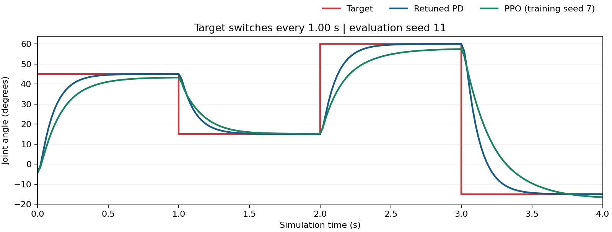

# GPU에서 PPO를 학습하고 목표 도달률 측정하기

세인티 2026 · Day 1 실습 11 · WSL2 Ubuntu 22.04 · Python 3.10 · NVIDIA CUDA

## 1. 학습 환경 확인과 실행

강의용 PC는 RTX 3060 Laptop GPU(6 GB)를 사용한다. 이 프로젝트는 WSL의 Linux x86-64 환경에서 PyTorch 2.5.1 CUDA 빌드와 Stable-Baselines3 2.7.0을 설치한다. 아래 명령을 VS Code의 **Ubuntu 터미널**에서 실행한다.

```bash
cd ~/sainty/day1/mujoco_beginner
nvidia-smi
uv sync --locked --extra policy
uv run --locked python -c "import torch; print(torch.__version__, torch.version.cuda, torch.cuda.is_available())"
uv run --locked 11_fast_target_ppo.py train
uv run --locked 11_fast_target_ppo.py compare
```

| 확인 위치 | 읽는 방법 |
|---|---|
| `nvidia-smi` | WSL에서 GPU와 Windows 드라이버가 보이는지 확인한다. 여기 표시되는 CUDA 버전은 드라이버가 지원하는 버전이다. |
| `torch.version.cuda` / `is_available()` | 실습 가상환경의 PyTorch 빌드와 실제 CUDA 접근을 확인한다. 이 PC의 기대값은 `12.4`와 `True`다. |
| 학습 로그와 `training_seed*.json` | 모델 파라미터와 역전파 후 Adam 모멘트 텐서가 모두 `cuda:0`에 있는지 8,192스텝마다 확인한다. |
| `compare` 결과 | 평가할 때도 PPO 정책은 GPU를 사용한다. PD와 MuJoCo 물리 계산은 CPU에서 실행한다. |

**GPU 사용 시 주의할 점.** Windows에 WSL 지원 NVIDIA 드라이버를 설치한다. WSL 안에 Linux용 디스플레이 드라이버를 별도로 설치하면 충돌할 수 있다. `nvidia-smi`가 성공해도 PyTorch가 `+cpu`이거나 CUDA가 `None`이면 해당 Python에서는 GPU 학습을 할 수 없다. 기존 CPU 빌드가 남아 있으면 이 폴더에서 `uv sync --locked --extra policy --reinstall-package torch`로 PyTorch만 다시 설치한 뒤 확인한다. 최초 설치 시 CUDA 라이브러리 다운로드에 시간이 걸린다. [NVIDIA WSL 안내](https://docs.nvidia.com/cuda/wsl-user-guide/index.html)

작은 MLP와 CPU 물리 환경에서는 관측 수집과 전송 시간이 커서 GPU 사용률이 오르내릴 수 있다. SB3도 MLP의 GPU 효율에 관한 경고를 낼 수 있다. 이 실습은 8개 환경의 관측을 묶어 처리하며 실제 장치는 학습 로그에서 확인한다. 시드 하나만 연습할 때는 `train --seed 7`을 사용한다. 전체 비교에는 시드 7·17·27의 모델이 필요하다.

<!-- pagebreak -->

## 2. 각도 오차를 90% 줄였는지 판정하기

목표 순서는 **45° → 15° → 60° → −15°**다. 현재 실습에서 설정한 토크 한도 ±8 N·m를 유지하고 목표 유지 시간을 **0.10초에서 1.00초**로 늘린다. 50 Hz 제어에서 목표마다 명령을 50번 보낼 수 있다. 한 에피소드는 4초다.

```text
구간 도달률(%) = 100 × (1 − |목표각 − 종료각| / |목표각 − 시작각|)
```

시작각은 그 구간이 시작될 때 **실제로 측정한 팔 각도**다. 예를 들어 팔이 60°에서 시작해 −15°를 향하면 시작 거리는 75°다. 1초 뒤 남은 오차가 7.5° 이내면 90% 도달이다. 목표를 지나쳤다가 멀어지면 종료 시점 오차가 그대로 반영된다. 기존 지표인 **종료 오차 ±2° 이내**와 평균 누적 보상도 함께 기록한다.

### 학습과 평가 순서

1. 시드 7·17·27마다 PPO를 처음부터 65,536스텝 학습한다. 8개 환경에서 각각 128스텝을 모아 128개 단위의 미니배치로 최적화한다.
2. 8,192스텝마다 별도 검증 시드 401·402·403에서 평가한다. 90%에 도달한 구간 수, 최저 구간 도달률, 평균 보상 순으로 체크포인트를 선택한다.
검증 시 가장 낮은 도달률이 92%에 못 미치면 선택한 체크포인트에서 학습률을 0.0003으로 낮춰 추가 학습한다. 8,192스텝 단위로 최대 65,536스텝을 더 사용한다. 92%는 검증 여유를 둔 값이고 최종 평가 기준은 90%다.

3. 선택한 모델을 학습·선택에 쓰지 않은 시작 시드 11·22·33·44·55에서 평가한다. 모델 한 개당 **4개 목표 × 5개 시작 상태 = 20개 구간**이다. `comparison.json`의 `reached_90`과 `min_reach_pct`를 읽는다.
4. `tracking.png`는 첫 평가 시드에서 목표, 재튜닝한 PD, 검증 결과로 선택한 PPO를 겹쳐 보여 준다. 다른 시드의 경로는 `trajectories.csv`에서 읽는다. 단위는 각도 deg, 토크 N·m, 시간 s다.

<!-- pagebreak -->

## 3. RTX 3060에서 측정한 결과

목표별 유지 시간은 1.00초, 토크 한도는 ±8 N·m다. 아래 표의 최저 도달률은 평가 시드 다섯 개에서 나온 20개 구간 중 가장 낮은 값이다. 최종 평균 각도 오차와 다른 지표이므로 구간별로 확인한다.

| 제어기 | 평균 보상 | 각도 RMSE | 90% 도달 | 최저 도달률 | ±2° 이내 |
|---|---:|---:|---:|---:|---:|
| 재튜닝 PD | -17.013 | 12.43° | 20/20 | 99.99% | 20/20 |
| PPO 시드 7 | -18.854 | 15.38° | 20/20 | 94.41% | 15/20 |
| PPO 시드 17 | -15.891 | 13.32° | 10/20 | 73.64% | 0/20 |
| PPO 시드 27 | -16.210 | 13.08° | 15/20 | 87.49% | 0/20 |

검증 시드에서 선택한 기본 모델은 학습 시드 7이다. 이 모델은 같은 폴더의 policy.zip으로도 저장한다.



**그래프 읽기**　빨간 계단선은 목표, 초록은 검증 데이터에서 선택한 PPO, 파랑은 재튜닝한 PD다. 한 구간의 끝에서 세로 간격이 얼마나 남아 있는지 확인한다. 목표를 향해 가는 중의 오차와 속도·토크도 누적 보상에 들어간다. 90% 도달만으로 평균 보상 순위를 판단할 수 없다.

평가 범위는 이 네 각도의 순서와 지정한 초기 상태다. 다른 주기나 임의의 각도에 대한 일반화는 별도 실험이 필요하다. 재현용 모델과 구간별 측정값은 WSL 실습의 `results/11_cuda_hold50_torque8/`에 저장한다.
