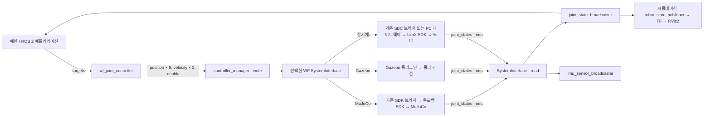

# Day 5 · TRON2

WSL의 ROS 2 Humble과 Python 3.10 환경에서 실행한다.

| 폴더 | 실습 |
|---|---|
| `tron2_sdk/` | MuJoCo 시뮬레이터와 LimX SDK 브리지 |
| `ros_lab/` | ROS 2 관절·IMU 수신, rosbag 기록과 재생 |
| `sainty_ws/` | ROS 2 패키지 빌드와 RViz2 모델 표시 |
| `locomotion/` | SF·WF 속도 추종 PPO 학습, 기존 결과와 정책 샘플 |

## ROS 2 패키지로 실행하는 관절 제어 실습

| 패키지 | 실행 위치와 역할 |
|---|---|
| `tron2_description` | 양쪽에서 공통으로 읽는 WF URDF, 메시, RViz 설정, 공식 관절 제어 설정 |
| `tron2_bringup` | 시뮬레이션 PC에서 물리 엔진을 선택하고 몸체·관절 TF와 ROS 상태를 제공한다. MuJoCo 경로는 기존 SDK 브리지를 그대로 실행한다. |
| `tron2_control` | controller_manager, 관절·IMU broadcaster, 관절 컨트롤러와 WF SystemInterface 플러그인 |
| `tron2_gz` | Gazebo Sim Fortress 전용 월드, WF xacro, 관절 토크와 센서 피드백을 처리하는 C++ 시스템 플러그인 |
| `tron2_dashboard` | 운영 PC에서 관절 패널, RViz2, rqt_graph를 실행한다. 시뮬레이션의 controller manager는 브링업에 있다. 실기체 연결 시 PC가 controller manager와 SDK 전달용 SystemInterface를 실행한다. |

### 빌드와 환경 준비

```bash
cd ~/sainty/day5/sainty_ws
source /opt/ros/humble/setup.bash
colcon build --symlink-install --packages-up-to tron2_bringup tron2_gz tron2_dashboard
source install/setup.bash
```

Gazebo 백엔드는 Ubuntu 22.04, ROS 2 Humble, Gazebo Sim Fortress를 사용한다. 이 조합의 시뮬레이터 명령은 `ign gazebo`다. 빌드에는 `libignition-gazebo6-dev`, 실행에는 Fortress의 시스템 플러그인과 `ros-humble-ros-gz-sim`, `ros-humble-xacro`가 필요하다. 기존 MuJoCo SDK 환경을 쓰려면 `~/sainty/day5/tron2_sdk/.venv`, 모델과 공식 시뮬레이터 서브모듈이 필요하다. 새 체크아웃에서 첫 `./panel_control.sh sim mujoco`가 이를 준비한다. 다른 위치에 준비한 경우 `sdk_root:=/절대/경로/tron2_sdk`를 지정한다. 운영 PC만 준비할 때는 `colcon build --packages-up-to tron2_dashboard`로 충분하다.

### WF 정책 주행과 속도 조이스틱

MuJoCo에서 서 있는 WF 모델을 속도로 조종하려면 기존 시뮬레이션을 종료하고 아래 launch를 실행한다. 이 모드는 전후 속도와 회전 속도를 받아 제조사 ONNX 두 개로 균형과 구동을 계산한다. 소스 변경 후에는 위의 패키지 빌드와 소싱을 먼저 수행한다.

```bash
cd ~/sainty/day5
git submodule update --init --depth 1 -- tron2_sdk/vendor/tron2_rl_deploy_python
(cd tron2_sdk && uv sync --locked && uv run --locked python fetch_models.py)
source sainty_ws/install/setup.bash
ros2 launch tron2_bringup policy_drive.launch.py
```

`profile:=reference`는 제조사 WF 예제의 속도 범위를 읽는다. `profile:=experiment`는 시뮬레이션에서 전후 ±5 m/s, 회전 ±4 rad/s까지 명령한다. 시험 범위는 `max_linear:=2.0 max_yaw:=1.5`처럼 바꿀 수 있다. RViz2는 `rviz:=true`로 추가한다. [정책 주행 실습 PDF](../pdf/TRON2_WF_정책주행_조이스틱_실습.pdf) · [속도·낙상 시험 46건](../pdf/tron2_figures/wf_policy_sweep.csv)

### 터미널 A — 시뮬레이션 브링업

```bash
source ~/sainty/day5/sainty_ws/install/setup.bash
ros2 launch tron2_bringup simulation_bringup.launch.py backend:=gz
```

MuJoCo로 실행하려면 위 명령에서 `backend:=mujoco`로 바꾼다. 엔진을 전환할 때 터미널 A에서 Ctrl+C로 기존 브링업을 종료한다. 한 사용자 세션에서는 도메인이나 터미널이 달라도 브링업 하나만 실행된다. 두 번째 요청은 현재 엔진 이름을 출력하고 구동 노드를 만들기 전에 종료한다. 대시보드는 엔진 전환 중에도 열어 둘 수 있다. Gazebo 서버만 열려면 `gz_gui:=false`를 추가한다.

- **MuJoCo** — 패널 → wf_joint_controller → controller_manager의 SystemInterface → 고정 SDK 브리지 → 루프백 LimX SDK → 공식 시뮬레이터. SDK가 관절과 IMU를 돌려주고 자유 몸체 자세로 세계 TF를 발행한다.
- **Gazebo** — 패널 → wf_joint_controller → controller_manager의 SystemInterface → Gazebo 모델 플러그인 → 관절 토크 → 물리 적분. 플러그인은 Gazebo의 관절각·속도, 몸체 자세·각속도·가속도를 ROS에 발행한다. Fortress GUI에는 링크당 약 3,500개 삼각형으로 단순화한 표시 전용 STL을 사용한다. 충돌 계산과 RViz2는 기존 모델을 사용한다. 두 엔진의 접촉과 적분 결과는 다를 수 있다.
- 두 경로에서 `joint_state_broadcaster`가 SystemInterface의 position·velocity·effort를 읽어 발행하고, `robot_state_publisher`가 이 토픽과 URDF로 링크 TF를 계산한다. MuJoCo 수동 뷰어와 Gazebo 재생 버튼에서 물리를 일시정지하면 패널의 새 피드백도 멈출 수 있다.

### 터미널 B — 운영 대시보드

```bash
source ~/sainty/day5/sainty_ws/install/setup.bash
ros2 launch tron2_dashboard dashboard.launch.py target:=simulation
```

다리는 위치(°), 바퀴는 속도(rad/s)로 조작한다. 오른쪽 열은 실측이다. 시뮬레이션에서는 슬라이더를 움직이면 즉시 적용된다. **명령 해제**는 감쇠를 요청한다. 두 발행 경로 모두 명령이 끊기면 0.25초 만료를 적용한다. 시뮬레이터와 대시보드를 각각 띄웠다면 패널을 닫아도 물리 엔진은 계속 실행된다. RViz와 rqt 창은 각각 `rviz:=false`, `rqt:=false`로 생략할 수 있다.

한 터미널에서 함께 열려면 `cd ~/sainty/day5` 후 `./panel_control.sh sim gz` 또는 `./panel_control.sh sim mujoco`를 사용한다. 바퀴 각도(±180°) 실습은 `./panel_control.sh control`로 연다. 이 모드는 `tron2_bringup/wheel_angle_demo.launch.py`에서 루프백 MuJoCo와 각도 전용 패널을 실행한다. SDK 폴더의 `sdk_bridge.py`는 ROS와 LimX SDK를 연결하고, `wf_servo.py`는 WF 구동 허용·명령 만료·감쇠를 처리한다.

### 고정된 실기체 SBC에 연결

이미 Day 5 ROS 브리지가 실행 중인 기체에서는 운영 PC에서만 아래 명령을 실행한다. 실기체는 몸체 기준으로 표시하며 버튼을 누르는 동안만 명령을 갱신한다. 기본 도메인 52는 기존 수업용 브리지 값이다. 실제 환경의 DDS 도메인·네트워크 설정과 시스템 시각을 맞춘다.

```bash
source ~/sainty/day5/sainty_ws/install/setup.bash
export ROS_DOMAIN_ID=52 ROS_LOCALHOST_ONLY=0
ros2 launch tron2_dashboard dashboard.launch.py target:=hardware
```

기체가 LimX 저수준 SDK만 제공하는 경우에는 **SDK가 설치된 PC**에서 별도 터미널로 아래 게이트웨이를 실행한다. 게이트웨이가 지정한 주소로 연결해 동일한 ROS 토픽과 몸체 기준 링크 TF를 제공한다. 이 경로의 전제는 EDU 저수준 SDK 접근 권한과 네트워크 연결이다. 이미 SBC 브리지가 이 토픽과 TF를 제공한다면 대시보드만 실행한다. 같은 기체에 두 번째 관찰 PC를 연결할 때는 `start_hardware_control:=false`로 이미 실행 중인 manager에 연결한다.

```bash
source ~/sainty/day5/sainty_ws/install/setup.bash
export ROS_DOMAIN_ID=52 ROS_LOCALHOST_ONLY=0
ros2 launch tron2_bringup sdk_gateway.launch.py robot_ip:="$ROBOT_IP"
```

게이트웨이는 기본 관찰 모드다. 기체를 지지하고 제조사 저수준 제어 전환과 기존 모터 제어기의 제어권 해제를 확인한 실기체 실습에서만 `motion:=true`를 선택한다. 게이트웨이는 기존 `sdk_bridge.py`의 권한 처리와 감쇠 동작을 그대로 사용한다. SBC에서 이미 사용하던 `./panel_control.sh hardware "$ROBOT_IP"`도 사용할 수 있다.

### 학생이 확인할 ROS 인터페이스

| 토픽 | 타입 | 방향·의미 |
|---|---|---|
| `/tron2/wf_joint_controller/targets` | `sensor_msgs/msg/JointState` | 패널 → 관절 컨트롤러. 컨트롤러가 8개 position과 2개 velocity 명령 자원을 점유한다. |
| `/tron2/wf_targets` | `sensor_msgs/msg/JointState` | SystemInterface → 구동부. 이름 10개, 다리는 position(rad), 바퀴는 velocity(rad/s), 나머지 성분은 0. 빈 이름 배열은 명령 해제. |
| `/tron2/panel_motion_enabled` | `std_msgs/msg/Bool` | 구동부 → 패널. 구동 허용·피드백 상태. |
| `/tron2/joint_states`, `/tron2/imu` | `sensor_msgs/msg/JointState`, `sensor_msgs/msg/Imu` | 물리 상태 또는 기체 계측값. |
| `/tron2/joint_state_broadcaster/joint_states` | `sensor_msgs/msg/JointState` | SystemInterface의 read → broadcaster → 패널 및 시뮬레이션의 robot_state_publisher. |
| `/tron2/imu_sensor_broadcaster/imu` | `sensor_msgs/msg/Imu` | 10개 IMU 상태 인터페이스를 읽은 broadcaster 출력. |
| `/tron2/robot_description`, `/tf`, `/tf_static` | `std_msgs/msg/String`, `tf2_msgs/msg/TFMessage` | URDF, 가동 및 고정 링크 TF. 시뮬레이션은 `world → tron2/base_Link`를 추가로 제공한다. |

```bash
ros2 pkg executables tron2_dashboard
ros2 launch tron2_bringup simulation_bringup.launch.py --show-args
ros2 control list_controllers -c /tron2/controller_manager
ros2 control list_hardware_components -c /tron2/controller_manager
ros2 control list_hardware_interfaces -c /tron2/controller_manager
ros2 node info /tron2/wf_joint_controller
ros2 node info /tron2/joint_panel
ros2 topic info /tron2/wf_targets -v
ros2 topic echo /tron2/joint_states --once
ros2 run tf2_ros tf2_echo world tron2/base_Link
```

K1처럼 manager가 URDF의 ros2_control 블록을 읽고 spawner가 컨트롤러와 broadcaster를 활성화한다. rqt_graph의 Nodes/Topics에서 패널의 `targets` 연결과 broadcaster의 상태 출력을 추적한다. manager와 플러그인 사이의 read/write 및 자원 점유는 프로세스 내부 호출이므로 위의 `ros2 control` 명령에서 확인한다. 실제 PD 계산은 하위 구동부가 맡는다.



세 백엔드는 같은 WF 메시지 계약을 사용하므로 공통 C++ `tron2_control/WheelFootSystem`을 재사용한다. manager에 등록되는 장치 이름은 `MujocoSdkSystem`, `GazeboSystem`, `LimxSdkSystem`이다. 실기체 SBC가 발행하는 기존 TF와 토픽은 PC에서 그대로 받을 수 있다. [ROBOTIS K1 launch](https://github.com/ROBOTIS-GIT/ai_sapiens/blob/main/ai_sapiens_bringup/launch/k1.launch.py) · [LimX SDK 가이드](https://www.limxdynamics.com/en/documents/856848486581276672) · [LimX WF 제어 설정](https://github.com/limxdynamics/tron2_rl_deploy_python/blob/dc27d921df839c27f7ab47308af2e3e82ec9265e/controllers/model/WF_TRON2A/params.yaml) · [TRON2 ROS 2 연결 실습 상세교안 (PDF)](../pdf/TRON2_ROS2_연결_실습_상세교안.pdf)

### Gazebo 창의 지연을 분리해서 확인하기

WSLg에서 `gpu_adapter:=NVIDIA`로 GeForce를 선택한다. 이 환경에서는 NVIDIA가 기본값이다. `nvidia-smi`의 그래픽 프로세스 PID와 `pgrep -af '^ign gazebo gui'`를 대조하고, `grep GL_RENDERER ~/.ignition/rendering/ogre.log`로 Gazebo가 선택한 OpenGL 장치를 확인한다. 이번 검증에서 두 결과 모두 RTX 3060 Laptop GPU를 가리켰다.

같은 무릎 목표를 바꿔 ROS 관절각, Gazebo 장면 메시지, 렌더 직전의 링크 자세, Gazebo 창의 픽셀을 순서대로 비교했다. 동기화 수정 전 두 번의 시험에서 렌더러 내부 자세 변화는 클릭 후 72–75 ms였고, 화면의 해당 영역 변화는 220–904 ms였다. 카메라의 FPS는 그동안 약 138까지 표시됐다. WSLg의 D3D12 렌더러에서만 `Tron2FrameSync`가 OGRE 카메라 렌더 완료 후 OpenGL 작업의 완료를 기다린다. 그러면 Qt가 다른 컨텍스트에서 공유 텍스처를 표시할 때 최신 프레임을 사용할 수 있다.

최종 Gazebo 창에서 다섯 번 측정한 클릭→화면 시간은 166, 74, 94, 66, 91 ms였다. 화면은 약 14 ms 간격으로 캡처하고, 무릎 조작 후 관찰 영역의 픽셀 변화가 그 시행 전체 변화의 5%를 넘는 시점을 사용했다. 이 값은 이 PC의 패널·물리·표시가 포함된 시간이다. 별도로 관절 컨트롤러를 비활성화하자 입력 43개가 들어오는 동안 하위 구동 명령은 0개였다. 재활성화 후 세 컨트롤러의 상태를 다시 확인했다.

## 관절·IMU 기록만 실행하기

```bash
cd ~/sainty/day5
./panel_control.sh check WF_TRON2A
```

대화형 실행을 종료한 뒤 사용한다. 두 토픽을 각각 60개 기록한 후 종료하고 결과 경로를 출력한다. 발형은 `./panel_control.sh check SF_TRON2A`로 실행한다.

## RViz2에서 기본 자세 확인

```bash
cd ~/sainty/day5/sainty_ws
source /opt/ros/humble/setup.bash
colcon build --symlink-install
source install/local_setup.bash
ros2 launch tron2_description display.launch.py
```

이 launch는 WF 관절을 0도로 고정해 기본 형태를 표시한다.

## Locomotion 학습

```bash
cd ~/sainty/day5/locomotion
uv run --locked tron2_locomotion.py WF_TRON2A --steps 1024 --out "results/wf-$(date +%Y%m%d-%H%M%S)"
```

`SF_TRON2A`도 같은 방법으로 실행한다. 지정한 새 출력 폴더에 `policy.zip`과 `evaluation.json`을 저장한다.

### WF 낙상 복구와 고속 직진의 학습·검증

WSL의 MuJoCo 실습은 별도 가상환경에서 Stable-Baselines3 PPO를 사용한다. ROS 환경을 source한 후 day5에서 실행한다. 출력 경로는 실행마다 새로 정한다.

```bash
R="$PWD/locomotion/results"
ros2 launch tron2_bringup locomotion_train.launch.py task:=recovery steps:=16384 out:="$R/recovery_class01"
ros2 launch tron2_bringup locomotion_train.launch.py task:=high_speed target:=5.0 crouch:=0.35 steps:=24576 out:="$R/speed_class01"
ros2 launch tron2_bringup policy_drive.launch.py profile:=experiment start_pose:=front \
  drive_onnx:="$R/wf_high_speed_s73/policy.onnx" recovery_onnx:="$R/wf_recovery_s73/policy.onnx"
```

제조사 WF 주행 정책과 수업용 복구 정책을 함께 실행하면 두 정책은 기본적으로 제조사 `encoder.onnx`를 공유한다. 인코더가 최근 10프레임의 관측으로 추정한 속도 3개가 정책 입력의 첫 세 값이다. 이 페이지의 42입력 복구 모델에는 낙상 방향과 복구 단계도 전달된다. 시작 로그의 `DRIVE`와 `RECOVERY`에서 실제 인코더·정책 경로를 확인한다. 다른 Isaac 학습 결과를 쓰면 함께 내보낸 인코더를 `drive_encoder` 또는 `recovery_encoder`로 지정한다.

주행 launch에 `recovery_onnx`를 지정하면 넘어질 때마다 속도 지령을 0으로 두고 현재 위치에서 일어나기를 시도한다. 한 번 실패하면 관절로 다리를 다시 접어 자세를 바꾼 뒤 재시도한다. 몸체의 높이와 직립도를 2초 연속 유지하면 조이스틱 주행을 재개한다. 학습·평가의 성공률은 이전과 같이 시도 1회 기준으로 계산한다.

[낙상 복구 실습](../pdf/TRON2_WF_낙상복구_PPO_상세교안.pdf)과 [고속 주행 실습](../pdf/TRON2_WF_고속주행_PPO_상세교안.pdf)에 전체 데이터 흐름, 같은 초기 상태에서의 대조군, 성공·실패 판정과 재평가 명령이 있다. 개별 96회 결과는 [시험 CSV](../pdf/tron2_figures/wf_training_trials.csv)에 있다.

LimX의 공식 평지 WF 과제는 [제조사 README](tron2_sdk/vendor/tron2_rl_lab/README.md)에 따라 Isaac Lab과 저장소에 포함된 rsl_rl을 사용한다. WSL 내부에 준비한 isaac_wsl/run-python을 통해 다음처럼 원본 trainer를 launch할 수 있다. num_envs와 iterations는 먼저 경로를 점검하기 위한 값이다.

```bash
ros2 launch tron2_bringup limx_wf_train.launch.py \
  num_envs:=4 iterations:=2
```

기준 과제(reference)는 LimX 원본 WF 설정이다. high_speed와 recovery는 WSL 프로젝트에서 별도로 등록하는 수업용 과제다. 공식 Linux Isaac 환경에서 stage:=play 및 checkpoint:=/경로/model_N.pt를 함께 지정하면 play.py가 actor와 encoder를 한 쌍으로 내보낸다. stage:=train에서 checkpoint를 지정하면 같은 과제의 학습을 재개한다.

이 PC의 WSL2에서 공식 trainer가 4환경 × 24스텝 × 2회 = 192스텝을 수집하고 model_2.pt를 생성했다. WSL과 일반 Linux CUDA 라이브러리를 함께 읽은 첫 실행에서는 PhysX가 CUDA 초기화에 실패했다. isaac_wsl/run-python은 해당 프로세스 안에서 WSL CUDA 드라이버를 우선 로드한다. CPU Vulkan 장치(llvmpipe)만 열거된 환경이므로 headless 학습과 RTX 화면 렌더링 검증을 구분한다.

### WSL2에서 다시 학습한 세 모델의 비교

기본·고속 과제는 각각 24,576스텝, 복구는 16,512스텝 학습했다. WSL2 원본 체크포인트와 짝을 이룬 ONNX는 `locomotion/results/wsl_isaac_{reference,high_speed,recovery}_s73/`에 정리했다. 각 폴더의 `training.json`에 원본 체크포인트의 절대 경로와 가중치 해시가 있다.

공통 MuJoCo 시험에서 기준 제어를 사용하는 수업 모델은 3·5 m/s 직진 12/12회, 정지 낙상 복구 9/12회를 통과했다. 기준 제어만으로도 같은 횟수를 통과했다. 짧게 학습한 Isaac 고속 모델은 같은 직진 조건에서 0/12회, Isaac 복구 모델도 0/12회였다. [WSL2 공식 학습과 MuJoCo 비교 교안](../pdf/TRON2_WF_WSL2_Isaac_공식학습과_MuJoCo_비교.pdf)에 실행 명령·그래프·판정 기준을, [시험 기록 CSV](../pdf/tron2_figures/wf_wsl_engine_comparison.csv)에 192회의 개별 결과를 담았다.

### WF 허리 RGB-D 카메라 실습

MuJoCo 정책 주행 또는 관절 패널 시뮬레이션을 실행하면 시뮬레이터와 별도로 Image View 창이 열리고 `/tron2/color`가 선택된다. 같은 창에서 `/tron2/depth`도 볼 수 있다. ROS launch 옵션 `camera_view:=false`로 창만 끌 수 있다. 기체 탑재 카메라 시점과 ROS 광학 프레임은 두 백엔드에서 일치하도록 정의했다. [조이스틱·카메라 실습 교안](../pdf/TRON2_WF_정책주행_조이스틱_실습.pdf)

```bash
cd ~/sainty/day5
source /opt/ros/humble/setup.bash
source sainty_ws/install/setup.bash
# 먼저 모델 파일만 검사
tron2_sdk/.venv/bin/python ros_lab/check_wf_camera.py
# 시뮬레이션을 실행한 후 별도 터미널에서 영상, 보정 정보, TF까지 검사
tron2_sdk/.venv/bin/python ros_lab/check_wf_camera.py --live
```
