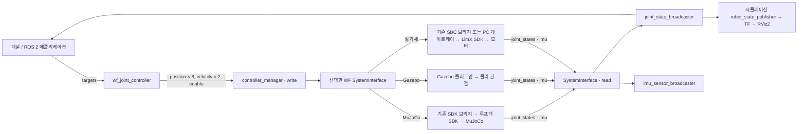

# Day 5 · TRON2

WSL의 ROS 2 Humble과 Python 3.10 환경에서 실행한다.

| 폴더 | 실습 |
|---|---|
| `tron2_sdk/` | MuJoCo 시뮬레이터와 LimX SDK 브리지 |
| `ros_lab/` | ROS 2 관절·IMU 수신, rosbag 기록과 재생 |
| `sainty_ws/` | ROS 2 패키지 빌드와 RViz2 모델 표시 |
| `locomotion/` | SF·WF 속도 추종 PPO 학습, 기존 결과와 정책 샘플 |

## ROS 2 패키지로 실행하는 관절 제어 실습

| 패키지 | 실행 위치와 역할 |
|---|---|
| `tron2_description` | 양쪽에서 공통으로 읽는 WF URDF, 메시, RViz 설정, 공식 관절 제어 설정 |
| `tron2_bringup` | 시뮬레이션 PC에서 물리 엔진을 선택하고 몸체·관절 TF와 ROS 상태를 제공한다. MuJoCo 경로는 기존 SDK 브리지를 그대로 실행한다. |
| `tron2_control` | controller_manager, 관절·IMU broadcaster, 관절 컨트롤러와 WF SystemInterface 플러그인 |
| `tron2_gz` | Gazebo Sim Fortress 전용 월드, WF xacro, 관절 토크와 센서 피드백을 처리하는 C++ 시스템 플러그인 |
| `tron2_dashboard` | 운영 PC에서 관절 패널, RViz2, rqt_graph를 실행한다. 시뮬레이션의 controller manager는 브링업에 있다. 실기체 연결 시 PC가 controller manager와 SDK 전달용 SystemInterface를 실행한다. |

### 빌드와 환경 준비

```bash
cd ~/sainty/day5/sainty_ws
source /opt/ros/humble/setup.bash
colcon build --symlink-install --packages-up-to tron2_bringup tron2_gz tron2_dashboard
source install/setup.bash
```

Gazebo 백엔드는 Ubuntu 22.04, ROS 2 Humble, Gazebo Sim Fortress를 사용한다. 이 조합의 시뮬레이터 명령은 `ign gazebo`다. 빌드에는 `libignition-gazebo6-dev`, 실행에는 Fortress의 시스템 플러그인과 `ros-humble-ros-gz-sim`, `ros-humble-xacro`가 필요하다. 기존 MuJoCo SDK 환경을 쓰려면 `~/sainty/day5/tron2_sdk/.venv`, 모델과 공식 시뮬레이터 서브모듈이 필요하다. 새 체크아웃에서 첫 `./panel_control.sh sim mujoco`가 이를 준비한다. 다른 위치에 준비한 경우 `sdk_root:=/절대/경로/tron2_sdk`를 지정한다. 운영 PC만 준비할 때는 `colcon build --packages-up-to tron2_dashboard`로 충분하다.

### 터미널 A — 시뮬레이션 브링업

```bash
source ~/sainty/day5/sainty_ws/install/setup.bash
ros2 launch tron2_bringup simulation_bringup.launch.py backend:=gz
```

MuJoCo로 실행하려면 위 명령에서 `backend:=mujoco`로 바꾼다. 엔진을 전환할 때 터미널 A에서 Ctrl+C로 기존 브링업을 종료한다. 한 사용자 세션에서는 도메인이나 터미널이 달라도 브링업 하나만 실행된다. 두 번째 요청은 현재 엔진 이름을 출력하고 구동 노드를 만들기 전에 종료한다. 대시보드는 엔진 전환 중에도 열어 둘 수 있다. Gazebo 서버만 열려면 `gz_gui:=false`를 추가한다.

- **MuJoCo** — 패널 → wf_joint_controller → controller_manager의 SystemInterface → 고정 SDK 브리지 → 루프백 LimX SDK → 공식 시뮬레이터. SDK가 관절과 IMU를 돌려주고 자유 몸체 자세로 세계 TF를 발행한다.
- **Gazebo** — 패널 → wf_joint_controller → controller_manager의 SystemInterface → Gazebo 모델 플러그인 → 관절 토크 → 물리 적분. 플러그인은 Gazebo의 관절각·속도, 몸체 자세·각속도·가속도를 ROS에 발행한다. Fortress GUI에는 링크당 약 3,500개 삼각형으로 단순화한 표시 전용 STL을 사용한다. 충돌 계산과 RViz2는 기존 모델을 사용한다. 두 엔진의 접촉과 적분 결과는 다를 수 있다.
- 두 경로에서 `joint_state_broadcaster`가 SystemInterface의 position·velocity·effort를 읽어 발행하고, `robot_state_publisher`가 이 토픽과 URDF로 링크 TF를 계산한다. MuJoCo 수동 뷰어와 Gazebo 재생 버튼에서 물리를 일시정지하면 패널의 새 피드백도 멈출 수 있다.

### 터미널 B — 운영 대시보드

```bash
source ~/sainty/day5/sainty_ws/install/setup.bash
ros2 launch tron2_dashboard dashboard.launch.py target:=simulation
```

다리는 위치(°), 바퀴는 속도(rad/s)로 조작한다. 오른쪽 열은 실측이다. 시뮬레이션에서는 슬라이더를 움직이면 즉시 적용된다. **명령 해제**는 감쇠를 요청한다. 두 발행 경로 모두 명령이 끊기면 0.25초 만료를 적용한다. 시뮬레이터와 대시보드를 각각 띄웠다면 패널을 닫아도 물리 엔진은 계속 실행된다. RViz와 rqt 창은 각각 `rviz:=false`, `rqt:=false`로 생략할 수 있다.

한 터미널에서 함께 열려면 `cd ~/sainty/day5` 후 `./panel_control.sh sim gz` 또는 `./panel_control.sh sim mujoco`를 사용한다. 예전 바퀴 각도(±180°) 실습은 `./panel_control.sh control`이다.

### 고정된 실기체 SBC에 연결

이미 Day 5 ROS 브리지가 실행 중인 기체에서는 운영 PC에서만 아래 명령을 실행한다. 실기체는 몸체 기준으로 표시하며 버튼을 누르는 동안만 명령을 갱신한다. 기본 도메인 52는 기존 수업용 브리지 값이다. 실제 환경의 DDS 도메인·네트워크 설정과 시스템 시각을 맞춘다.

```bash
source ~/sainty/day5/sainty_ws/install/setup.bash
export ROS_DOMAIN_ID=52 ROS_LOCALHOST_ONLY=0
ros2 launch tron2_dashboard dashboard.launch.py target:=hardware
```

기체가 LimX 저수준 SDK만 제공하는 경우에는 **SDK가 설치된 PC**에서 별도 터미널로 아래 게이트웨이를 실행한다. 게이트웨이가 지정한 주소로 연결해 동일한 ROS 토픽과 몸체 기준 링크 TF를 제공한다. 이 경로의 전제는 EDU 저수준 SDK 접근 권한과 네트워크 연결이다. 이미 SBC 브리지가 이 토픽과 TF를 제공한다면 대시보드만 실행한다. 같은 기체에 두 번째 관찰 PC를 연결할 때는 `start_hardware_control:=false`로 이미 실행 중인 manager에 연결한다.

```bash
source ~/sainty/day5/sainty_ws/install/setup.bash
export ROS_DOMAIN_ID=52 ROS_LOCALHOST_ONLY=0
ros2 launch tron2_bringup sdk_gateway.launch.py robot_ip:="$ROBOT_IP"
```

게이트웨이는 기본 관찰 모드다. 기체를 지지하고 제조사 저수준 제어 전환과 기존 모터 제어기의 제어권 해제를 확인한 실기체 실습에서만 `motion:=true`를 선택한다. 게이트웨이는 기존 `sdk_bridge.py`의 권한 처리와 감쇠 동작을 그대로 사용한다. SBC에서 이미 사용하던 `./panel_control.sh hardware "$ROBOT_IP"`도 사용할 수 있다.

### 학생이 확인할 ROS 인터페이스

| 토픽 | 타입 | 방향·의미 |
|---|---|---|
| `/tron2/wf_joint_controller/targets` | `sensor_msgs/msg/JointState` | 패널 → 관절 컨트롤러. 컨트롤러가 8개 position과 2개 velocity 명령 자원을 점유한다. |
| `/tron2/wf_targets` | `sensor_msgs/msg/JointState` | SystemInterface → 구동부. 이름 10개, 다리는 position(rad), 바퀴는 velocity(rad/s), 나머지 성분은 0. 빈 이름 배열은 명령 해제. |
| `/tron2/panel_motion_enabled` | `std_msgs/msg/Bool` | 구동부 → 패널. 구동 허용·피드백 상태. |
| `/tron2/joint_states`, `/tron2/imu` | `sensor_msgs/msg/JointState`, `sensor_msgs/msg/Imu` | 물리 상태 또는 기체 계측값. |
| `/tron2/joint_state_broadcaster/joint_states` | `sensor_msgs/msg/JointState` | SystemInterface의 read → broadcaster → 패널 및 시뮬레이션의 robot_state_publisher. |
| `/tron2/imu_sensor_broadcaster/imu` | `sensor_msgs/msg/Imu` | 10개 IMU 상태 인터페이스를 읽은 broadcaster 출력. |
| `/tron2/robot_description`, `/tf`, `/tf_static` | `std_msgs/msg/String`, `tf2_msgs/msg/TFMessage` | URDF, 가동 및 고정 링크 TF. 시뮬레이션은 `world → tron2/base_Link`를 추가로 제공한다. |

```bash
ros2 pkg executables tron2_dashboard
ros2 launch tron2_bringup simulation_bringup.launch.py --show-args
ros2 control list_controllers -c /tron2/controller_manager
ros2 control list_hardware_components -c /tron2/controller_manager
ros2 control list_hardware_interfaces -c /tron2/controller_manager
ros2 node info /tron2/wf_joint_controller
ros2 node info /tron2/joint_panel
ros2 topic info /tron2/wf_targets -v
ros2 topic echo /tron2/joint_states --once
ros2 run tf2_ros tf2_echo world tron2/base_Link
```

K1처럼 manager가 URDF의 ros2_control 블록을 읽고 spawner가 컨트롤러와 broadcaster를 활성화한다. rqt_graph의 Nodes/Topics에서 패널의 `targets` 연결과 broadcaster의 상태 출력을 추적한다. manager와 플러그인 사이의 read/write 및 자원 점유는 프로세스 내부 호출이므로 위의 `ros2 control` 명령에서 확인한다. 실제 PD 계산은 하위 구동부가 맡는다.



세 백엔드는 같은 WF 메시지 계약을 사용하므로 공통 C++ `tron2_control/WheelFootSystem`을 재사용한다. manager에 등록되는 장치 이름은 `MujocoSdkSystem`, `GazeboSystem`, `LimxSdkSystem`이다. 실기체 SBC가 발행하는 기존 TF와 토픽은 PC에서 그대로 받을 수 있다. [ROBOTIS K1 launch](https://github.com/ROBOTIS-GIT/ai_sapiens/blob/main/ai_sapiens_bringup/launch/k1.launch.py) · [LimX SDK 가이드](https://www.limxdynamics.com/en/documents/856848486581276672) · [LimX WF 제어 설정](https://github.com/limxdynamics/tron2_rl_deploy_python/blob/dc27d921df839c27f7ab47308af2e3e82ec9265e/controllers/model/WF_TRON2A/params.yaml) · [TRON2 ROS 2 연결 실습 상세교안 (PDF)](../pdf/TRON2_ROS2_연결_실습_상세교안.pdf)

### Gazebo 창의 지연을 분리해서 확인하기

WSLg에서 `gpu_adapter:=NVIDIA`로 GeForce를 선택한다. 이 환경에서는 NVIDIA가 기본값이다. `nvidia-smi`의 그래픽 프로세스 PID와 `pgrep -af '^ign gazebo gui'`를 대조하고, `grep GL_RENDERER ~/.ignition/rendering/ogre.log`로 Gazebo가 선택한 OpenGL 장치를 확인한다. 이번 검증에서 두 결과 모두 RTX 3060 Laptop GPU를 가리켰다.

같은 무릎 목표를 바꿔 ROS 관절각, Gazebo 장면 메시지, 렌더 직전의 링크 자세, Gazebo 창의 픽셀을 순서대로 비교했다. 동기화 수정 전 두 번의 시험에서 렌더러 내부 자세 변화는 클릭 후 72–75 ms였고, 화면의 해당 영역 변화는 220–904 ms였다. 카메라의 FPS는 그동안 약 138까지 표시됐다. WSLg의 D3D12 렌더러에서만 `Tron2FrameSync`가 OGRE 카메라 렌더 완료 후 OpenGL 작업의 완료를 기다린다. 그러면 Qt가 다른 컨텍스트에서 공유 텍스처를 표시할 때 최신 프레임을 사용할 수 있다.

최종 Gazebo 창에서 다섯 번 측정한 클릭→화면 시간은 166, 74, 94, 66, 91 ms였다. 화면은 약 14 ms 간격으로 캡처하고, 무릎 조작 후 관찰 영역의 픽셀 변화가 그 시행 전체 변화의 5%를 넘는 시점을 사용했다. 이 값은 이 PC의 패널·물리·표시가 포함된 시간이다. 별도로 관절 컨트롤러를 비활성화하자 입력 43개가 들어오는 동안 하위 구동 명령은 0개였다. 재활성화 후 세 컨트롤러의 상태를 다시 확인했다.

## 관절·IMU 기록만 실행하기

```bash
cd ~/sainty/day5
./panel_control.sh check WF_TRON2A
```

대화형 실행을 종료한 뒤 사용한다. 두 토픽을 각각 60개 기록한 후 종료하고 결과 경로를 출력한다. 발형은 `./panel_control.sh check SF_TRON2A`로 실행한다.

## RViz2에서 기본 자세 확인

```bash
cd ~/sainty/day5/sainty_ws
source /opt/ros/humble/setup.bash
colcon build --symlink-install
source install/local_setup.bash
ros2 launch tron2_description display.launch.py
```

이 launch는 WF 관절을 0도로 고정해 기본 형태를 표시한다.

## Locomotion 학습

```bash
cd ~/sainty/day5/locomotion
uv run --locked tron2_locomotion.py WF_TRON2A --steps 1024 --out "results/wf-$(date +%Y%m%d-%H%M%S)"
```

`SF_TRON2A`도 같은 방법으로 실행한다. 지정한 새 출력 폴더에 `policy.zip`과 `evaluation.json`을 저장한다.
