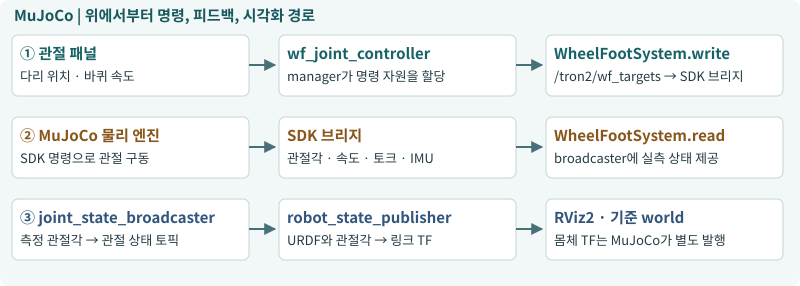
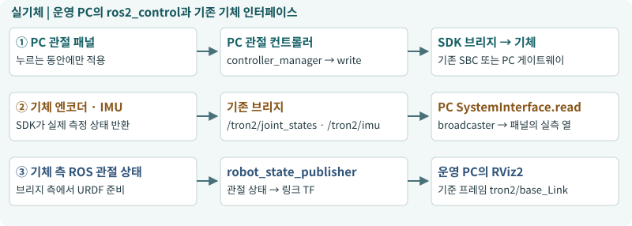
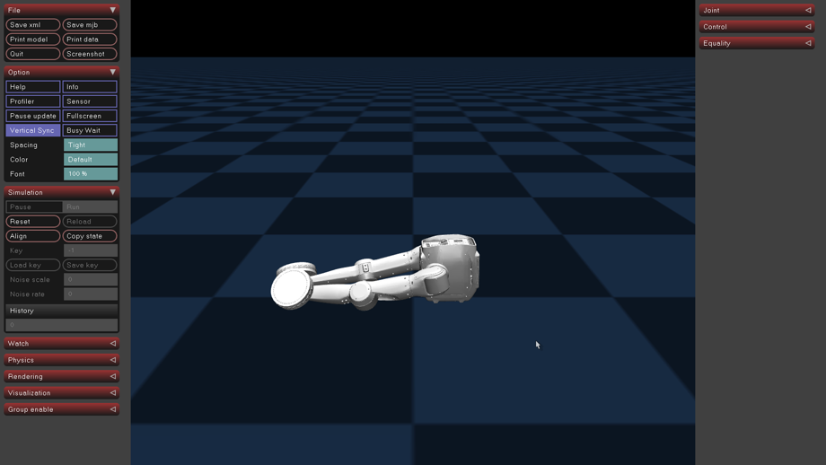

# K1·TRON2 시뮬레이션을 ROS 2에 연결하기

실습의 구조

앞부분에서는 시뮬레이터에서 얻은 관절각 하나가 ROS 메시지를 거쳐 rosbag 파일에 저장되는 과정을 추적한다. 두 로봇은 같은 관찰 코드를 쓰지만, 관절값을 얻는 지점과 명령이 전달되는 방향은 다르다.

**읽는 순서**  1–6쪽은 SDK·ROS 기록 실습, 7–10쪽은 WF 관절 제어와 균형, 11쪽부터는 패키지 빌드, 컨트롤러 추적, GPU 검증과 장애 진단 실습이다.

### 두 로봇에서 데이터가 흐르는 방향

K1   관찰 노드가 /k1/cmd_vel로 목표 속도를 보낸다. verify_policy.py는 목표를 보행 정책에 입력하고 MuJoCo를 진행한 뒤, 관절 상태와 IMU를 ROS에 발행한다.

TRON2   SF_TRON2A 시뮬레이터가 루프백에서 LimX SDK 상태를 제공한다. sdk_bridge.py가 SDK 콜백으로 받은 상태를 ROS에 발행한다. 이 경로에서 관찰 노드는 로봇에 속도 명령을 보내지 않는다.

### 코드를 열어 둘 위치

```
cd ~/sainty/day5
ls ros_lab/{run.sh,telemetry.py,observe.py,replay.sh}
ls ../day1/K1/verify_policy.py tron2_sdk/sdk_bridge.py
```

run.sh는 프로세스를 시작하고 결과 폴더를 만든다. telemetry.py는 로봇별 값을 공통 메시지로 변환한다. observe.py는 구독·검사·기록을 담당하고, replay.sh는 저장된 bag을 재생해 다시 받은 값을 대조한다.

### 실습 환경과 관찰 터미널

WSL2 Ubuntu 22.04, ROS 2 Humble, 시스템 Python 3.10, uv를 사용한다. K1과 TRON2는 서로 다른 잠금 파일로 환경을 구성한다. 실행 터미널과 별도로 아래 명령을 입력한 터미널을 준비한다. 실행이 짧으므로 관찰 명령을 먼저 대기시켜도 된다.

```
source /opt/ros/humble/setup.bash
export ROS_LOCALHOST_ONLY=1 ROS_DOMAIN_ID=86
ros2 topic echo /k1/joint_states sensor_msgs/msg/JointState --once
```

**완료 기준**  각 로봇에서 두 토픽을 60개씩 기록하고 재생한 120개 메시지의 필드가 일치하는지 확인한다. K1에서는 명령 수신과 만료를 CSV에서도 확인한다.

## 0.15 m/s 명령을 보낸 뒤 어떤 값이 돌아오는가

K1 · 명령에서 피드백까지

### 실행하고 결과 위치 보관하기

```
source /opt/ros/humble/setup.bash
cd ~/sainty/day5
ROS_DOMAIN_ID=86 bash ros_lab/run.sh k1
read -r -p 'Evidence directory 경로를 붙여 넣으세요: ' K1_RUN
```

run.sh k1은 K1 프로젝트에서 uv sync --locked를 수행하고 results/ros-…에 이번 실행만의 결과 폴더를 만든다. verify_policy.py --no-render --ros2는 백그라운드에서 상태를 생산한다. observe.py k1 23은 관절 수 23을 기대하며 앞에서 두 토픽을 구독한다.

### 명령을 만드는 코드와 소비하는 코드

observe.py의 K1 분기는 Twist.linear.x를 0.15로 설정하고 0.1초 간격의 타이머로 발행한다. verify_policy.py의 accept_twist는 유한한 값만 받아 ±0.3 m/s 범위로 제한하고, 수신 시각을 단조 시계로 저장한다.

```
# K1/verify_policy.py 에서 제어 틱마다 실행되는 두 줄
rclpy.spin_once(telemetry, timeout_sec=0)
command[0] = latest_cmd[0] if time.monotonic() - latest_cmd[1] < 0.5 else 0.0
```

정책은 명령과 상태 이력을 받아 관절 목표 23개를 낸다. PD 제어로 토크를 계산하고 MuJoCo가 물리를 적분한다. 발행하는 관절각은 적분 뒤 읽은 data.qpos이며, 속도와 힘은 data.qvel과 data.actuator_force에서 온다.

### 명령이 끊긴 흔적 찾기

```
python3 - "$K1_RUN/sim/policy_rollout.csv" <<'PY'
import csv, sys
with open(sys.argv[1]) as f:
    rows = list(csv.DictReader(f))
cmd = [float(r["command_x"]) for r in rows]
print("received", 0.15 in cmd, "final", cmd[-1])
PY
```

**판독**  received True와 final 0.0이면 명령이 정책 입력까지 도달했고 오래된 입력이 해제됐다. 목표 속도를 실제로 추종했는지는 같은 CSV의 velocity_x를 별도로 비교한다.

## 시뮬레이터와 브리지를 분리해서 읽기

TRON2 · SDK에서 ROS로

```
cd ~/sainty/day5
ROS_DOMAIN_ID=86 bash ros_lab/run.sh tron2
read -r -p 'Evidence directory 경로를 붙여 넣으세요: ' TRON_RUN
```

run.sh tron2는 fetch_models.py로 모델 목록과 체크섬을 확인한다. ROBOT_TYPE=SF_TRON2A, ROBOT_IP=127.0.0.1 환경에서 headless 시뮬레이터와 sdk_bridge.py를 별도 프로세스로 시작한다. 관찰자는 이 족형 모델에서 관절 10개를 기대한다.

### sdk_bridge.py의 세 단계

① 연결과 구독. Robot(RobotType.Tron2)을 만든 뒤 robot.init으로 연결한다. subscribeRobotState(state)와 subscribeImuData(imu)가 서로 다른 종류의 샘플을 전달한다.

② 이름과 순서 검사. state는 SDK의 motor_names를 선택한 모델의 관절 목록과 비교한다. 이름이 모두 비어 있을 때만 모델 순서를 대신 쓴다. 이름이 있으면 SDK 배열 순서대로 URDF 이름을 대응시킨다. 이름 집합이나 상태 배열 길이가 맞지 않으면 해당 샘플을 건너뛴다.

③ 발행. 콜백은 잠금 안에서 최신 샘플을 복사한다. 루프는 약 0.02초마다 각 종류의 stamp가 직전에 보낸 값과 다를 때만 발행한다. SDK가 더 자주 갱신되면 그사이의 샘플이 생략될 수 있다.

### 필드가 건너가는 경계

```
SDK RobotState    q / dq / tau      -> JointState.position / velocity / effort
SDK ImuData       quat / gyro / acc -> Imu.orientation / angular_velocity /
                                        linear_acceleration
SDK message.stamp                   -> ROS header.stamp
```

같은 결과 폴더의 simulator.log는 시뮬레이터, sdk.log는 브리지의 출력이다. 두 토픽이 모두 비면 브리지 초기화를, IMU만 들어오면 state 콜백의 이름·길이 조건을 먼저 본다.

**확인 문제**  TRON2에서 /tron2/cmd_vel의 구독자가 없어도 이 실습이 성공하는 이유는 무엇인가? 성공 조건은 SDK의 관절·IMU 상태가 ROS로 도착해 기록되는 것이다.

## telemetry.py와 observe.py를 한 쌍으로 읽기

공통 코드 · 메시지 계약

### 발행자가 약속하는 필드

Telemetry('k1')과 Telemetry('tron2')는 같은 클래스로 /<robot>/joint_states와 /<robot>/imu 발행자를 만든다. 큐 깊이는 10이다. joint_sample은 name, position, velocity, effort를 같은 인덱스로 정렬해 넣는다. name[i]가 바뀌면 같은 position[i]도 다른 관절을 가리킨다.

```
# ros_lab/telemetry.py
sec, nanosec = divmod(int(ns), 1_000_000_000)
# 예: 1_020_000_000 ns -> sec=1, nanosec=20_000_000
```

K1은 data.time을 나노초로 바꿔 넘기고 TRON2는 SDK의 message.stamp를 넘긴다. imu_sample은 원본 [w, x, y, z]를 ROS의 이름 있는 orientation.w, .x, .y, .z에 대입한다. 두 로봇의 기준 프레임은 각각 imu와 base_imu다.

### 수신자가 검사하는 조건

observe.py의 receive(topic, msg)는 토픽별 직전 stamp보다 새 stamp가 커야 통과시킨다. 관절은 첫 메시지의 이름 순서가 유지되는지, 이름이 고유한지, 네 배열의 길이가 각각 23 또는 10인지 확인한다.

IMU는 쿼터니언 노름이 1에 가까운지, 각속도와 가속도 성분이 유한한지 검사한다. 관절 위치·속도·힘에도 유한값 검사를 적용한다. 노름만으로 축의 순서나 센서 방향까지 판정할 수는 없다.

### 서로 다른 두 시각

```
# observe.py 의 receive 함수
raw = serialize_message(msg)
writer.write(topic, raw, node.get_clock().now().nanoseconds)
rows.append((stamp, hashlib.sha256(raw).hexdigest()))
```

**읽기 과제**  header.stamp는 원본 샘플의 시각이고 writer.write의 마지막 인자는 수신 노드가 기록한 시각이다. K1의 시뮬레이션 시간과 수신 시계를 곧바로 빼서 전송 지연을 계산하면 기준 시계가 서로 다르다.

## 두 종류의 일치 검사를 결과 파일에서 확인하기

기록 · 재생 · 판정

### 1. 실시간 수신 → SQLite bag

observe.py는 rclpy.spin_once로 콜백을 처리해 토픽당 60개를 채운다. 기록 종료 후 SequentialReader로 같은 bag을 다시 읽고, 각 토픽에서 직렬화 바이트의 SHA-256 목록을 수신 당시 목록과 순서대로 대조한다. 성공하면 receipt.json에 live, bag, 첫·마지막 stamp와 PASS가 남는다.

```
cat "$K1_RUN/receipt.json"
cat "$TRON_RUN/bag_info.txt"
ros2 bag info "$K1_RUN/telemetry"
```

### 2. 원본 bag → DDS 재생 → 두 번째 bag

```
cd ~/sainty/day5
ROS_DOMAIN_ID=88 bash ros_lab/replay.sh k1 "$K1_RUN"
ROS_DOMAIN_ID=88 bash ros_lab/replay.sh tron2 "$TRON_RUN"
```

replay.sh는 --passive 관찰자를 먼저 띄우고 ros2 bag play를 3초 지연해 구독 연결 시간을 준다. 이 관찰자는 K1 속도 명령을 발행하지 않는다. 재수신분은 원본 결과 아래 새 replay-… 폴더에 기록한다.

마지막에 원본·재생 SQLite에서 토픽별 메시지 순서대로 데이터를 읽어 역직렬화하고 모든 메시지 필드를 대조한다. 재생 시점에 새로 부여한 bag 기록 시각은 이 비교에 포함되지 않는다.

```
# 각 재생 명령이 출력한 replay-… 폴더의 comparison.json 확인
find "$K1_RUN" "$TRON_RUN" -name comparison.json -print -exec cat {} \;
```

**제출할 증거**  각 로봇별 receipt.json에서 두 토픽의 live=60, bag=60을 확인한다. comparison.json에서 all_fields_equal=true, messages=120을 기록한다. K1은 2쪽의 명령 만료 결과를 함께 제출한다.

교안 검증 결과   WSL2에서 현재 코드를 복사해 두 로봇의 수신·재생을 독립 실행했다. K1과 TRON2 모두 두 토픽에서 60개씩 기록했고, 재생 비교 결과는 각각 120개 전 필드 일치였다.

## 어느 경계에서 데이터가 멈췄는지 좁히기

문제 해결 · 선수 실습

토픽이 보이지 않는다   실행과 관찰 터미널에서 ROS_LOCALHOST_ONLY=1, ROS_DOMAIN_ID가 같은지 확인한다. run.sh의 기본 도메인은 86, replay.sh는 88이다. 이미 설정한 환경 변수 값이 우선한다. 실행이 끝나면 스크립트가 시작한 생산자도 종료되므로 그 뒤에는 bag으로 관찰한다.

50초 뒤 TimeoutError   예외의 토픽별 수신 개수를 비교한다. 둘 다 0이면 실행한 로봇, 도메인과 프로세스 로그를 확인한다. 한쪽만 부족하면 그 토픽의 발행자와 브리지의 입력을 추적한다.

K1에서 명령 확인 실패   receipt.json과 sim/policy_rollout.csv를 각각 본다. 관절·IMU 메시지를 받았어도 cmd_vel이 전달되고 만료됐다는 검사는 별개다. TRON2의 SDK init failed는 sdk.log에서 찾아 시뮬레이터의 구동과 루프백 주소부터 확인한다.

### 선수 교안 「ROS2 기초 관절상태와 제어」 코드 찾기

Windows에서는 그 PDF와 같은 상세교안 폴더의 ROS2_기초_실습코드.zip을 연다. WSL에서는 아래 위치에 같은 파일 세 개가 있다. leg.urdf는 무릎 한 관절과 모의 하드웨어, controllers.yaml은 상태 방송기와 무릎 위치 컨트롤러, lesson.launch.py는 두 모드의 시작 구성을 정의한다.

```
cd ~/sainty/day5/ros_lab/ros2_basics
source /opt/ros/humble/setup.bash
export ROS_DOMAIN_ID=81 ROS_LOCALHOST_ONLY=1
ros2 launch ./lesson.launch.py mode:=model
# Ctrl+C로 종료한 뒤 같은 터미널에서 실행
ros2 launch ./lesson.launch.py mode:=control
```

model에서는 joint_state_publisher가 상태값을 공급한다. control에서는 mock_components/GenericSystem의 상태 인터페이스를 joint_state_broadcaster가 읽는다. 두 경우 모두 robot_state_publisher가 관절 상태와 URDF로 링크 자세를 계산한다.

**다음 읽기**  같은 상세교안 폴더의 K1_ROS2.pdf는 K1 정책과 ROBOTIS 구성을, TRON2_SDK.pdf는 LimX SDK와 형상별 동작을 더 깊게 다룬다.

## Day 5 · MuJoCo에서 목표와 실측을 추적하기

바퀴형 WF_TRON2A의 왼쪽 무릎을 움직인다. 슬라이더의 목표, SDK가 돌려준 실제 각도, RViz2의 무릎 링크를 차례로 확인한다. 발형 SF와 양팔형 DA는 관절 배열이 다르므로 이 패널의 대상은 WF다.



**그림 1.** 패널의 목표는 wf_joint_controller와 SystemInterface.write를 거쳐 SDK 브리지에 도착한다. 브리지가 LimX SDK에 RobotCmd를 보낸다. 시뮬레이터가 토크를 적용하고 물리 상태를 적분한 뒤에야 관절각과 IMU 값이 돌아온다. rqt_graph는 그림에서 ROS 2로 연결한 구간을 보여준다.

### 실행하고 무릎과 바퀴를 구별하기

```bash
cd ~/sainty/day5
./panel_control.sh sim
```

다리 슬라이더 단위는 도(°)이고 ROS 메시지의 위치 단위는 rad다. 바퀴 슬라이더는 rad/s다. 0.7을 선택하면 바퀴가 초당 0.7 rad로 회전하도록 명령한다. MuJoCo에서는 슬라이더를 움직이면 바로 적용되며 현재 목표를 유지한다. **명령 해제**를 누르면 구동 명령을 해제하고 감쇠를 요청한다. 계속 움직임을 관찰하려면 MuJoCo 뷰어의 Space 일시정지를 해제한다.

```bash
ros2 topic echo /tron2/wf_targets --once
ros2 topic echo /tron2/joint_states --once
ros2 run tf2_ros tf2_echo world tron2/base_Link
```

SDK가 돌려준 관절각으로 링크 TF를 계산한다. 몸체의 세계 위치·회전은 별도 모듈이 MuJoCo 자유 관절에서 읽는다. 넘어지는 동안 자세와 높이까지 보이는 이유다. 기존 바퀴 각도(±180°) 실습은 `./panel_control.sh control`로 연다.

## Day 5 · 실기체의 온보드 브리지와 조작 PC 연결하기

**준비 환경.** 이 구현은 ROS 2 Humble, Python 3.10, WF_TRON2A EDU 저수준 SDK를 대상으로 한다. SBC에서 `echo "$ROS_DISTRO"`와 `uname -m`을 확인한다. 제조사 문서의 탑재 이미지 설명에는 버전 차이가 있다. ARM64 SBC에는 aarch64용 SDK, x86_64 SBC에는 amd64용 SDK를 사용한다. 운영 PC는 패널과 controller_manager를 실행한다.



**그림 2.** 운영 PC의 관절 컨트롤러와 하드웨어 인터페이스를 거친 목표가 DDS를 통해 기존 SBC 브리지에 도착한다. 브리지는 명시적으로 지정한 기체 SDK 주소에 연결한다. 주제어기가 제공하는 엔코더와 IMU는 반대 방향으로 돌아온다. 기본 실기체 화면은 몸체 기준의 관절 움직임을 표시한다. 전역 위치·낙상 높이를 보려면 별도의 상태 추정기가 실제 TF를 제공하고 RViz2 기준 프레임을 그 부모 프레임으로 바꿔야 한다.

### 먼저 모터 출력 없이 연결하기

기존 수업용 브리지가 실행 중인 SBC는 그대로 두고 운영 PC에 대시보드와 제어 패키지를 준비한다. 두 호스트의 ROS_DOMAIN_ID(기본 52), DDS 네트워크, 시스템 시각을 맞춘다. 교실 bag 실습에서 `ROS_LOCALHOST_ONLY=1`을 사용했다면 두 터미널에서 `export ROS_LOCALHOST_ONLY=0`을 설정한다.

```bash
# 기존 수업용 브리지가 꺼져 있을 때만 SBC에서 실행한다.
cd ~/sainty/day5
./panel_control.sh hardware "$ROBOT_IP"

# 운영 PC: 별도 터미널
cd ~/sainty/day5
./panel_control.sh operator
```

기본 하드웨어 모드에서는 RobotCmd를 송신하지 않는다. 관절이 10개인지, 좌우 관절명과 피드백이 해당 기체와 일치하는지 확인한다. 청취 중인 /tron2/joint_states 발행자는 한 개여야 한다. SDK가 별도 Python 환경에 있으면 SBC에서 TRON2_SDK_PYTHON으로 인터프리터 절대 경로를 지정한다.

## Day 5 · 관절 명령을 허용하고 결과 판독하기

### 실기체에서 조작 권한을 분리하는 이유

제조사가 지정한 지지대에 기체를 고정하고 물리 비상정지를 준비한다. WF 구성, 영점과 저수준 개발 모드를 확인하고 같은 모터를 제어하는 기존 정책·컨트롤러를 종료한다. 관찰 모드의 SBC 브리지를 종료한 뒤 아래처럼 같은 주소로 다시 실행한다. 실기체 모터를 시험할 때에는 제조사 시운전 절차를 따른다.

```bash
./panel_control.sh hardware "$ROBOT_IP" --enable-motion
```

패널은 첫 실측 자세로 다리 슬라이더를 채우고 바퀴 속도를 0으로 둔다. 목표를 정한 뒤 **누르는 동안 적용**을 누른다. 버튼을 놓으면 감쇠 명령을 요청한다. 유효 명령 또는 새 상태가 0.25초간 끊겨도 같은 동작을 시도한다. 통신 자체가 끊기면 감쇠 명령의 전달은 보장되지 않는다. 물리 비상정지와 기체 자체 보호 기능을 별도로 사용한다.

### 제조사 값과 수업용 패널의 차이

| 설정 | 공식 WF 설정과 수업 코드에서의 의미 |
|---|---|
| 500 Hz / 50 Hz | 공식 SDK 제어 루프는 500 Hz, WALK 정책은 10회마다 추론해 50 Hz다. 패널은 SDK 목표 주기 2 ms를 사용한다. WSL과 Python의 실제 주기는 부하에 따라 달라진다. |
| 다리 위치 PD | 일반 다리 Kp/Kd는 159.67/10.16, 근위 yaw는 53.22/3.39다. 소프트웨어 토크 한도는 각각 140/40 N·m다. |
| 바퀴 속도 | Kp=0, Kd=0.6, 토크 한도 22 N·m다. 패널 범위 ±7 rad/s는 몸체 명령 0.7 m/s와 바퀴 반경 0.1 m로 환산한 실습 범위다. |
| 응답과 균형 | 모터 명령은 실측 q·dq로 토크 한계를 적용한다. 패널에는 제조사 설정에 없는 고정 0.35 rad/s 다리 램프를 적용하지 않는다. 두 바퀴 위 자세 유지는 IMU·관절 이력을 읽는 별도 encoder/actor 정책의 역할이다. |

### 각 신호의 소유자 확인

`/tron2/robot_description`과 관절 TF는 robot_state_publisher, `/tron2/joint_states`와 `/tron2/imu`는 SDK 브리지가 발행한다. `/tron2/wf_targets`의 position에는 여덟 다리 위치, velocity에는 두 바퀴 속도를 담으며 사용하지 않는 성분은 0이다. 헤더 시각은 명령 만료 판정에 사용한다. 시간 차이가 큰 두 컴퓨터는 DDS에서 토픽이 보여도 명령이 거절될 수 있다.

**공식 자료.** [LimX SDK 개발 가이드](https://www.limxdynamics.com/en/documents/856848486581276672) · [WF 설정 원문](https://github.com/limxdynamics/tron2_rl_deploy_python/blob/dc27d921df839c27f7ab47308af2e3e82ec9265e/controllers/model/WF_TRON2A/params.yaml) · [WF 제어 루프](https://github.com/limxdynamics/tron2_rl_deploy_python/blob/dc27d921df839c27f7ab47308af2e3e82ec9265e/controllers/WheelfootController.py).

## Day 5 · 무릎 응답과 두 바퀴 균형을 따로 측정하기

### 슬라이더 목표가 실측값에 나타나기까지

왼쪽 무릎 슬라이더를 한 번에 −80°로 옮겼다. 첫 변경 목표를 ROS에서 수신한 시각을 시작점으로 삼았다. 직전 실측각을 q₀, 목표를 q*라 할 때, 실측각이 q₀ + 0.8 × (q* − q₀)를 진행 방향으로 처음 통과한 시각까지가 아래의 80% 도달 시간이다. 피드백은 약 47–48 Hz로 수신했다.

| MuJoCo 패널 경로 | 직전 실측 | 목표 | 80% 도달 | 4.5초 관찰 종료 시 실측 |
|---|---:|---:|---:|---:|
| 기존 목표 변화율 제한 0.35 rad/s | −21.65° | −80° | 2.36초 | −79.81° |
| 공식 게인과 토크 한도를 반영한 경로 | −17.94° | −80° | 0.24초 | −78.23° |

이전 구현은 초당 약 20°씩만 목표를 바꿀 수 있었다. 슬라이더를 빠르게 움직여도 큰 각도 명령이 수초에 걸쳐 전달됐다. 수정한 브리지는 각 제어 주기마다 현재 각도와 속도로 요청 토크를 계산해 한도를 적용한다. 두 실행의 초기 자세와 접촉 조건은 동일하게 통제하지 않았다. 이 수치는 패널부터 시뮬레이션 피드백까지 측정한 예이며 실기체 모터 자체의 정착 시간과 대역폭은 별도 측정 대상이다.

제조사 URDF가 선언한 무릎의 속도·토크 한도는 18.3 rad/s·150 N·m, 바퀴는 41.89 rad/s·22 N·m다. 공식 제어기는 무릎 명령에 140 N·m 한도를 적용한다. URDF 속도 한도만으로 주어진 하중에서의 응답 시간을 계산할 수 없다. [공식 WF 관절 모델](https://github.com/limxdynamics/tron2-robot-description/blob/main/tron2a/WF_TRON2A/urdf/robot.urdf)

### 균형을 보려면 정책에 어떤 입력을 주는가

공식 WF WALK 제어기는 IMU·관절 상태와 관측 이력을 encoder와 actor에 입력하고, 정지 속도 명령에서도 좌우 다리 목표와 바퀴 속도를 갱신한다. 정책 출력은 50 Hz, 하위 SDK 명령 루프는 목표 500 Hz다. 수동 패널은 조작자가 정한 목표를 유지한다. 따라서 임의 관절각을 고정한 채 두 바퀴로 서 있는 능력을 평가할 수 없다.

별도 평지 MuJoCo 시험에서 기존 실습의 `train_tron2_wf.py` 환경에 제조사 `encoder.onnx`와 `policy.onnx`를 연결해 전진·회전 목표를 0으로 두었다. 두 바퀴를 바닥에 닿게 한 직립 자세에서 시작했다. 한 번의 8초 시험 동안 낙상 없이 유지됐고, 전후 변위 −0.173 m, 좌우 변위 +0.030 m를 기록했다. 이 시험은 정책과 물리 모델의 폐루프 점검이다. 정지 위치의 정밀도와 실기체 복원 성능은 별도 지표로 측정한다.

### 반응이 보이지 않을 때 읽을 신호

1. MuJoCo의 일시정지를 풀고 다리 슬라이더를 움직인다. 패널 출력 `/tron2/wf_joint_controller/targets`와 하위 출력 `/tron2/wf_targets`에서 해당 관절의 position(rad)이 바뀌는지 본다.
2. 목표만 변하면 브리지의 `/tron2/panel_motion_enabled`, 실행 모드, 중복 SDK 제어기, 브리지 로그를 확인한다. 하드웨어 패널은 허용된 세션에서 적용 버튼을 누르는 동안만 지령을 보낸다.
3. 목표를 바꾼 시각과 해당 관절 실측값의 방향을 비교한다. 중력과 지면 접촉만으로도 관절각은 변할 수 있다. RViz2만 멈췄다면 RobotModel의 Description Topic과 기준 프레임을 점검한다. 기체의 몸체 이동은 별도 TF가 필요하다.

## 실습 1 · 패키지를 빌드하고 두 터미널로 열기

**도달 목표**  WF_TRON2A의 모델, 물리 엔진, 제어기, 운영 화면을 누가 실행하는지 소스에서 찾아 설명한다. 실습 환경은 Ubuntu 22.04/WSL2와 ROS 2 Humble이다. Windows의 WSLg가 그래픽 창을 표시한다.

| 패키지 | 먼저 열 파일 | 코드에서 확인할 것 |
|---|---|---|
| tron2_description | `urdf/wf_tron2a.urdf` | 링크, 회전축, 관절 한도, 메시 경로 |
| tron2_bringup | `launch/simulation_bringup.launch.py` | backend 분기, 한 엔진만 점유하는 실행 잠금 |
| tron2_control | `launch/control.launch.py`, `config/controllers.yaml` | manager 생성, spawner, 컨트롤러 종류, 500 Hz 설정 |
| tron2_gz | `urdf/wf_gz.urdf.xacro`, `worlds/classroom.sdf` | 모델의 물리 플러그인과 GUI 플러그인 구분 |
| tron2_dashboard | `launch/dashboard.launch.py` | 관절 패널, RViz2, rqt_graph의 실행 조건 |

```bash
cd ~/sainty/day5/sainty_ws
source /opt/ros/humble/setup.bash
colcon build --symlink-install --packages-up-to tron2_bringup tron2_gz tron2_dashboard
source install/setup.bash
ros2 pkg prefix tron2_control
ros2 launch tron2_bringup simulation_bringup.launch.py --show-args
```

**터미널 A**에서 `ros2 launch tron2_bringup simulation_bringup.launch.py backend:=gz`를 실행한다. **터미널 B**에서도 같은 워크스페이스의 `install/setup.bash`를 불러온 뒤 `ros2 launch tron2_dashboard dashboard.launch.py target:=simulation`을 실행한다. 두 터미널의 ROS_DOMAIN_ID를 맞춘다. MuJoCo로 바꿀 때는 A에서 Ctrl+C로 브링업이 끝난 것을 확인한 다음 `backend:=mujoco`로 다시 실행한다. B는 열린 채로 새 상태를 기다릴 수 있다.

**첫 MuJoCo 실행**  새 체크아웃에서는 `~/sainty/day5`에서 `./panel_control.sh sim mujoco`를 한 번 실행해 잠긴 SDK 환경과 모델을 준비한다. 이 명령은 대시보드도 연다. 두 터미널 실습 전 종료한다. Gazebo 단독 실행에는 이 준비가 필요하지 않다.

**확인 문제**  운영 PC에 SDK와 MuJoCo가 없어도 기존 SBC의 ROS 인터페이스에 연결할 수 있는 이유는 무엇인가? 패널의 발행자를 찾아 패키지명과 토픽 타입을 적는다. PC 전용 빌드는 `--packages-up-to tron2_dashboard`를 사용한다.

## 실습 2 · 패널의 목표 한 개를 모터와 RViz까지 추적하기

왼쪽 무릎 슬라이더를 움직이면 **목표 → 구동 → 계측** 순서로 다른 값이 생긴다. 목표와 실측을 같은 이름의 관절로 비교한다. 배열 인덱스는 메시지의 `name`에서 찾는다. 패널의 다리 표시는 도(°), ROS 위치 단위는 rad, 바퀴 속도는 rad/s다.

| 순서 | 어디서 보는가 | 무엇이 변하는가 |
|---|---|---|
| 1. 패널 출력 | `/tron2/wf_joint_controller/targets` | JointState에 다리 위치와 바퀴 속도 목표를 넣는다. |
| 2. 제어기 | `wf_joint_controller` | 명령의 시각과 관절명을 검사하고 manager가 할당한 command interface에 값을 쓴다. |
| 3. 구동부로 전달 | `/tron2/wf_targets` | SystemInterface.write가 하위 명령을 발행한다. MuJoCo는 SDK 브리지, Gazebo는 물리 플러그인이 받는다. |
| 4. 물리 피드백 | `/tron2/joint_states`, `/tron2/imu` | 엔진이 적분한 관절과 센서 상태가 들어온다. 실제 기체에서는 SDK의 계측값이 들어온다. |
| 5. 상태 배포 | `/tron2/joint_state_broadcaster/joint_states` | SystemInterface.read가 읽은 값이 패널과 시뮬레이션의 robot_state_publisher로 전달된다. |

```bash
ros2 node info /tron2/wf_joint_controller
ros2 topic info /tron2/wf_targets -v
ros2 topic echo /tron2/joint_state_broadcaster/joint_states --once
ros2 run tf2_ros tf2_echo world tron2/base_Link
```

**RViz2에서 보는 두 운동**  링크 사이의 무릎 회전은 robot_state_publisher가 계산한다. 로봇 전체의 낙상과 이동은 시뮬레이터가 별도로 발행하는 `world → tron2/base_Link`에서 온다. 실기체 기본 대시보드는 `tron2/base_Link` 기준이다. 세계 위치를 보려면 기체 측 상태 추정 TF가 필요하다.

**K1 소스와 대조**  ROBOTIS의 `k1.launch.py`에서 robot_description, ros2_control_node, spawner, RViz 옵션을 찾는다. TRON2는 같은 제어 관리 방식을 사용하고, 실제 모터 통신은 기존 LimX SDK 브리지에 맡긴다. [ROBOTIS K1 launch 원문](https://github.com/ROBOTIS-GIT/ai_sapiens/blob/main/ai_sapiens_bringup/launch/k1.launch.py) · [Humble 하드웨어 구성 요소 문서](https://control.ros.org/humble/doc/ros2_control/hardware_interface/doc/writing_new_hardware_component.html)

## 실습 3 · rqt_graph와 제어 자원 점유를 함께 읽기

rqt_graph에서 Nodes/Topics 보기를 선택하고 새로고침한다. 패널에서 컨트롤러로 들어가는 `targets`와 broadcaster에서 나오는 상태 토픽을 찾는다. manager가 플러그인의 `read()`와 `write()`를 호출하는 과정은 같은 프로세스 안에서 진행된다. 자원 점유는 controller manager의 서비스로 조회한다.

```bash
CM=/tron2/controller_manager
ros2 control list_controllers -c "$CM"
ros2 control list_hardware_components -c "$CM"
ros2 control list_hardware_interfaces -c "$CM"
```

**판독 기준**  `wf_joint_controller`, `joint_state_broadcaster`, `imu_sensor_broadcaster` 세 개의 상태가 `active`여야 한다. `claimed`인 명령 자원은 다리 위치 8개, 바퀴 속도 2개, `panel/enable` 1개다. 모터는 10개다. 장치 이름은 선택에 따라 GazeboSystem, MujocoSdkSystem, LimxSdkSystem으로 바뀐다. 세 장치는 같은 WF 데이터 계약을 쓰므로 공통 플러그인 `tron2_control/WheelFootSystem`을 사용한다.

### 제어기가 실제 명령 경로에 있는지 시험하기

**시뮬레이션에서만 수행한다.** 두 관찰 터미널에서 각각 `/tron2/wf_joint_controller/targets`와 `/tron2/wf_targets`를 echo한다. 패널로 목표를 바꾼 뒤 다음 순서로 비교한다.

```bash
ros2 control set_controller_state -c "$CM" wf_joint_controller inactive
# 패널 입력과 하위 토픽에서 이름 배열이 채워진 명령 개수를 비교한다.
ros2 control set_controller_state -c "$CM" wf_joint_controller active
ros2 control list_controllers -c "$CM"
```

기존 직접 연결에서는 패널이 하위 명령 토픽을 발행했다. 수정 후 시험에서는 비활성 구간 약 2초간 **패널 입력 43개, 유효 하위 명령 0개**였다. 해제를 알리는 빈 JointState는 유효 구동 명령 개수에서 제외한다. 재활성화한 뒤 슬라이더를 움직여 실측이 다시 변하는지 확인한다.

**제출**  그래프에서 찾은 토픽 연결 하나, CLI에서 확인한 점유 자원 하나, 비활성화 전후의 명령 수를 기록한다. rqt_graph에 패키지 이름이 나타나는지만으로 제어 경로를 판정하면 플러그인 내부 호출을 놓친다.

## 실습 4 · MuJoCo와 Gazebo가 어느 GPU로 그리는지 확인하기

**검증 환경**  2026-11-27, WSLg / Mesa D3D12, AMD Radeon 내장 GPU와 NVIDIA GeForce RTX 3060 Laptop GPU를 탑재한 노트북. NVIDIA 드라이버는 `nvidia-smi` 기준 581.29였다.

| 실제 뷰어 실행 조건 | 뷰어가 보고한 OpenGL 렌더러 | NVIDIA 프로세스에서 확인한 결과 |
|---|---|---|
| MuJoCo, GPU 환경 변수 미지정 | D3D12 (AMD Radeon(TM) Graphics) | 뷰어 PID 31440 미표시 |
| MuJoCo, NVIDIA 환경 변수 지정 | D3D12 (NVIDIA GeForce RTX 3060 Laptop GPU) | PID 31687, G, /python 일치 |
| Gazebo, WSLg 기본 NVIDIA 선택 | D3D12 (NVIDIA GeForce RTX 3060 Laptop GPU) | 앞선 Gazebo 시험 PID 30437, G, /ruby 일치 |

MuJoCo 두 번의 실행에서는 뷰어가 실제 프레임을 스왑하는 스레드에서 `glGetString(GL_RENDERER)`를 한 번 읽어 기록했다. Gazebo는 OGRE 로그의 `GL_RENDERER`를 읽었다. PID는 실행할 때마다 달라진다. GPU 사용률은 다른 프로그램의 부하도 포함하므로 프로세스 일치 여부를 먼저 본다.

```bash
# 기존 엔진을 종료한 뒤, 소싱한 브링업 터미널에서 한 줄로 실행
MESA_D3D12_DEFAULT_ADAPTER_NAME=NVIDIA ros2 launch tron2_bringup simulation_bringup.launch.py backend:=mujoco
```

```bash
# 별도 WSL 터미널
pgrep -af '[p]ython -m tron2_bringup.mujoco_sim'
nvidia-smi
# Gazebo를 선택한 실습일 때
pgrep -af '^ign gazebo gui'
grep GL_RENDERER ~/.ignition/rendering/ogre.log | tail -1
```

**주의**  이 버전의 `gpu_adapter:=NVIDIA` launch 인자는 Gazebo 분기에 전달된다. MuJoCo에서는 위 환경 변수를 브링업 프로세스에 전달해야 한다. `glxinfo -B`는 그 명령이 만든 컨텍스트를 알려준다. 뷰어의 PID, 렌더러 문자열을 함께 기록하면 학생끼리 다른 장비의 결과를 비교할 수 있다. 이 검사의 범위는 화면 렌더링이다. [Mesa D3D12 어댑터 선택 문서](https://docs.mesa3d.org/drivers/d3d12.html)

## 실습 5 · 높은 FPS에서도 로봇 화면이 늦는 이유 찾기

Gazebo 창이 약 138 FPS를 표시하는 동안 RViz2에서는 무릎이 즉시 움직였고 Gazebo의 로봇만 뒤늦게 움직였다. 클릭 시각을 0으로 놓고, 같은 무릎 목표를 반복 적용하며 아래 경계를 차례로 계측했다. 행별 범위에는 서로 다른 반복 시험이 포함된다.

| 관찰 지점 | 클릭 후 관찰 시간 | 이 값이 알려주는 것 |
|---|---:|---|
| ROS 관절 피드백 | 41–58 ms | 패널 입력이 물리 관절까지 전달됐다. |
| Gazebo 장면 메시지의 무릎 자세 | 58–91 ms | 서버가 GUI에 전달할 새 자세를 만들었다. |
| 렌더 직전 GUI 내부 무릎 링크 | 72–75 ms | 렌더러의 장면에도 새 자세가 도착했다. |
| 수정 전 Gazebo 창의 픽셀 | 220–904 ms | 창에는 이전 자세가 오래 남았다. |
| 수정 후 Gazebo 창의 픽셀 | 66–166 ms | 5회 값은 166, 74, 94, 66, 91 ms. 중앙값 91 ms. |

**수정한 지점**  Fortress의 OGRE 카메라가 그린 텍스처를 Qt가 다른 GL 컨텍스트에서 표시한다. `tron2_gz/gui/Tron2FrameSync.cpp`는 WSLg의 D3D12 렌더러에서 카메라 렌더 이후 `glFinish()`로 생산 측 GPU 작업 완료를 기다린다. 실제 화면에서는 지연 감소와 중간 자세의 연속 표시를 확인했다. 이 결과는 해당 노트북과 렌더링 경로에서의 관측이다.

**측정 방법**  목표가 바뀐 시각, 관절 피드백, 렌더 직전의 무릎 링크, 실제 창의 같은 영역을 기록한다. 이 시험에서는 약 14 ms 간격으로 화면을 캡처하고 픽셀 변화가 해당 시행 전체 변화의 5%를 넘은 첫 시점을 사용했다. 10쪽의 80% 도달 시간은 관절각 변화의 지표다. 화면의 5% 변화와 한 열에 섞으면 서로 다른 현상을 같은 지연으로 읽게 된다.

**실습 질문**  FPS가 높고 렌더러 내부 링크 자세까지 제때 변한다면 다음에 관측할 곳은 어디인가? 그래픽 메모리에 그린 이미지가 최종 창에 표시되는 시각을 답에 포함한다.

## 현장 주의사항 · 증상에서 검사와 복구까지

| 겪은 증상 | 먼저 확인할 증거 | 복구 또는 조치 |
|---|---|---|
| Gazebo와 MuJoCo 창이 동시에 열렸다 | 실행 중인 브링업과 엔진 이름. Gazebo의 server와 gui는 한 엔진의 두 프로세스다. | 기존 브링업을 Ctrl+C로 끝낸 후 다음 backend를 선택한다. 현재 launch는 다른 터미널·도메인의 중복 시작도 거절한다. 잠금 파일을 지워서 우회하지 않는다. |
| 패널을 움직여도 MuJoCo가 조용하다 | 뷰어 일시정지, 조작 모드, 컨트롤러 active, 패널 targets와 하위 wf_targets를 순서대로 확인한다. | 물리를 재개하고 simulation 모드를 확인한다. 실기체 모드에서는 허용 상태에서 적용 버튼을 누르는 동안만 명령이 갱신된다. |
| rqt_graph에 제어기가 보이지 않거나 패널이 구동부와 직접 연결된다 | `ros2 control list_controllers`와 토픽의 실제 발행자. 예전 수업 코드에서는 패널이 하위 토픽을 직접 발행했다. | 현재 워크스페이스를 빌드·소싱하고 13쪽의 비활성화 시험으로 명령 경로를 확인한다. |
| 관절 반응이 지나치게 느리다 | 목표 토픽과 실제 관절각을 함께 기록한다. 예전 패널은 목표를 0.35 rad/s씩 바꿨다. | WF 공식 설정과 현재 코드 경로를 확인한다. RViz가 먼저 움직이는 경우 15쪽의 표시 지연 검사를 수행한다. |
| 모델의 링크는 보이는데 몸체 낙상이 RViz에 표시되지 않는다 | 기준 프레임, `/tron2/robot_description`, 몸체 TF와 관절 TF를 각각 확인한다. | 시뮬레이션은 world, 실기체 기본 화면은 tron2/base_Link를 선택한다. echo가 XML을 말줄임해도 RViz의 메시 로딩 오류는 별도로 확인한다. |
| GeForce가 있는데 뷰어가 내장 GPU를 선택한다 | `nvidia-smi` 장치 이름과 뷰어 PID를 대조한다. Gazebo는 OGRE 렌더러 로그도 확인한다. | 14쪽의 백엔드별 선택 방법으로 새 프로세스를 띄운다. GPU 변경 후에도 지연이 남으면 화면 단계까지 측정한다. |
| Gazebo 서버만 실행하면 피드백이 오지만 GUI를 켜면 시작 중 종료된다 | WSLg에서 최초 OGRE2 실행 로그에 `GL3PlusTextureGpu::copyTo` 예외가 기록됐다. 이는 실행 후 자세가 늦게 표시된 사례와 증상이 다르다. | 현재 패키지의 Gazebo launch는 GUI에 OGRE를 지정한다. `gz_gui:=false`로 서버를 따로 확인하고 GUI 실행 로그를 비교한다. |
| PC에서 기체 토픽이 보이는데 명령이 거절된다 | 두 호스트의 시각, motion 허용 상태, 목표의 헤더 시각·수신 간격을 확인한다. | 관찰 모드에서 관절 10개의 이름과 피드백부터 확인한다. 두 호스트 시각과 DDS 설정을 맞춘 뒤 제조사 시운전 절차를 따른다. |

**기체 연결 전 확인**  WSL 검증은 루프백 SDK를 사용했다. 실제 로봇의 토크 출력, 낙상 복원, 네트워크 단절 시 감쇠 도달은 별도 시운전 항목이다. 사용자 임의의 관절 목표와 두 바퀴 균형정책은 서로 다른 실습으로 운영한다.

## 실습 기록 · 뷰어 화면과 결과를 함께 제출하기



**현장 캡처**  RTX 3060 Laptop GPU를 명시한 시험의 MuJoCo 뷰어다. 동일한 PID 31687에서 읽은 GL_RENDERER와 `nvidia-smi` 결과를 14쪽에 기록했다. 화면에 로봇이 보이는 것만으로는 어느 GPU가 그렸는지 구분할 수 없다.

| 제출할 기록 | 판정 기준 |
|---|---|
| 실행한 backend와 launch 명령 | 브링업과 대시보드가 분리되고 물리 엔진 하나만 실행된다. |
| controller manager 결과와 패널 조작 1회 | 세 컨트롤러가 active이고, 무릎 목표와 같은 관절의 실측각이 변화한다. |
| GPU 모델과 뷰어 프로세스 | 어댑터 선택 조건, 렌더러 근거 또는 NVIDIA PID 대조 결과를 적는다. |
| 지연 진단 한 문장 | 가장 먼저 늦어진 경계, 판단에 쓴 측정값, 아직 확인하지 않은 부분을 구분한다. |

**종료 순서**  시뮬레이션 패널에서 명령을 해제하고 대시보드와 브링업을 종료한다. 실기체 수업에서는 제조사의 지지·감쇠·비상정지 절차를 별도로 따른다.
