# TRON2의 관절 하나가 움직이는 경로

왼쪽 무릎 슬라이더를 움직인다고 생각해 보자. 패널은 원하는 각도를 보낸다. 컨트롤러는 그 목표를 구동부에 전달한다. RViz2에서 무릎이 움직이려면 구동부가 돌려준 관절각으로 링크 자세를 다시 계산해야 한다.

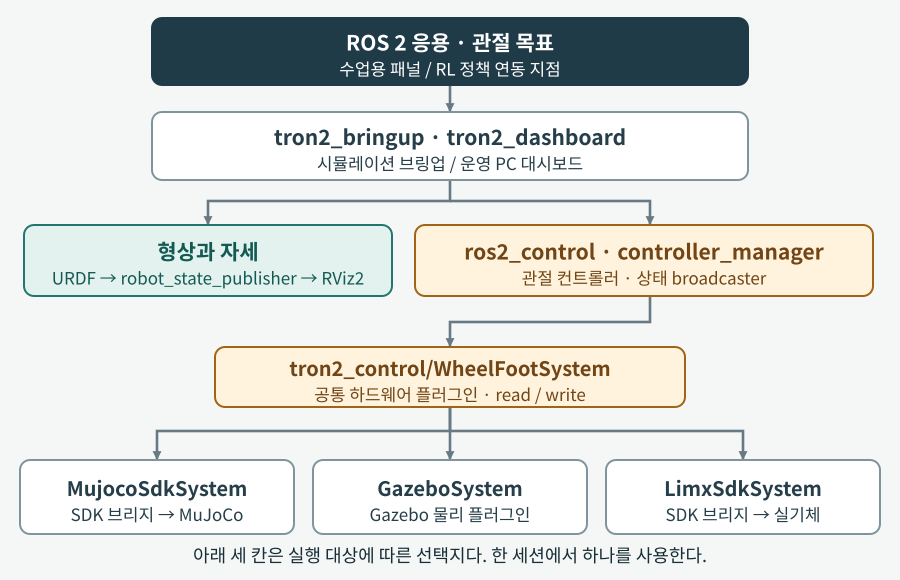

**그림 1 · WF 시스템 구성.** 위에서 아래로 실행 구성을 읽는다. 왼쪽 가지는 형상과 자세를 표시하고, 오른쪽 가지는 관절 명령과 피드백을 처리한다. 수업에서는 패널이 목표를 발행한다. RL 정책을 연결하려면 출력을 같은 관절 목표 메시지로 변환해야 한다. 맨 아래는 controller manager에 등록되는 장치 이름이다. 세 장치가 공통 플러그인을 사용한다.

**수업에서 따라갈 경로**   SDK 수신과 기록은 2–6쪽, MuJoCo·Gazebo·실기체 흐름은 7–9쪽, 관절 명령과 응답 측정은 10–11쪽이다. 12쪽부터 패키지를 실행한다. 14쪽의 실제 노드 그래프와 17쪽의 화면 지연 측정은 실행 중 무엇을 관찰해야 하는지 보여 준다. 20–24쪽에서는 슬라이더를 속도 조이스틱으로 바꿔 WF 정책의 균형과 속도 한계를 측정한다.

구성 근거는 `tron2_bringup`·`tron2_dashboard`의 launch와 `tron2_control/launch/control.launch.py`다. 실기체의 controller manager는 운영 PC에서 실행하며, 기존 SBC 브리지에 ROS 토픽으로 연결한다.

## 발형 모델에서 관절·IMU 기록 준비하기

두 실습은 서로 다른 형상의 로봇을 사용한다. 먼저 발형 모델(SF_TRON2A)에서 SDK 상태를 ROS 2로 받아 기록한다. 이어서 바퀴형 모델(WF_TRON2A)에서 패널의 목표가 어느 제어기를 거쳐 모터에 도달하는지, 어느 상태가 RViz2로 돌아오는지 추적한다.

### 수신 실습과 관절 제어 실습

`SF 시뮬레이터 → LimX SDK → sdk_bridge.py → 관절·IMU 토픽 → rosbag`

뒤의 WF 실습에서는 이 수신 경로에 패널과 컨트롤러를 연결해 명령과 피드백을 함께 관찰한다.

### 실습 파일 열기

```
cd ~/sainty/day5
ls ros_lab/{run.sh,telemetry.py,observe.py,replay.sh}
ls tron2_sdk/sdk_bridge.py
```

run.sh가 생산자와 관찰자를 시작한다. telemetry.py는 센서값을 ROS 메시지로 변환하고, observe.py는 메시지를 검사해 기록한다. replay.sh는 기록을 재생해 필드가 보존됐는지 검사한다.

### 관찰 터미널 준비

WSL2 Ubuntu 22.04, ROS 2 Humble, Python 3.10, uv를 사용한다. 다음 명령을 별도 터미널에 입력하고 다음 쪽의 실습을 시작한다.

```
source /opt/ros/humble/setup.bash
export ROS_LOCALHOST_ONLY=1 ROS_DOMAIN_ID=86
ros2 topic echo /tron2/joint_states sensor_msgs/msg/JointState --once
```

**완료 기준**  관절·IMU 메시지를 각각 60개 기록하고, 재생한 120개 메시지의 모든 필드가 원본과 일치하는지 확인한다.

## 시뮬레이터와 브리지를 분리해서 읽기

TRON2 · SDK에서 ROS로

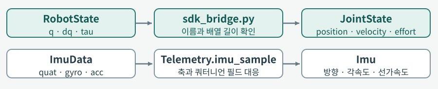

**그림 2 · 발형 모델의 센서 경로.** 위쪽은 관절 배열, 아래쪽은 IMU 샘플이다. 같은 시각에 두 콜백이 실행된다고 가정하지 않고 토픽별 stamp를 확인한다.

```
cd ~/sainty/day5
ROS_DOMAIN_ID=86 bash ros_lab/run.sh tron2
read -r -p 'Evidence directory 경로를 붙여 넣으세요: ' TRON_RUN
```

run.sh tron2는 fetch_models.py로 모델 목록과 체크섬을 확인한다. ROBOT_TYPE=SF_TRON2A, ROBOT_IP=127.0.0.1 환경에서 headless 시뮬레이터와 sdk_bridge.py를 별도 프로세스로 시작한다. 관찰자는 이 족형 모델에서 관절 10개를 기대한다.

### sdk_bridge.py의 세 단계

① 연결과 구독. Robot(RobotType.Tron2)을 만든 뒤 robot.init으로 연결한다. subscribeRobotState(state)와 subscribeImuData(imu)가 서로 다른 종류의 샘플을 전달한다.

② 이름과 순서 검사. state는 SDK의 motor_names를 선택한 모델의 관절 목록과 비교한다. 이름이 모두 비어 있을 때만 모델 순서를 대신 쓴다. 이름이 있으면 SDK 배열 순서대로 URDF 이름을 대응시킨다. 이름 집합이나 상태 배열 길이가 맞지 않으면 해당 샘플을 건너뛴다.

③ 발행. 콜백은 잠금 안에서 최신 샘플을 복사한다. 루프는 약 0.02초마다 각 종류의 stamp가 직전에 보낸 값과 다를 때만 발행한다. SDK가 더 자주 갱신되면 그사이의 샘플이 생략될 수 있다.

### 필드가 건너가는 경계

```
SDK RobotState    q / dq / tau      -> JointState.position / velocity / effort
SDK ImuData       quat / gyro / acc -> Imu.orientation / angular_velocity /
                                        linear_acceleration
SDK message.stamp                   -> ROS header.stamp
```

같은 결과 폴더의 simulator.log는 시뮬레이터, sdk.log는 브리지의 출력이다. 두 토픽이 모두 비면 브리지 초기화를, IMU만 들어오면 state 콜백의 이름·길이 조건을 먼저 본다.

**확인 문제**  TRON2에서 /tron2/cmd_vel의 구독자가 없어도 이 실습이 성공하는 이유는 무엇인가? 성공 조건은 SDK의 관절·IMU 상태가 ROS로 도착해 기록되는 것이다.

## telemetry.py와 observe.py를 한 쌍으로 읽기

공통 코드 · 메시지 계약

### 발행자가 약속하는 필드

Telemetry('tron2')는 /tron2/joint_states와 /tron2/imu 발행자를 만든다. 큐 깊이는 10이다. joint_sample은 name, position, velocity, effort를 같은 인덱스로 정렬해 넣는다. name[i]가 바뀌면 같은 position[i]도 다른 관절을 가리킨다.

```
# ros_lab/telemetry.py
sec, nanosec = divmod(int(ns), 1_000_000_000)
# 예: 1_020_000_000 ns -> sec=1, nanosec=20_000_000
```

브리지는 SDK의 message.stamp를 넘긴다. imu_sample은 원본 [w, x, y, z]를 ROS의 이름 있는 orientation.w, .x, .y, .z에 대입한다. 이 모델의 IMU 기준 프레임은 base_imu다.

### 수신자가 검사하는 조건

observe.py의 receive(topic, msg)는 토픽별 직전 stamp보다 새 stamp가 커야 통과시킨다. 관절은 첫 메시지의 이름 순서가 유지되는지, 이름이 고유한지, 네 배열의 길이가 각각 10인지 확인한다.

IMU는 쿼터니언 노름이 1에 가까운지, 각속도와 가속도 성분이 유한한지 검사한다. 관절 위치·속도·힘에도 유한값 검사를 적용한다. 노름만으로 축의 순서나 센서 방향까지 판정할 수는 없다.

### 서로 다른 두 시각

```
# observe.py 의 receive 함수
raw = serialize_message(msg)
writer.write(topic, raw, node.get_clock().now().nanoseconds)
rows.append((stamp, hashlib.sha256(raw).hexdigest()))
```

**읽기 과제**  header.stamp는 원본 샘플의 시각이고 writer.write의 마지막 인자는 수신 노드가 기록한 시각이다. SDK의 샘플 시계와 수신 시계가 같은 기준인지 확인해야 두 값의 차이를 전송 지연으로 해석할 수 있다.

## 두 종류의 일치 검사를 결과 파일에서 확인하기

기록 · 재생 · 판정

### 1. 실시간 수신 → SQLite bag

observe.py는 rclpy.spin_once로 콜백을 처리해 토픽당 60개를 채운다. 기록 종료 후 SequentialReader로 같은 bag을 다시 읽고, 각 토픽에서 직렬화 바이트의 SHA-256 목록을 수신 당시 목록과 순서대로 대조한다. 성공하면 receipt.json에 live, bag, 첫·마지막 stamp와 PASS가 남는다.

```
cat "$TRON_RUN/receipt.json"
cat "$TRON_RUN/bag_info.txt"
ros2 bag info "$TRON_RUN/telemetry"
```

### 2. 원본 bag → DDS 재생 → 두 번째 bag

```
cd ~/sainty/day5
ROS_DOMAIN_ID=88 bash ros_lab/replay.sh tron2 "$TRON_RUN"
```

replay.sh는 --passive 관찰자를 먼저 띄우고 ros2 bag play를 3초 지연해 구독 연결 시간을 준다. 재수신분은 원본 결과 아래 새 replay-… 폴더에 기록한다.

마지막에 원본·재생 SQLite에서 토픽별 메시지 순서대로 데이터를 읽어 역직렬화하고 모든 메시지 필드를 대조한다. 재생 시점에 새로 부여한 bag 기록 시각은 이 비교에 포함되지 않는다.

```
# 재생 명령이 출력한 replay-… 폴더의 comparison.json 확인
find "$TRON_RUN" -name comparison.json -print -exec cat {} \;
```

**제출할 증거**  receipt.json에서 두 토픽의 live=60, bag=60을 확인한다. comparison.json에서 all_fields_equal=true, messages=120을 기록한다.

**기존 실습의 검증 결과**  WSL2에서 두 토픽을 60개씩 기록했고 재생 시 120개 메시지의 모든 필드가 일치했다.

## 어느 경계에서 데이터가 멈췄는지 좁히기

문제 해결 · 선수 실습

토픽이 보이지 않는다   실행과 관찰 터미널에서 ROS_LOCALHOST_ONLY=1, ROS_DOMAIN_ID가 같은지 확인한다. run.sh의 기본 도메인은 86, replay.sh는 88이다. 이미 설정한 환경 변수 값이 우선한다. 실행이 끝나면 스크립트가 시작한 생산자도 종료되므로 그 뒤에는 bag으로 관찰한다.

50초 뒤 TimeoutError   예외의 토픽별 수신 개수를 비교한다. 둘 다 0이면 실행한 로봇, 도메인과 프로세스 로그를 확인한다. 한쪽만 부족하면 그 토픽의 발행자와 브리지의 입력을 추적한다.

SDK init failed   sdk.log에서 초기화 오류를 찾고 시뮬레이터의 구동과 루프백 주소를 확인한다.

### 선수 교안 「ROS2 기초 관절상태와 제어」 코드 찾기

Windows에서는 그 PDF와 같은 상세교안 폴더의 ROS2_기초_실습코드.zip을 연다. WSL에서는 아래 위치에 같은 파일 세 개가 있다. leg.urdf는 무릎 한 관절과 모의 하드웨어, controllers.yaml은 상태 방송기와 무릎 위치 컨트롤러, lesson.launch.py는 두 모드의 시작 구성을 정의한다.

```
cd ~/sainty/day5/ros_lab/ros2_basics
source /opt/ros/humble/setup.bash
export ROS_DOMAIN_ID=81 ROS_LOCALHOST_ONLY=1
ros2 launch ./lesson.launch.py mode:=model
# Ctrl+C로 종료한 뒤 같은 터미널에서 실행
ros2 launch ./lesson.launch.py mode:=control
```

model에서는 joint_state_publisher가 상태값을 공급한다. control에서는 mock_components/GenericSystem의 상태 인터페이스를 joint_state_broadcaster가 읽는다. 두 경우 모두 robot_state_publisher가 관절 상태와 URDF로 링크 자세를 계산한다.

**다음 읽기**  같은 폴더의 TRON2_SDK.pdf에서 LimX SDK와 형상별 동작을 살펴본다.

## Day 5 · MuJoCo에서 목표와 실측을 추적하기

바퀴형 WF_TRON2A의 왼쪽 무릎을 움직인다. 슬라이더의 목표, SDK가 돌려준 실제 각도, RViz2의 무릎 링크를 차례로 확인한다. 발형 SF와 양팔형 DA는 관절 배열이 다르므로 이 패널의 대상은 WF다.

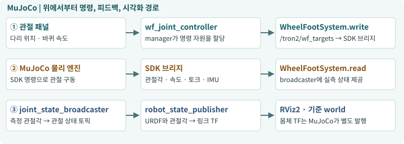

**그림 3 · MuJoCo 명령과 피드백.** 패널의 목표는 wf_joint_controller와 SystemInterface.write를 거쳐 SDK 브리지에 도착한다. 브리지가 LimX SDK에 RobotCmd를 보낸다. 시뮬레이터가 토크를 적용하고 물리 상태를 적분한 뒤에야 관절각과 IMU 값이 돌아온다. rqt_graph는 그림에서 ROS 2로 연결한 구간을 보여준다.

### 실행하고 무릎과 바퀴를 구별하기

```bash
cd ~/sainty/day5
./panel_control.sh sim
```

다리 슬라이더 단위는 도(°)이고 ROS 메시지의 위치 단위는 rad다. 바퀴 슬라이더는 rad/s다. 0.7을 선택하면 바퀴가 초당 0.7 rad로 회전하도록 명령한다. MuJoCo에서는 슬라이더를 움직이면 바로 적용되며 현재 목표를 유지한다. **명령 해제**를 누르면 구동 명령을 해제하고 감쇠를 요청한다. 계속 움직임을 관찰하려면 MuJoCo 뷰어의 Space 일시정지를 해제한다.

```bash
ros2 topic echo /tron2/wf_targets --once
ros2 topic echo /tron2/joint_states --once
ros2 run tf2_ros tf2_echo world tron2/base_Link
```

SDK가 돌려준 관절각으로 링크 TF를 계산한다. 몸체의 세계 위치·회전은 별도 모듈이 MuJoCo 자유 관절에서 읽는다. 넘어지는 동안 자세와 높이까지 보이는 이유다. 기존 바퀴 각도(±180°) 실습은 `./panel_control.sh control`로 연다.

## Gazebo에서 같은 무릎 목표를 따라가기

`backend:=gz`를 선택하면 패널과 ROS 컨트롤러는 같은 토픽을 사용한다. 하위 명령의 구독자는 Gazebo 모델 플러그인이다. 아래에서 세 번째 줄과 네 번째 줄은 같은 물리 상태를 서로 다른 창으로 전달한다.

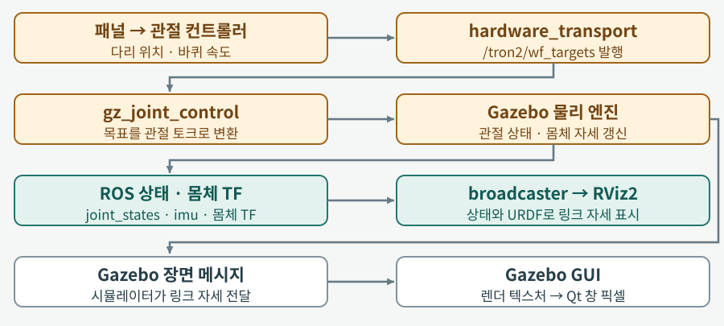

**그림 4 · 명령 하나, 두 화면.** 맨 위 두 줄은 명령과 물리 계산이다. 청록색 줄에서 관절 상태는 broadcaster와 robot_state_publisher를 거쳐 RViz2의 링크 자세로 이어진다. 오른쪽에서 갈라지는 선은 Gazebo GUI용 장면 데이터다. 플러그인은 몸체의 세계 자세도 TF로 보낸다.

### 두 터미널에서 경계 확인하기

```bash
ros2 topic info /tron2/wf_targets -v
ros2 topic echo /tron2/joint_states --once
```

첫 명령에서 구독 노드 `/tron2/gz_joint_control`을 찾는다. 두 번째 명령의 관절 배열에서 `knee_L_Joint`의 위치가 변하면 목표가 물리 관절에 반영된 것이다. RViz2가 먼저 움직이고 Gazebo 창만 늦으면 17쪽에서 장면, 렌더 직전 자세, 창의 픽셀을 순서대로 비교한다.

구현 위치는 `tron2_gz/src/wheel_foot_system.cpp`와 `tron2_control/src/system.cpp`다.

## Day 5 · 실기체의 온보드 브리지와 조작 PC 연결하기

**준비 환경.** 이 구현은 ROS 2 Humble, Python 3.10, WF_TRON2A EDU 저수준 SDK를 대상으로 한다. SBC에서 `echo "$ROS_DISTRO"`와 `uname -m`을 확인한다. 제조사 문서의 탑재 이미지 설명에는 버전 차이가 있다. ARM64 SBC에는 aarch64용 SDK, x86_64 SBC에는 amd64용 SDK를 사용한다. 운영 PC는 패널과 controller_manager를 실행한다.

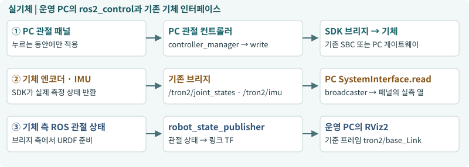

**그림 5 · 운영 PC와 기체의 경계.** 운영 PC의 관절 컨트롤러와 하드웨어 인터페이스를 거친 목표가 DDS를 통해 기존 SBC 브리지에 도착한다. 브리지는 명시적으로 지정한 기체 SDK 주소에 연결한다. 주제어기가 제공하는 엔코더와 IMU는 반대 방향으로 돌아온다. 기본 실기체 화면은 몸체 기준의 관절 움직임을 표시한다. 전역 위치·낙상 높이를 보려면 별도의 상태 추정기가 실제 TF를 제공하고 RViz2 기준 프레임을 그 부모 프레임으로 바꿔야 한다.

### 먼저 모터 출력 없이 연결하기

기존 수업용 브리지가 실행 중인 SBC는 그대로 두고 운영 PC에 대시보드와 제어 패키지를 준비한다. 두 호스트의 ROS_DOMAIN_ID(기본 52), DDS 네트워크, 시스템 시각을 맞춘다. 교실 bag 실습에서 `ROS_LOCALHOST_ONLY=1`을 사용했다면 두 터미널에서 `export ROS_LOCALHOST_ONLY=0`을 설정한다.

```bash
# 기존 수업용 브리지가 꺼져 있을 때만 SBC에서 실행한다.
cd ~/sainty/day5
./panel_control.sh hardware "$ROBOT_IP"

# 운영 PC: 별도 터미널
cd ~/sainty/day5
./panel_control.sh operator
```

기본 하드웨어 모드에서는 RobotCmd를 송신하지 않는다. 관절이 10개인지, 좌우 관절명과 피드백이 해당 기체와 일치하는지 확인한다. 청취 중인 /tron2/joint_states 발행자는 한 개여야 한다. SDK가 별도 Python 환경에 있으면 SBC에서 TRON2_SDK_PYTHON으로 인터프리터 절대 경로를 지정한다.

## Day 5 · 관절 명령을 허용하고 결과 판독하기

### 실기체에서 조작 권한을 분리하는 이유

제조사가 지정한 지지대에 기체를 고정하고 물리 비상정지를 준비한다. WF 구성, 영점과 저수준 개발 모드를 확인하고 같은 모터를 제어하는 기존 정책·컨트롤러를 종료한다. 관찰 모드의 SBC 브리지를 종료한 뒤 아래처럼 같은 주소로 다시 실행한다. 실기체 모터를 시험할 때에는 제조사 시운전 절차를 따른다.

```bash
./panel_control.sh hardware "$ROBOT_IP" --enable-motion
```

패널은 첫 실측 자세로 다리 슬라이더를 채우고 바퀴 속도를 0으로 둔다. 목표를 정한 뒤 **누르는 동안 적용**을 누른다. 버튼을 놓으면 감쇠 명령을 요청한다. 유효 명령 또는 새 상태가 0.25초간 끊겨도 같은 동작을 시도한다. 통신 자체가 끊기면 감쇠 명령의 전달은 보장되지 않는다. 물리 비상정지와 기체 자체 보호 기능을 별도로 사용한다.

### 제조사 값과 수업용 패널의 차이

| 설정 | 공식 WF 설정과 수업 코드에서의 의미 |
|---|---|
| 500 Hz / 50 Hz | 공식 SDK 제어 루프는 500 Hz, WALK 정책은 10회마다 추론해 50 Hz다. 패널은 SDK 목표 주기 2 ms를 사용한다. WSL과 Python의 실제 주기는 부하에 따라 달라진다. |
| 다리 위치 PD | 일반 다리 Kp/Kd는 159.67/10.16, 근위 yaw는 53.22/3.39다. 소프트웨어 토크 한도는 각각 140/40 N·m다. |
| 바퀴 속도 | Kp=0, Kd=0.6, 토크 한도 22 N·m다. 패널 범위 ±7 rad/s는 몸체 명령 0.7 m/s와 바퀴 반경 0.1 m로 환산한 실습 범위다. |
| 응답과 균형 | 모터 명령은 실측 q·dq로 토크 한계를 적용한다. 패널에는 제조사 설정에 없는 고정 0.35 rad/s 다리 램프를 적용하지 않는다. 두 바퀴 위 자세 유지는 IMU·관절 이력을 읽는 별도 encoder/actor 정책의 역할이다. |

### 각 신호의 소유자 확인

`/tron2/robot_description`과 관절 TF는 robot_state_publisher, `/tron2/joint_states`와 `/tron2/imu`는 SDK 브리지가 발행한다. `/tron2/wf_targets`의 position에는 여덟 다리 위치, velocity에는 두 바퀴 속도를 담으며 사용하지 않는 성분은 0이다. 헤더 시각은 명령 만료 판정에 사용한다. 시간 차이가 큰 두 컴퓨터는 DDS에서 토픽이 보여도 명령이 거절될 수 있다.

**공식 자료.** [LimX SDK 개발 가이드](https://www.limxdynamics.com/en/documents/856848486581276672) · [WF 설정 원문](https://github.com/limxdynamics/tron2_rl_deploy_python/blob/dc27d921df839c27f7ab47308af2e3e82ec9265e/controllers/model/WF_TRON2A/params.yaml) · [WF 제어 루프](https://github.com/limxdynamics/tron2_rl_deploy_python/blob/dc27d921df839c27f7ab47308af2e3e82ec9265e/controllers/WheelfootController.py).

## Day 5 · 무릎 응답과 두 바퀴 균형을 따로 측정하기

### 슬라이더 목표가 실측값에 나타나기까지

왼쪽 무릎 슬라이더를 한 번에 −80°로 옮겼다. 첫 변경 목표를 ROS에서 수신한 시각을 시작점으로 삼았다. 직전 실측각을 q₀, 목표를 q*라 할 때, 실측각이 q₀ + 0.8 × (q* − q₀)를 진행 방향으로 처음 통과한 시각까지가 아래의 80% 도달 시간이다. 피드백은 약 47–48 Hz로 수신했다.

| MuJoCo 패널 경로 | 직전 실측 | 목표 | 80% 도달 | 4.5초 관찰 종료 시 실측 |
|---|---:|---:|---:|---:|
| 기존 목표 변화율 제한 0.35 rad/s | −21.65° | −80° | 2.36초 | −79.81° |
| 공식 게인과 토크 한도를 반영한 경로 | −17.94° | −80° | 0.24초 | −78.23° |

이전 구현은 초당 약 20°씩만 목표를 바꿀 수 있었다. 슬라이더를 빠르게 움직여도 큰 각도 명령이 수초에 걸쳐 전달됐다. 수정한 브리지는 각 제어 주기마다 현재 각도와 속도로 요청 토크를 계산해 한도를 적용한다. 두 실행의 초기 자세와 접촉 조건은 동일하게 통제하지 않았다. 이 수치는 패널부터 시뮬레이션 피드백까지 측정한 예이며 실기체 모터 자체의 정착 시간과 대역폭은 별도 측정 대상이다.

제조사 URDF가 선언한 무릎의 속도·토크 한도는 18.3 rad/s·150 N·m, 바퀴는 41.89 rad/s·22 N·m다. 공식 제어기는 무릎 명령에 140 N·m 한도를 적용한다. URDF 속도 한도만으로 주어진 하중에서의 응답 시간을 계산할 수 없다. [공식 WF 관절 모델](https://github.com/limxdynamics/tron2-robot-description/blob/main/tron2a/WF_TRON2A/urdf/robot.urdf)

### 균형을 보려면 정책에 어떤 입력을 주는가

공식 WF WALK 제어기는 IMU·관절 상태와 관측 이력을 encoder와 actor에 입력하고, 정지 속도 명령에서도 좌우 다리 목표와 바퀴 속도를 갱신한다. 정책 출력은 50 Hz, 하위 SDK 명령 루프는 목표 500 Hz다. 수동 패널은 조작자가 정한 목표를 유지한다. 따라서 임의 관절각을 고정한 채 두 바퀴로 서 있는 능력을 평가할 수 없다.

별도 평지 MuJoCo 시험에서 기존 실습의 `train_tron2_wf.py` 환경에 제조사 `encoder.onnx`와 `policy.onnx`를 연결해 전진·회전 목표를 0으로 두었다. 두 바퀴를 바닥에 닿게 한 직립 자세에서 시작했다. 한 번의 8초 시험 동안 낙상 없이 유지됐고, 전후 변위 −0.173 m, 좌우 변위 +0.030 m를 기록했다. 이 시험은 정책과 물리 모델의 폐루프 점검이다. 정지 위치의 정밀도와 실기체 복원 성능은 별도 지표로 측정한다.

### 반응이 보이지 않을 때 읽을 신호

1. MuJoCo의 일시정지를 풀고 다리 슬라이더를 움직인다. 패널 출력 `/tron2/wf_joint_controller/targets`와 하위 출력 `/tron2/wf_targets`에서 해당 관절의 position(rad)이 바뀌는지 본다.
2. 목표만 변하면 브리지의 `/tron2/panel_motion_enabled`, 실행 모드, 중복 SDK 제어기, 브리지 로그를 확인한다. 하드웨어 패널은 허용된 세션에서 적용 버튼을 누르는 동안만 지령을 보낸다.
3. 목표를 바꾼 시각과 해당 관절 실측값의 방향을 비교한다. 중력과 지면 접촉만으로도 관절각은 변할 수 있다. RViz2만 멈췄다면 RobotModel의 Description Topic과 기준 프레임을 점검한다. 기체의 몸체 이동은 별도 TF가 필요하다.

## 실습 1 · 패키지를 빌드하고 두 터미널로 열기

**도달 목표**  WF_TRON2A의 모델, 물리 엔진, 제어기, 운영 화면을 누가 실행하는지 소스에서 찾아 설명한다. 실습 환경은 Ubuntu 22.04/WSL2와 ROS 2 Humble이다. Windows의 WSLg가 그래픽 창을 표시한다.

| 패키지 | 먼저 열 파일 | 코드에서 확인할 것 |
|---|---|---|
| tron2_description | `urdf/wf_tron2a.urdf` | 링크, 회전축, 관절 한도, 메시 경로 |
| tron2_bringup | `launch/simulation_bringup.launch.py` | backend 분기, 한 엔진만 점유하는 실행 잠금 |
| tron2_control | `launch/control.launch.py`, `config/controllers.yaml` | manager 생성, spawner, 컨트롤러 종류, 500 Hz 설정 |
| tron2_gz | `urdf/wf_gz.urdf.xacro`, `worlds/classroom.sdf` | 모델의 물리 플러그인과 GUI 플러그인 구분 |
| tron2_dashboard | `launch/dashboard.launch.py` | 관절 패널, RViz2, rqt_graph의 실행 조건 |

```bash
cd ~/sainty/day5/sainty_ws
source /opt/ros/humble/setup.bash
colcon build --symlink-install --packages-up-to tron2_bringup tron2_gz tron2_dashboard
source install/setup.bash
ros2 pkg prefix tron2_control
ros2 launch tron2_bringup simulation_bringup.launch.py --show-args
```

**터미널 A**에서 `ros2 launch tron2_bringup simulation_bringup.launch.py backend:=gz`를 실행한다. **터미널 B**에서도 같은 워크스페이스의 `install/setup.bash`를 불러온 뒤 `ros2 launch tron2_dashboard dashboard.launch.py target:=simulation`을 실행한다. 두 터미널의 ROS_DOMAIN_ID를 맞춘다. MuJoCo로 바꿀 때는 A에서 Ctrl+C로 브링업이 끝난 것을 확인한 다음 `backend:=mujoco`로 다시 실행한다. B는 열린 채로 새 상태를 기다릴 수 있다.

**첫 MuJoCo 실행**  새 체크아웃에서는 `~/sainty/day5`에서 `./panel_control.sh sim mujoco`를 한 번 실행해 잠긴 SDK 환경과 모델을 준비한다. 이 명령은 대시보드도 연다. 두 터미널 실습 전 종료한다. Gazebo 단독 실행에는 이 준비가 필요하지 않다.

**확인 문제**  운영 PC에 SDK와 MuJoCo가 없어도 기존 SBC의 ROS 인터페이스에 연결할 수 있는 이유는 무엇인가? 패널의 발행자를 찾아 패키지명과 토픽 타입을 적는다. PC 전용 빌드는 `--packages-up-to tron2_dashboard`를 사용한다.

## 실습 2 · 패널의 목표 한 개를 모터와 RViz까지 추적하기

왼쪽 무릎 슬라이더를 움직이면 **목표 → 구동 → 계측** 순서로 다른 값이 생긴다. 목표와 실측을 같은 이름의 관절로 비교한다. 배열 인덱스는 메시지의 `name`에서 찾는다. 패널의 다리 표시는 도(°), ROS 위치 단위는 rad, 바퀴 속도는 rad/s다.

| 순서 | 어디서 보는가 | 무엇이 변하는가 |
|---|---|---|
| 1. 패널 출력 | `/tron2/wf_joint_controller/targets` | JointState에 다리 위치와 바퀴 속도 목표를 넣는다. |
| 2. 제어기 | `wf_joint_controller` | 명령의 시각과 관절명을 검사하고 manager가 할당한 command interface에 값을 쓴다. |
| 3. 구동부로 전달 | `/tron2/wf_targets` | SystemInterface.write가 하위 명령을 발행한다. MuJoCo는 SDK 브리지, Gazebo는 물리 플러그인이 받는다. |
| 4. 물리 피드백 | `/tron2/joint_states`, `/tron2/imu` | 엔진이 적분한 관절과 센서 상태가 들어온다. 실제 기체에서는 SDK의 계측값이 들어온다. |
| 5. 상태 배포 | `/tron2/joint_state_broadcaster/joint_states` | SystemInterface.read가 읽은 값이 패널과 시뮬레이션의 robot_state_publisher로 전달된다. |

```bash
ros2 node info /tron2/wf_joint_controller
ros2 topic info /tron2/wf_targets -v
ros2 topic echo /tron2/joint_state_broadcaster/joint_states --once
ros2 run tf2_ros tf2_echo world tron2/base_Link
```

**RViz2에서 보는 두 운동**  링크 사이의 무릎 회전은 robot_state_publisher가 계산한다. 로봇 전체의 낙상과 이동은 시뮬레이터가 별도로 발행하는 `world → tron2/base_Link`에서 온다. 실기체 기본 대시보드는 `tron2/base_Link` 기준이다. 세계 위치를 보려면 기체 측 상태 추정 TF가 필요하다.

**하드웨어 인터페이스**  실기체에서는 PC의 SystemInterface가 하위 목표를 전달하고 기존 LimX SDK 브리지가 모터와 통신한다. [ROS 2 Humble 하드웨어 구성 요소 문서](https://control.ros.org/humble/doc/ros2_control/hardware_interface/doc/writing_new_hardware_component.html)

## 실행 중인 노드 그래프 읽기

Gazebo 서버와 시뮬레이션 대시보드를 같은 ROS 도메인에서 실행하고 rqt_graph의 **Nodes/Topics (active)** 보기로 캡처했다. **타원은 노드, 사각형은 토픽**이다. 화살촉을 따라가면 명령이 나가는 길과 실측값이 돌아오는 길을 구분할 수 있다.

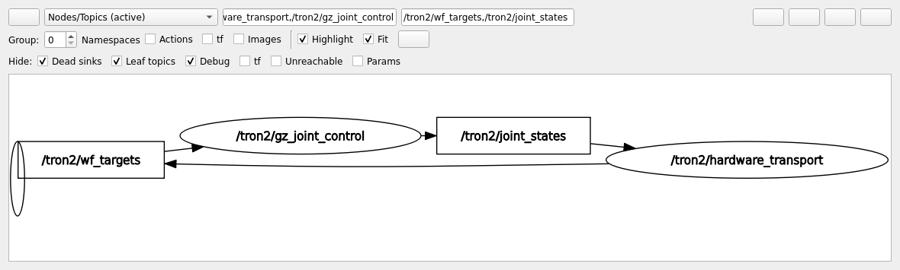

**그림 6 · rqt_graph 실화면.** 토픽 필터에 `/tron2/wf_targets,/tron2/joint_states`를 넣어 구동부 구간을 확대했다. MuJoCo에서 같은 필터를 사용하면 하위 명령을 받는 쪽은 SDK 브리지의 `/tron2_telemetry` 노드다.

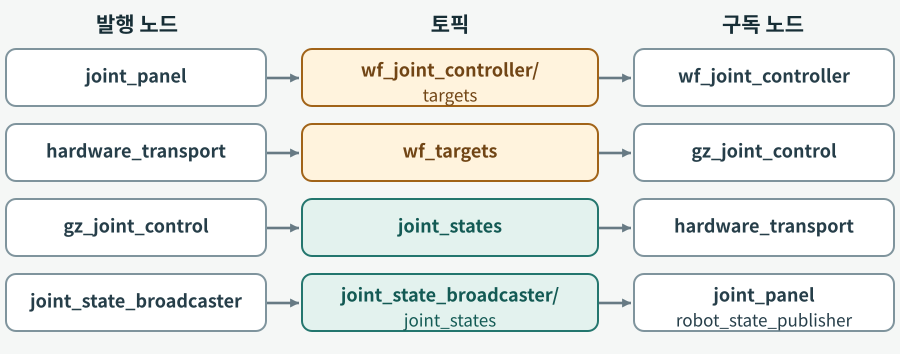

**그림 7 · 같은 실행의 네 연결.** 각 행을 왼쪽에서 오른쪽으로 읽는다. 가운데 토픽 양쪽은 DDS에서 조회한 발행·구독 노드다. 표기는 공통 접두사 `/tron2/`를 생략했다. 마지막 줄의 실측 상태는 패널과 robot_state_publisher가 각각 구독한다.

**그림 사이의 빈 구간 읽기**   첫 줄의 `wf_joint_controller`와 둘째 줄의 `hardware_transport` 사이에서는 manager가 할당한 명령 인터페이스에 목표를 쓰고 플러그인이 읽는다. 이 프로세스 내부 구간은 다음 쪽의 `ros2 control` 명령으로 확인한다. 캡처 당시 관절 컨트롤러와 두 broadcaster 모두 `active`였다.

## 실습 3 · rqt_graph와 제어 자원 점유를 함께 읽기

rqt_graph에서 Nodes/Topics 보기를 선택하고 새로고침한다. 패널에서 컨트롤러로 들어가는 `targets`와 broadcaster에서 나오는 상태 토픽을 찾는다. manager가 플러그인의 `read()`와 `write()`를 호출하는 과정은 같은 프로세스 안에서 진행된다. 자원 점유는 controller manager의 서비스로 조회한다.

```bash
CM=/tron2/controller_manager
ros2 control list_controllers -c "$CM"
ros2 control list_hardware_components -c "$CM"
ros2 control list_hardware_interfaces -c "$CM"
```

**판독 기준**  `wf_joint_controller`, `joint_state_broadcaster`, `imu_sensor_broadcaster` 세 개의 상태가 `active`여야 한다. `claimed`인 명령 자원은 다리 위치 8개, 바퀴 속도 2개, `panel/enable` 1개다. 모터는 10개다. 장치 이름은 선택에 따라 GazeboSystem, MujocoSdkSystem, LimxSdkSystem으로 바뀐다. 세 장치는 같은 WF 데이터 계약을 쓰므로 공통 플러그인 `tron2_control/WheelFootSystem`을 사용한다.

### 제어기가 실제 명령 경로에 있는지 시험하기

**시뮬레이션에서만 수행한다.** 두 관찰 터미널에서 각각 `/tron2/wf_joint_controller/targets`와 `/tron2/wf_targets`를 echo한다. 패널로 목표를 바꾼 뒤 다음 순서로 비교한다.

```bash
ros2 control set_controller_state -c "$CM" wf_joint_controller inactive
# 패널 입력과 하위 토픽에서 이름 배열이 채워진 명령 개수를 비교한다.
ros2 control set_controller_state -c "$CM" wf_joint_controller active
ros2 control list_controllers -c "$CM"
```

기존 직접 연결에서는 패널이 하위 명령 토픽을 발행했다. 수정 후 시험에서는 비활성 구간 약 2초간 **패널 입력 43개, 유효 하위 명령 0개**였다. 해제를 알리는 빈 JointState는 유효 구동 명령 개수에서 제외한다. 재활성화한 뒤 슬라이더를 움직여 실측이 다시 변하는지 확인한다.

**제출**  그래프에서 찾은 토픽 연결 하나, CLI에서 확인한 점유 자원 하나, 비활성화 전후의 명령 수를 기록한다. rqt_graph에 패키지 이름이 나타나는지만으로 제어 경로를 판정하면 플러그인 내부 호출을 놓친다.

## 실습 4 · MuJoCo와 Gazebo가 어느 GPU로 그리는지 확인하기

**검증 환경**  2026-11-27, WSLg / Mesa D3D12, AMD Radeon 내장 GPU와 NVIDIA GeForce RTX 3060 Laptop GPU를 탑재한 노트북. NVIDIA 드라이버는 `nvidia-smi` 기준 581.29였다.

| 실제 뷰어 실행 조건 | 뷰어가 보고한 OpenGL 렌더러 | NVIDIA 프로세스에서 확인한 결과 |
|---|---|---|
| MuJoCo, GPU 환경 변수 미지정 | D3D12 (AMD Radeon(TM) Graphics) | 뷰어 PID 31440 미표시 |
| MuJoCo, NVIDIA 환경 변수 지정 | D3D12 (NVIDIA GeForce RTX 3060 Laptop GPU) | PID 31687, G, /python 일치 |
| Gazebo, WSLg 기본 NVIDIA 선택 | D3D12 (NVIDIA GeForce RTX 3060 Laptop GPU) | 앞선 Gazebo 시험 PID 30437, G, /ruby 일치 |

MuJoCo 두 번의 실행에서는 뷰어가 실제 프레임을 스왑하는 스레드에서 `glGetString(GL_RENDERER)`를 한 번 읽어 기록했다. Gazebo는 OGRE 로그의 `GL_RENDERER`를 읽었다. PID는 실행할 때마다 달라진다. GPU 사용률은 다른 프로그램의 부하도 포함하므로 프로세스 일치 여부를 먼저 본다.

```bash
# 기존 엔진을 종료한 뒤, 소싱한 브링업 터미널에서 한 줄로 실행
MESA_D3D12_DEFAULT_ADAPTER_NAME=NVIDIA ros2 launch tron2_bringup simulation_bringup.launch.py backend:=mujoco
```

```bash
# 별도 WSL 터미널
pgrep -af '[p]ython -m tron2_bringup.mujoco_sim'
nvidia-smi
# Gazebo를 선택한 실습일 때
pgrep -af '^ign gazebo gui'
grep GL_RENDERER ~/.ignition/rendering/ogre.log | tail -1
```

**주의**  이 버전의 `gpu_adapter:=NVIDIA` launch 인자는 Gazebo 분기에 전달된다. MuJoCo에서는 위 환경 변수를 브링업 프로세스에 전달해야 한다. `glxinfo -B`는 그 명령이 만든 컨텍스트를 알려준다. 뷰어의 PID, 렌더러 문자열을 함께 기록하면 학생끼리 다른 장비의 결과를 비교할 수 있다. 이 검사의 범위는 화면 렌더링이다. [Mesa D3D12 어댑터 선택 문서](https://docs.mesa3d.org/drivers/d3d12.html)

## 실습 5 · 높은 FPS에서도 로봇 화면이 늦는 이유 찾기

Gazebo 창이 약 138 FPS를 표시하는 동안 RViz2에서는 무릎이 즉시 움직였고 Gazebo의 로봇만 뒤늦게 움직였다. 클릭 시각을 0으로 놓고, 같은 무릎 목표를 반복 적용하며 아래 경계를 차례로 계측했다. 행별 범위에는 서로 다른 반복 시험이 포함된다.

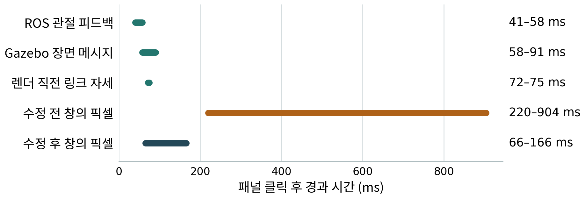

**그림 8 · 클릭부터 화면까지.** 각 선은 해당 관측 지점에서 기록한 최소·최대 시간이다. 수정 전에는 렌더 직전 링크가 72–75 ms에 바뀌었는데 창 픽셀은 220–904 ms에 바뀌었다. 수정 뒤 창에서 관측한 다섯 값은 166, 74, 94, 66, 91 ms였고 중앙값은 91 ms였다. 각 줄은 클릭을 기준으로 하므로 범위를 더하거나 서로 빼지 않는다.

**수정한 지점**  Fortress의 OGRE 카메라가 그린 텍스처를 Qt가 다른 GL 컨텍스트에서 표시한다. `tron2_gz/gui/Tron2FrameSync.cpp`는 WSLg의 D3D12 렌더러에서 카메라 렌더 이후 `glFinish()`로 생산 측 GPU 작업 완료를 기다린다. 실제 화면에서는 지연 감소와 중간 자세의 연속 표시를 확인했다. 이 결과는 해당 노트북과 렌더링 경로에서의 관측이다.

**측정 방법**  목표가 바뀐 시각, 관절 피드백, 렌더 직전의 무릎 링크, 실제 창의 같은 영역을 기록한다. 이 시험에서는 약 14 ms 간격으로 화면을 캡처하고 픽셀 변화가 해당 시행 전체 변화의 5%를 넘은 첫 시점을 사용했다. 11쪽의 80% 도달 시간은 관절각 변화의 지표다. 화면의 5% 변화와 한 열에 섞으면 서로 다른 현상을 같은 지연으로 읽게 된다.

**실습 질문**  FPS가 높고 렌더러 내부 링크 자세까지 제때 변한다면 다음에 관측할 곳은 어디인가? 그래픽 메모리에 그린 이미지가 최종 창에 표시되는 시각을 답에 포함한다.

## 현장 주의사항 · 증상에서 검사와 복구까지

| 겪은 증상 | 먼저 확인할 증거 | 복구 또는 조치 |
|---|---|---|
| Gazebo와 MuJoCo 창이 동시에 열렸다 | 실행 중인 브링업과 엔진 이름. Gazebo의 server와 gui는 한 엔진의 두 프로세스다. | 기존 브링업을 Ctrl+C로 끝낸 후 다음 backend를 선택한다. 현재 launch는 다른 터미널·도메인의 중복 시작도 거절한다. 잠금 파일을 지워서 우회하지 않는다. |
| 패널을 움직여도 MuJoCo가 조용하다 | 뷰어 일시정지, 조작 모드, 컨트롤러 active, 패널 targets와 하위 wf_targets를 순서대로 확인한다. | 물리를 재개하고 simulation 모드를 확인한다. 실기체 모드에서는 허용 상태에서 적용 버튼을 누르는 동안만 명령이 갱신된다. |
| rqt_graph에 제어기가 보이지 않거나 패널이 구동부와 직접 연결된다 | `ros2 control list_controllers`와 토픽의 실제 발행자. 예전 수업 코드에서는 패널이 하위 토픽을 직접 발행했다. | 현재 워크스페이스를 빌드·소싱하고 15쪽의 비활성화 시험으로 명령 경로를 확인한다. |
| 관절 반응이 지나치게 느리다 | 목표 토픽과 실제 관절각을 함께 기록한다. 예전 패널은 목표를 0.35 rad/s씩 바꿨다. | WF 공식 설정과 현재 코드 경로를 확인한다. RViz가 먼저 움직이는 경우 17쪽의 표시 지연 검사를 수행한다. |
| 모델의 링크는 보이는데 몸체 낙상이 RViz에 표시되지 않는다 | 기준 프레임, `/tron2/robot_description`, 몸체 TF와 관절 TF를 각각 확인한다. | 시뮬레이션은 world, 실기체 기본 화면은 tron2/base_Link를 선택한다. echo가 XML을 말줄임해도 RViz의 메시 로딩 오류는 별도로 확인한다. |
| GeForce가 있는데 뷰어가 내장 GPU를 선택한다 | `nvidia-smi` 장치 이름과 뷰어 PID를 대조한다. Gazebo는 OGRE 렌더러 로그도 확인한다. | 16쪽의 백엔드별 선택 방법으로 새 프로세스를 띄운다. GPU 변경 후에도 지연이 남으면 화면 단계까지 측정한다. |
| Gazebo 서버만 실행하면 피드백이 오지만 GUI를 켜면 시작 중 종료된다 | WSLg에서 최초 OGRE2 실행 로그에 `GL3PlusTextureGpu::copyTo` 예외가 기록됐다. 이는 실행 후 자세가 늦게 표시된 사례와 증상이 다르다. | 현재 패키지의 Gazebo launch는 GUI에 OGRE를 지정한다. `gz_gui:=false`로 서버를 따로 확인하고 GUI 실행 로그를 비교한다. |
| PC에서 기체 토픽이 보이는데 명령이 거절된다 | 두 호스트의 시각, motion 허용 상태, 목표의 헤더 시각·수신 간격을 확인한다. | 관찰 모드에서 관절 10개의 이름과 피드백부터 확인한다. 두 호스트 시각과 DDS 설정을 맞춘 뒤 제조사 시운전 절차를 따른다. |

**기체 연결 전 확인**  WSL 검증은 루프백 SDK를 사용했다. 실제 로봇의 토크 출력, 낙상 복원, 네트워크 단절 시 감쇠 도달은 별도 시운전 항목이다. 사용자 임의의 관절 목표와 두 바퀴 균형정책은 서로 다른 실습으로 운영한다.

## 실습 기록 · 뷰어 화면과 결과를 함께 제출하기

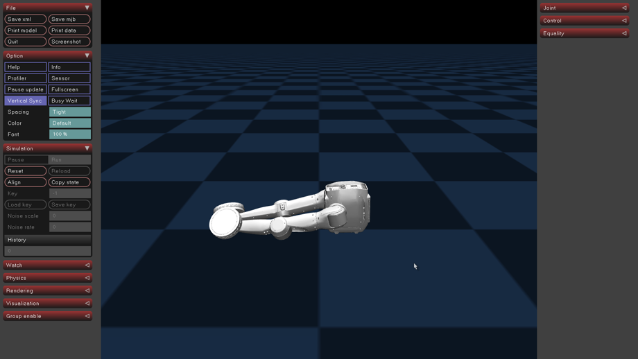

**그림 9 · MuJoCo 실행 화면.**  RTX 3060 Laptop GPU를 명시한 시험의 MuJoCo 뷰어다. 동일한 PID 31687에서 읽은 GL_RENDERER와 `nvidia-smi` 결과를 16쪽에 기록했다. 화면에 로봇이 보이는 것만으로는 어느 GPU가 그렸는지 구분할 수 없다.

| 제출할 기록 | 판정 기준 |
|---|---|
| 실행한 backend와 launch 명령 | 브링업과 대시보드가 분리되고 물리 엔진 하나만 실행된다. |
| controller manager 결과와 패널 조작 1회 | 세 컨트롤러가 active이고, 무릎 목표와 같은 관절의 실측각이 변화한다. |
| GPU 모델과 뷰어 프로세스 | 어댑터 선택 조건, 렌더러 근거 또는 NVIDIA PID 대조 결과를 적는다. |
| 지연 진단 한 문장 | 가장 먼저 늦어진 경계, 판단에 쓴 측정값, 아직 확인하지 않은 부분을 구분한다. |

**종료 순서**  시뮬레이션 패널에서 명령을 해제하고 대시보드와 브링업을 종료한다. 실기체 수업에서는 제조사의 지지·감쇠·비상정지 절차를 별도로 따른다.

## TRON2 WF · 조이스틱으로 균형을 잡고 주행하기

두 바퀴로 선 WF_TRON2A에 전진 속도와 회전 속도를 보낸다. 손을 놓으면 목표 속도가 0으로 돌아오며, 정책은 넘어지지 않도록 관절과 바퀴를 계속 조절한다. 이 실습은 MuJoCo 한 대를 구동한다.

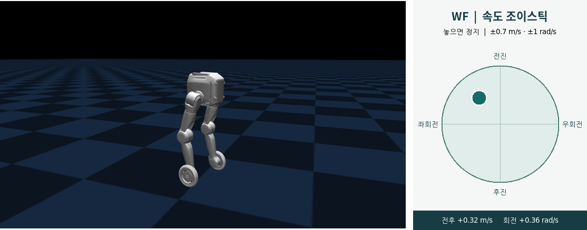

**실행 화면.** 원의 위·아래는 전진·후진, 왼쪽·오른쪽은 좌회전·우회전이다. 중심에서 멀어질수록 명령이 커진다. 대각선으로 끌면 전진하면서 회전한다. 상태 표시줄은 입력 목표를 표시한다.

### 처음 한 번 준비하기

```bash
cd ~/sainty/day5
git submodule update --init --depth 1 -- tron2_sdk/vendor/tron2_rl_deploy_python
(cd tron2_sdk && uv sync --locked && uv run --locked python fetch_models.py)
cd sainty_ws
source /opt/ros/humble/setup.bash
colcon build --symlink-install --packages-up-to tron2_bringup
source install/setup.bash
ros2 launch tron2_bringup policy_drive.launch.py
```

다음 실행부터는 새 터미널에서 워크스페이스의 `install/setup.bash`를 소싱하고 마지막 줄을 실행한다. RViz2도 보려면 `rviz:=true`를 붙인다. 기존 MuJoCo 또는 Gazebo 브링업을 먼저 종료한다. 조이스틱이나 뷰어를 닫으면 이 launch가 시작한 프로세스들이 종료된다.

**첫 관찰**   중심에서 손을 놓고 몸체가 서 있는지 확인한다. 원을 조금만 위로 민 다음, 끝까지 밀어 하단의 m/s 값이 어떻게 달라지는지 읽는다. MuJoCo 카메라는 몸체를 따라간다. 실제 이동량은 뒤의 `/tron2/odom` 실습에서 측정한다.

## 정책이 균형을 만드는 20 ms

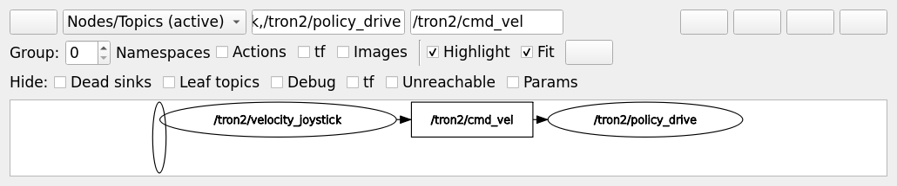

**ROS 경계.** `velocity_joystick`이 `/tron2/cmd_vel`에 Twist를 20 Hz로 발행한다. `linear.x`는 m/s, `angular.z`는 rad/s이며 양의 회전은 왼쪽이다. 노드가 0.25초 동안 새 명령을 받지 못하면 다음 추론부터 두 목표를 0으로 사용한다.

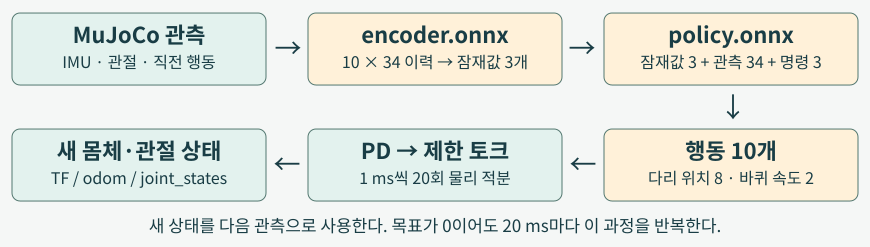

같은 화면을 열려면 소싱한 터미널에서 `ros2 run rqt_graph rqt_graph`를 실행하고 Nodes/Topics (active) 보기에서 `/tron2/cmd_vel`을 찾는다.

**정책 내부.** `train_tron2_wf.py`의 `WheelDrive`와 `session()`을 재사용한다. 시작 때 CPU ONNX Runtime 세션 두 개를 열고, 매 틱에 관측 이력으로 인코더를 실행한 뒤 속도 명령을 포함한 40개 값을 액터에 넣는다. 앞의 이력과 직전 행동은 방향을 바꿀 때도 이어진다.

### RViz2가 읽는 값

`policy_drive`는 적분이 끝난 관절 10개의 상태를 `/tron2/joint_states`에 발행한다. `robot_state_publisher`가 URDF와 관절각으로 링크 TF를 만들고, 정책 노드는 몸체에서 읽은 `world → tron2/base_Link` TF와 오도메트리를 발행한다.

이 launch의 모터 명령 소유자는 정책이다. 앞 교안에서 쓰던 관절 슬라이더와 ros2_control 관절 브링업은 별도 실습에서 실행한다. 코드 진입점은 `tron2_bringup/launch/policy_drive.launch.py`, 추론은 `tron2_bringup/policy_drive.py`, 조이스틱은 `tron2_dashboard/velocity_joystick.py`다.

## 누가 속도를 정하는가 · 기립 자세에서 시작하는 이유

| 확인 대상 | 수치 또는 동작 | 실습에서의 의미 |
|---|---|---|
| LimX 휠형 제품 사양 | 최대 이동 속도 3–5 m/s | 제조사가 발표한 기체 성능 범위다. 영상 한 장면의 속도는 거리와 시간 계측이 필요하다. |
| 공개 WF 예제 | 전후 ±0.7 m/s, 좌우 이동 0, 회전 ±1.0 rad/s | `params.yaml`의 `commands.max`와 제조사 Python 컨트롤러의 스틱 처리 코드에서 확인한다. |
| 수업의 기본 모드 | `profile:=reference` | 시작할 때 설치된 WF YAML에서 위 값을 읽고, UI와 명령 수신 측에 같은 범위를 적용한다. |
| 수업의 확장 모드 | `profile:=experiment` | 기본 스틱 범위 ±5 m/s와 ±4 rad/s는 이번 시험 설계값이다. 두 축을 launch 인자로 각각 바꿀 수 있다. |

제조사 예제는 스틱을 정규화하고 `_process_joystick()`에서 설정값으로 스케일·클립한다. 해당 버전의 관측 생성 코드에는 명령을 한 번 더 스케일하는 단계도 있다. 수업은 사용자가 지정한 `test_wf_direction.py`의 입력 계약에 따라 액터 입력 마지막 세 칸에 `[vx, 0, wz]`를 직접 넣는다. 따라서 실습의 목표와 결과는 이 경로를 기준으로 읽는다. 공개 자료에서 모든 시뮬레이션에 0.7 m/s를 강제하는 지침은 확인하지 못했다. [제조사 휠형 사양](https://www.limxdynamics.com/ko/products/tron2/spec) · [WF 설정](https://github.com/limxdynamics/tron2_rl_deploy_python/blob/dc27d921df839c27f7ab47308af2e3e82ec9265e/controllers/model/WF_TRON2A/params.yaml) · [제조사 컨트롤러](https://github.com/limxdynamics/tron2_rl_deploy_python/blob/dc27d921df839c27f7ab47308af2e3e82ec9265e/controllers/WheelfootController.py)

### 같은 정책으로 다른 범위 시험하기

```bash
ros2 launch tron2_bringup policy_drive.launch.py profile:=experiment
# 위 세션을 종료한 후 전후 ±2 m/s, 회전 ±1.5 rad/s로 다시 실행
ros2 launch tron2_bringup policy_drive.launch.py profile:=experiment max_linear:=2.0 max_yaw:=1.5
```

바뀌는 것은 목표 속도의 범위다. 두 모드는 같은 가중치·질량·토크 한계·바닥을 사용한다. 고속 시험에서 넘어지면 마지막 상태를 발행하고 세션이 종료된다.

### 실기체의 낙상 복구와 공개 모델

제조사 사용자 매뉴얼에는 휠형의 낙상 감지 후 기립 기능이 명시돼 있다. 공식 GitHub·Hugging Face와 공개 검색에서 이 MuJoCo WF 모델에 적용 가능한 독립 복구 체크포인트는 확인하지 못했다. 공개 예제의 `handle_stand_mode()`는 초기·기본 관절각을 보간한다. 실습은 `WheelDrive.reset()`으로 기본 관절각과 몸체 방향을 설정하고 바퀴가 바닥에 닿게 높이를 맞춘다. 이 초기화는 쓰러진 로봇이 스스로 일어나는 능력을 검증하지 않는다. [실기체 매뉴얼](https://www.limxdynamics.com/en/documents/852949782845591552) · [공개 WF 파일](https://huggingface.co/limxdynamics/tron2-rl-locomotion-policies/tree/main/WF_TRON2A)

## 목표 속도와 실제 속도를 따로 측정하기

실제 조이스틱 위젯에 마우스 입력을 보내 정지, 전후진, 제자리 회전, 곡선, 해제를 연속 실행했다. 오른쪽 끝에서는 주행 중 조이스틱 발행을 2초간 중단해 입력 만료를 시험했다. 점선이 비어 있는 구간은 새 명령이 도착하지 않은 시간이다.

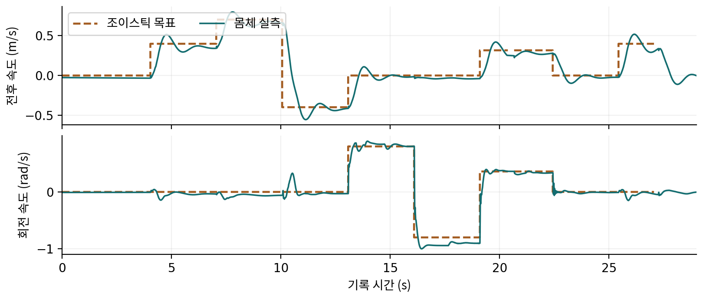

| 조작 | 전후 목표 / 실측 (m/s) | 회전 목표 / 실측 (rad/s) |
|---|---:|---:|
| 전진 | +0.397 / +0.357 | -0.000 / -0.032 |
| 최대 전진 | +0.700 / +0.666 | -0.000 / -0.058 |
| 후진 | -0.397 / -0.433 | -0.000 / -0.032 |
| 좌회전 | -0.000 / -0.010 | +0.802 / +0.827 |
| 우회전 | -0.000 / -0.038 | -0.802 / -0.916 |
| 전진과 좌회전 | +0.315 / +0.281 | +0.360 / +0.344 |
| 손 놓음 | -0.000 / -0.029 | -0.000 / -0.012 |

**검증 기준.** 각 동작을 약 3초 유지하고 초기 0.8초를 제외해 평균을 냈다. 최대 전진에서는 몸체의 월드 위치 변화량을 진행 방향에 투영해서도 속도를 계산했다. 관성 주축과 링크 좌표축이 다르므로 `Odometry.twist`는 MuJoCo의 `mjOBJ_XBODY`를 사용해 `tron2/base_Link` 축으로 표현한다.

기립과 방향 전환을 포함한 28.4초 동안 최저 높이는 0.712 m, 최대 몸체 기울기는 4.5°였다. 최대 전진에서 위치 기반 평균은 0.666 m/s였다. 발행을 중단한 뒤 1.25~2초 구간의 전후 속도는 -0.016 m/s였다.

```bash
source ~/sainty/day5/sainty_ws/install/setup.bash
cd ~/sainty/day5
python3 ros_lab/measure_wf_speed.py --seconds 3
```

다른 터미널에서 측정하는 동안 스틱을 일정하게 유지한다. 출력의 `pose rate`는 위치 변화 기반 속도, `mean twist`는 속도 메시지의 시간 평균이다. 정지 명령에서도 균형을 잡는 동안 작은 잔류 이동이 생긴다.

## 입력을 5 m/s까지 올리면 어디서 넘어지는가

같은 초기 자세에서 매 시험을 다시 시작했다. 첫 1초는 정지, 이후에는 목표를 즉시 주거나 2초 동안 선형으로 증가시킨다. 6초 또는 20초 유지한 뒤 마지막 2초의 평균을 계산한다. 걸린 시간은 시뮬레이션 시각이며 낙상 시간에는 첫 1초도 포함한다.

| 전진 목표 | 즉시 입력 | 2초 가속 입력 |
|---|---|---|
| 0.7 m/s · 6초 유지 | 0.662 m/s | 0.661 m/s |
| 2.0 m/s · 20초 유지 | 2.254 m/s | 2.254 m/s |
| 2.2 m/s · 20초 시도 | 9.24초에 낙상 | 6.90초에 낙상 |
| 2.6 m/s · 20초 시도 | 기립 유지, 1.313 m/s | 4.74초에 낙상 |
| 3.0 m/s · 20초 시도 | 4.82초에 낙상 | 4.62초에 낙상 |
| 4.0 m/s · 6초 시도 | 3.28초에 낙상 | 기립 유지, −0.098 m/s |
| 5.0 m/s · 6초 시도 | 2.24초에 낙상 | 4.36초에 낙상 |

**판독.** 2.0 m/s에서는 서 있었지만 목표보다 약 13% 빨랐다. 2.6 m/s 즉시 입력에서는 목표보다 느렸고, 4.0 m/s 가속 입력에서는 진행 방향까지 바뀌었다. 따라서 낙상 여부와 속도 오차를 함께 읽는다. 이산적으로 시험한 평지·초기 자세 한 종류의 결과이므로 2.0 m/s를 절대 임계속도로 해석할 수 없다.

**후진과 회전.** −2.0 m/s 즉시 입력에서는 −4.588 m/s까지 과속했다(마지막 2초 평균). +4.0 rad/s 회전은 +3.813 rad/s, −4.0 rad/s는 −3.108 rad/s였다. 독립 시뮬레이션 시험에 더해 실제 확장 launch에서도 스틱 끝이 +5.0 m/s를 발행하고 낙상 시 세션이 종료되는 것을 확인했다.

### 같은 46개 조건 재현하기

```bash
cd ~/sainty/day5
tron2_sdk/.venv/bin/python ros_lab/sweep_wf_policy.py > wf_sweep.csv
tron2_sdk/.venv/bin/python ros_lab/sweep_wf_policy.py --hold-seconds 20 \
  --linear 2 2.2 2.4 2.6 2.8 3 --yaw > wf_forward_20s.csv
```

시험 프로그램은 화면 없이 물리를 적분한다. `fallen`은 몸체의 위쪽 축과 세계 수직축의 내적이 0.65 미만이거나 높이가 0.40 m 미만일 때 참이다. `steady_rate`는 완주한 시험에서만 기록된다. CSV에는 최대 기울기와 최저 높이도 담았다. 측정 파일은 교안 폴더의 `tron2_figures/wf_policy_sweep.csv`다.
