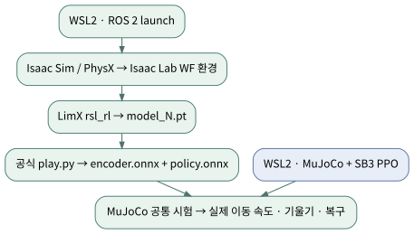
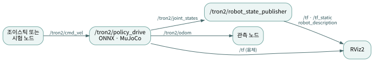
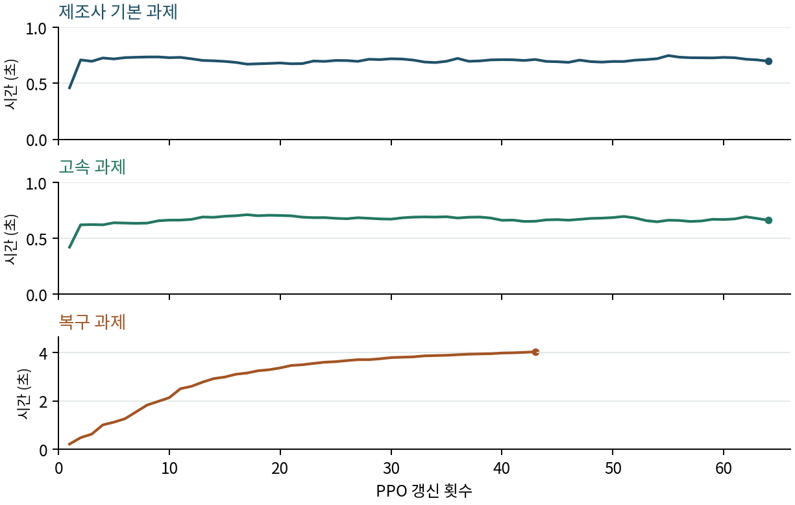

# TRON2 WF | WSL2에서 LimX 공식 PPO 학습과 검증

WSL2 Ubuntu 22.04 안에서 시뮬레이터와 학습 프로세스를 함께 실행했다. LimX의 원본 WF 환경을 먼저 학습한 후, 같은 trainer로 고속 직진·낙상 복구 과제를 각각 학습했다. 이번 교안은 새로 학습한 정책과 이미 완성한 MuJoCo 수업 정책을 같은 물리 환경에서 비교한다.



**그림 1.** 위쪽은 학습과 내보내기, 아래쪽은 공통 시험이다. 윈도우 호스트는 WSL2에 GPU 드라이버를 제공한다. 이 그림에 나오는 Python, Isaac Sim, PhysX, PPO, ONNX 평가 프로세스는 모두 Linux에서 실행했다.

### 공식 방법에서 먼저 확인할 것

제조사 README의 MJCF Quick start는 형상 확인 절차다. 정책 학습은 Isaac Sim 5.1과 Isaac Lab 2.3.1에서 실행하는 scripts/rsl_rl/train.py가 담당한다. SF 예제를 WF에 적용할 때 과제 ID는 Isaac-Limx-WF-TRON2A-Blind-Flat-v0이다. 새 과제에 Gym ID를 붙이면 환경과 PPO 설정을 함께 선택할 수 있다. [확인한 LimX README](https://github.com/limxdynamics/tron2_rl_lab/blob/3ce61328d2e108fe3a6de361cd6b3c5b8638cabd/README.md)

## 1장 | WSL2에서 무엇을 검증했는가

| 확인 지점 | 이 노트북에서 관측한 결과 |
|---|---|
| CUDA | nvidia-smi에서 GeForce RTX 3060 Laptop GPU, 드라이버 581.29, 6144 MiB. WSL 가상환경의 PyTorch 2.7.0+cu126에서 CUDA 장치 1개를 인식했다. |
| Vulkan | vulkaninfo에는 llvmpipe CPU 장치만 나타났다. NVIDIA ICD를 지정한 테스트에서도 Vulkan 물리 장치 열거에 실패했다. |
| 첫 공식 학습 | WSL 프록시와 일반 Linux용 libcuda를 같은 프로세스가 함께 읽었다. PhysX가 CUDA 컨텍스트를 생성하지 못했고 소프트웨어 폴백 경고를 냈다. |
| 경로 조정 후 | run-python이 실행되는 동안만 WSL 제공 libcuda.so.1과 libnvidia-ml.so.1을 우선하도록 했다. 공식 WF 과제의 장치가 cuda:0으로 표시됐고 4환경 × 24스텝 × 2회 = 192스텝을 완료했다. |
| 실제 학습 증거 | model_0.pt와 model_2.pt를 읽어 첫 actor 선형층의 가중치 변화 최댓값 0.003021을 확인했다. 로딩이나 CUDA 장치 조회만으로 통과 판정하지 않았다. |

**결론.** 이 구성에서는 화면 없이 WF 시뮬레이션을 진행하면서 CUDA PPO를 학습할 수 있다. Kit에는 Vulkan 그래픽 장치 생성 오류가 남았다. 이번 결과로 RTX 뷰포트, 카메라 렌더링, 다른 WSL 배포판까지 검증했다고 해석할 수 없다. NVIDIA의 5.1 문서에서 설명하는 WSL ROS 2 + Windows Isaac 브리지와, 이번 Linux headless 학습은 실행 구성이 다르다. [NVIDIA 5.1 ROS 2 설치 안내](https://docs.isaacsim.omniverse.nvidia.com/5.1.0/installation/install_ros.html)

LimX README는 Python 3.10을 기재하고, NVIDIA는 Isaac Sim 5.x의 가상환경에 Python 3.11을 지정한다. 여기서는 WSL Python 3.11.14와 Isaac Lab v2.3.1을 사용했다. LimX 저장소 커밋은 3ce61328, Isaac Lab 태그의 커밋은 5c2ec81c다. editable 설치한 rsl_rl의 실제 소스는 day5/tron2_sdk/vendor/tron2_rl_lab/rsl_rl이다. [NVIDIA Python 버전 안내](https://isaac-sim.github.io/IsaacLab/v2.3.1/source/setup/installation/binaries_installation.html#setting-up-a-python-environment-optional)

## 2장 | 기준 과제와 수업용 확장

| task | 학습 정의 | 샘플 수 |
|---|---|---:|
| reference | 제조사 평지 속도 추종. 전후 ±1 m/s 및 회전 ±1 rad/s에서 표본 추출. 몸체 접촉 또는 큰 기울기에서 종료 | 24,576 |
| high_speed | 수업용 Isaac 과제. 직진 0.5–5 m/s, 회전 0. 가속 오차가 크면 전체 질량중심 목표를 최대 29 mm 낮추도록 보상 | 24,576 |
| recovery | 수업용 Isaac 과제. 앞·뒤로 실제 낙하해 정착한 MuJoCo 상태 32개에서 초기화. 몸체 접촉과 기울기 종료를 해제하고 4.6초 동안 직립을 보상 | 16,512 |

원본 trainer는 PhysX를 200 Hz, 정책을 50 Hz로 실행한다. 10프레임의 관측 340개를 인코더가 몸체 속도 추정치 3개로 변환한다. actor는 추정치·현재 관측·명령을 합한 입력 40개를 받아 다리 위치 8개와 바퀴 속도 2개를 출력한다. critic은 학습 중에만 접근 가능한 추가 상태를 사용한다. WF 평지 과제는 높이 스캔 관측을 끈다.

고속 확장은 속도 오차와 전체 질량중심을 보상에 넣고 관절 동작은 PPO가 찾게 했다. 복구 확장은 초기화 시 한 번 몸체·관절의 자세와 속도를 PhysX에 쓴다. 이후에는 시뮬레이터가 만든 상태에서 정책이 직접 행동한다. 두 확장은 별도 Gym ID를 사용하며 소스는 day5/locomotion/wf_isaac_tasks.py다. 원본 과제의 보상·종료 설정은 공급사 저장소에 있다. [WF 환경 설정](https://github.com/limxdynamics/tron2_rl_lab/tree/3ce61328d2e108fe3a6de361cd6b3c5b8638cabd/exts/bipedal_locomotion/bipedal_locomotion/tasks/locomotion/cfg/WF_TRON2A)

**예산을 맞춘 이유.** Isaac의 환경 수는 16개, 환경당 수집 길이는 24스텝이며 주행 64회, 복구 43회 갱신했다. MuJoCo 쪽 예산은 주행 24,576스텝, 복구 16,384스텝이다. 제조사 README의 4,096환경 예시와 WF의 기본 15,000회 갱신에 비해 이번 Isaac 학습은 짧다. MuJoCo 쪽은 이미 균형을 잡는 기준 제어기나 복구 자세를 제공하고 PPO가 보정했다. 이 차이를 결과 해석에 포함한다. [LimX PPO 설정](https://github.com/limxdynamics/tron2_rl_lab/blob/3ce61328d2e108fe3a6de361cd6b3c5b8638cabd/exts/bipedal_locomotion/bipedal_locomotion/tasks/locomotion/agents/limx_rsl_rl_ppo_cfg.py)

## 3장 | ROS 2 launch로 재현하기

설치 환경은 day5/isaac_wsl/env에 있다. 같은 구성을 새로 설치할 때는 Linux 셸에서 day5/isaac_wsl/setup.sh를 실행한다. NVIDIA 이용약관은 설치 사용자가 확인한다. 이 PC는 사용자가 동의한 환경으로 설정했다.

```
cd ~/sainty/day5
source /opt/ros/humble/setup.bash
source sainty_ws/install/setup.bash
ros2 launch tron2_bringup limx_wf_train.launch.py \
  task:=reference num_envs:=4 iterations:=2 run_name:=class_check
```



**그림 2.** 학습 launch는 체크포인트를 쓴다. 위 그래프는 이를 내보낸 뒤 별도의 policy_drive.launch.py로 MuJoCo에서 재생하는 단계다.

마지막 로그에서 Total timesteps: 192를 찾고 아래 경로에서 model_2.pt를 확인한다. 과제와 새 실행 이름을 바꾸면 각 실습을 독립적으로 반복할 수 있다.

```
ros2 launch tron2_bringup limx_wf_train.launch.py \
  task:=high_speed num_envs:=16 iterations:=64 run_name:=class_speed
ros2 launch tron2_bringup limx_wf_train.launch.py \
  task:=recovery num_envs:=16 iterations:=43 run_name:=class_recovery
```

학습 체크포인트는 tron2_sdk/vendor/tron2_rl_lab/logs/rsl_rl/wf_tron_2a_flat 아래 시간별 폴더에 생긴다. play 단계는 해당 모델이 학습한 과제를 지정한다. 예를 들어 수업의 WSL 고속 모델을 이 방법으로 불러온다.

```
R="$PWD/locomotion/results/wsl_isaac_high_speed_s73"
CK=$(python3 -c 'import json,sys; print(json.load(open(sys.argv[1]))["checkpoint"])' \
  "$R/training.json")
ros2 launch tron2_bringup limx_wf_train.launch.py \
  stage:=play task:=high_speed num_envs:=1 checkpoint:="$CK"
```

공식 play.py는 exported 폴더에 policy.pt, policy.onnx, encoder.onnx를 쓰고 재생을 계속한다. 내보낸 뒤 Ctrl+C로 끝낸다. 재개는 동일 과제의 train 단계에서 checkpoint를 주면 된다. launch가 원본 trainer에 --resume True와 --checkpoint_path를 전달한다. [공식 내보내기 코드](https://github.com/limxdynamics/tron2_rl_lab/blob/3ce61328d2e108fe3a6de361cd6b3c5b8638cabd/scripts/rsl_rl/play.py)

## 4장 | 학습 중 에피소드 길이 읽기



**그림 3.** 공식 runner는 종료된 최근 에피소드 최대 100개의 길이를 기록한다. 각 갱신의 평균 스텝 수를 정책 주파수 50 Hz로 나눠 초로 표시했다. 세 그래프의 세로축 눈금은 과제별로 다르다. 마지막 평균은 제조사 기본 과제 0.70초, 고속 과제 0.66초, 복구 과제 4.03초였다.

기본 과제와 고속 과제는 몸체 접촉과 기울기가 에피소드를 끝낼 수 있다. 반면 복구 과제는 이미 누운 상태에서 시작하고 두 종료 조건을 해제했다. 복구의 에피소드 길이가 제한 시간 4.6초에 가까워도 기립에 성공했는지는 알 수 없다. 다음 장은 별도의 기립 조건으로 실제 결과를 판정한다.

### 같은 조건으로 반복할 때

이번 세 실행은 원본 train.py에 seed 73을 전달했다. 로그에는 환경을 생성하는 시점에 초기 seed가 없다는 경고도 남았다. 원본 trainer가 gym.make() 뒤에 env.seed()를 호출하기 때문이다. 이 결과는 단일 학습 실행의 기록이며 다른 초기값에서도 같은 가중치나 성공률이 나온다고 단정할 수 없다.

## 5장 | 같은 MuJoCo 시험에서 비교하기

속도별로 초기값 3개와 즉시 명령·2초 램프를 조합했다. 20초 동안 낙상이 없고 마지막 2초 평균 속도가 목표의 ±15%면 통과다. 각 시험에서 같은 초기값과 조작을 사용하고, 공개 인코더 또는 해당 WSL 체크포인트가 직접 학습한 인코더를 짝지었다.

| 시험한 모델 | 0.7 m/s | 1 m/s | 3 m/s | 5 m/s |
|---|---:|---:|---:|---:|
| LimX 공개 배포 가중치 | 6/6 | 0/6 | 0/6 | 0/6 |
| MuJoCo 고속 · 기준 제어 + PPO | 6/6 | 0/6 | 6/6 | 6/6 |
| WSL Isaac 제조사 기본 과제 | 0/6 | 0/6 | 0/6 | 0/6 |
| WSL Isaac 수업용 고속 과제 | 0/6 | 0/6 | 0/6 | 0/6 |


1 m/s에서 공개 배포 모델은 평균 1.168 m/s, MuJoCo 고속 모델은 0.825 m/s였다. 두 모델 모두 서 있었지만 허용 오차를 벗어났다. 5 m/s에서 성공한 결과를 전 속도 구간으로 확대할 수 없다.

낙상은 앞·뒤 각각 기준 자세와 변형 5개에서 시험했다. 1.62초 안에 몸체 높이 0.51 m와 직립도 0.74를 넘어야 다음 단계로 넘어간다. 이후 높이 0.58 m와 직립도 0.93을 2초 연속 초과해야 성공이다. 직립도는 몸체 위쪽 축과 세계 좌표의 위쪽 축 사이 각도의 코사인이다.

| 시험한 모델 | 앞 낙상 | 뒤 낙상 |
|---|---:|---:|
| LimX 공개 배포 가중치 | 0/6 | 0/6 |
| MuJoCo 복구 · 기준 자세 + PPO | 4/6 | 5/6 |
| WSL Isaac 제조사 기본 과제 | 0/6 | 0/6 |
| WSL Isaac 수업용 복구 과제 | 0/6 | 0/6 |


MuJoCo의 기준 자세만 사용하는 대조군도 앞 4/6, 뒤 5/6이었다. PPO 보정이 성공 횟수를 늘렸다는 증거는 없다. 공개 주행 모델에 5 m/s를 명령해 이동 중 넘어뜨린 별도 ROS 시험에서는 이 복구 방식도 실패했다.

**수업에서의 선택.** 이번 수업 예산에서는 MuJoCo 기준 제어를 사용하는 방식이 3·5 m/s 직진과 정지 낙상 복구 시연에 적합했다. 기준 제어만으로도 같은 횟수를 통과했다. 반면 WSL Isaac 기본·고속 모델은 초기 균형부터 잃었고, 복구 모델도 12회 모두 실패했다. 제조사 훈련 절차와 환경·보상 설계를 배우는 용도에는 공식 Isaac 경로를 사용한다. 사전 제어기, 학습량, 평가 엔진이 다르므로 이번 결과만으로 충분히 학습한 두 엔진의 우열을 정할 수 없다.

## 6장 | 직접 결과를 확인하는 실습

다음 명령은 WSL 환경에서 학습한 actor와 encoder의 입력·출력, 스텝 수 및 체크포인트 위치를 확인할 때 사용한다. JSON의 max_abs_error_32_random_inputs는 동일한 입력 32개로 PyTorch 체크포인트와 ONNX Runtime을 대조한 최대 절대 오차다.

```
cd ~/sainty/day5/locomotion
R="$PWD/results"
cat "$R/wsl_isaac_high_speed_s73/training.json"
.venv/bin/python wf_task_evaluate.py --workers 4 --ablate \
  --speed "$R/wf_high_speed_s73/policy.onnx" \
  --straight "$R/wf_high_straight_s73/policy.onnx" \
  --recovery "$R/wf_recovery_s73/policy.onnx" \
  --isaac-export "$R/wsl_isaac_reference_s73" \
  --isaac-speed-export "$R/wsl_isaac_high_speed_s73" \
  --isaac-recovery-export "$R/wsl_isaac_recovery_s73" \
  --csv "$R/wsl_compare_repeat01.csv"
```

새로 학습한 모델은 실제 체크포인트 경로를 CK로 정한 뒤 .venv/bin/python wf_verify_export.py "$CK"로 검사한다. 이어서 --isaac-speed-export 등에 해당 체크포인트 옆의 exported 폴더를 지정하면 새 actor와 encoder를 함께 시험할 수 있다.

원시 기록은 교안 옆 tron2_figures/wf_wsl_engine_comparison.csv에 있다. result에서 fall(낙상), miss(생존했으나 속도 오차 초과), tracking(추종)을 구분한다. 낙상한 시행의 마지막 순간 속도는 목표 속도 도달의 근거로 사용하지 않는다.

WSL 공식 runner가 누적한 학습 루프 시간은 기본 316초, 고속 327초, 복구 194초였다. Kit 시작·ONNX 내보내기·평가 시간은 별도다. 속도·복구·높이의 성공 기준이 다른 과제끼리 학습 보상 숫자를 직접 비교하지 않는다.

**실제 ROS 2 재생 결과.** WSL에서 만든 기본 과제 actor와 encoder를 policy_drive.launch.py에 지정했다. 0.7 m/s를 명령하자 /tron2/odom을 1.58초 동안 81개 수신했다. 몸체 높이는 0.752 m에서 0.416 m로 내려갔고 낙상 판정으로 실행이 끝났다. 모델 로딩과 메시지 전달은 확인됐지만 주행에 실패한 시행이다. 기록은 day5/isaac_wsl/ros-playback.log에 있다.

**토론 문제.** 같은 학습 샘플 수로 같은 평가를 치렀어도 한쪽은 기준 제어기의 도움을 받았다. 다음 실험에서 기준 동작 유무, 학습 스텝 수, 학습 seed, 마찰 및 낙상 방향 중 어느 변인을 고정하고 어느 변인을 바꿔야 두 방법의 차이를 설명할 수 있을까?

## 7장 | 학습 시간을 늘리기 전에 확인할 것

### 같은 Isaac 환경에 두 정책을 넣는 시험

시뮬레이터를 옮기며 생긴 성능 차이인지 확인하려면 정책만 바꾼다. WSL2의 WF 평지 Play 과제에서 같은 네 환경을 seed 137로 초기화했다. 초기 몸체 속도를 0으로 두고 관절을 ±0.008 rad 이내에서 바꿨다. 정책별 초기 관절 위치의 최대 차이는 0이었다. 1초간 정지 명령 후 10초간 전방 0.7 m/s를 명령했다.

| Isaac에서 시험한 actor와 encoder | 11초간 직립 | 관측 결과 |
|---|---:|---|
| 제조사 배포 WF | 4/4 | 마지막 2초 평균 전진 속도 0.646 m/s |
| 이번 기본 과제 64회 갱신 | 0/4 | 시작 0.96~1.40초에 종료 |
| 이번 고속 과제 64회 갱신 | 0/4 | 시작 1.00~1.24초에 종료 |

**해석.** 같은 Isaac 환경에서 배포 정책은 주행했다. 새 정책은 MuJoCo로 옮기기 전부터 초기 균형을 잃었다. 이 실험은 저속 한 명령에 대한 결과다. 원시 기록은 day5/isaac_wsl/paired-native-check.json에 있다.

### 두 PPO가 배운 동작

MuJoCo 고속 과제는 균형 제어식이 만든 행동에 4개 보정값을 더한다. 낙상 복구는 자세 3단계를 거쳐 배포 정책에 기립 유지를 넘긴다. 보정값을 0으로 고정해도 기준 제어만으로 고속 직진 12/12회, 정지 낙상 복구 9/12회를 통과했다.

이번 Isaac 학습은 사전학습 체크포인트 없이 시작해 10개 관절 명령 전체를 학습했다. 복구 시의 목표 속도는 0이다. 마지막 학습 로그에서 속도 추종 항목은 +2.84였다. 누워서 멈춰도 이 항목에서 점수를 얻을 수 있다. 원래 목표인 기립·유지 성공률을 별도로 기록해야 하는 이유다.

### 전이학습을 설계하는 순서

배포 actor와 encoder를 이식한 뒤, PPO 갱신 전에 위 저속 시험을 재현한다. 추론용 ONNX만 있을 때는 critic과 optimizer를 별도로 초기화한다. 그 다음 저속 균형을 유지하면서 목표 속도를 단계적으로 높인다. 복구는 기립 전의 정지 속도 보상을 분리하고, 일어서서 2초간 유지한 횟수로 평가한다. 이번 실행은 이 후속 학습의 출발점을 결정하는 시험이다.
