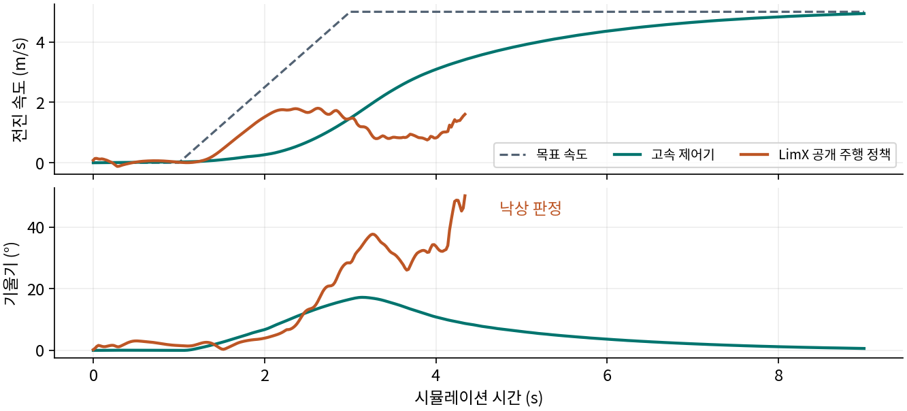
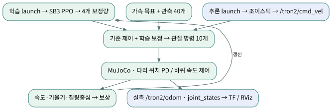

# TRON2 WF 실습 | 5 m/s까지 가속할 때의 자세

속도 명령, 바퀴 회전, 차체의 실제 이동은 서로 다른 값이다. 이번 실습에서는 평지에서 5 m/s를 명령하고, 차체 변위로 속도를 측정한다. 무릎을 굽힌 경우와 같은 가중치로 굽힘만 끈 경우를 비교해, 가속 중 몸체 기울기와 전체 질량중심이 어떻게 변하는지 확인한다.



**그림 1.** 같은 기본 자세에서 1초 대기한 뒤 2초 동안 목표 속도를 올린 MuJoCo 시행이다. 고속 제어기는 목표를 따라간다. 공개 정책의 곡선은 낙상을 판정한 시점에서 끝난다. 그래프에는 첫 9초를 표시했고 합격 여부는 가속 후 20초 동안 판정했다.

### 제조사에서 정한 값은 어디에 쓰이는가

| 출처 | 전후 / 회전 값 | 의미 |
|---|---|---|
| LimX 배포 예제 WF params.yaml | 0.7 m/s / 1.0 rad/s | 공개 예제가 조작 입력에 적용하는 최대값 |
| LimX Isaac Lab WF 평지 과제 | ±1 m/s / ±1 rad/s | 공식 과제가 학습 중 표본 추출하는 명령 범위 |
| 이번 수업의 고속 학습 | 전진 0.5–5 m/s / 회전 0 | 평지 직선에서 목표 속도 추종과 가속 자세를 검증하기 위한 실험 설정 |

첫 번째 값은 제조사의 공개 예제에 실제로 들어 있다. 이를 시뮬레이션 전체의 상한 또는 실기체의 최고 속도로 해석할 근거는 없다. [공개 배포 파라미터](https://github.com/limxdynamics/tron2_rl_deploy_python/blob/dc27d921df839c27f7ab47308af2e3e82ec9265e/controllers/model/WF_TRON2A/params.yaml) · [공식 학습 과제](https://github.com/limxdynamics/tron2_rl_lab/tree/3ce61328d2e108fe3a6de361cd6b3c5b8638cabd/exts/bipedal_locomotion/bipedal_locomotion/tasks/locomotion/cfg/WF_TRON2A)

## 1장 | 학습 루프와 몸체 자세



**그림 2.** 학습에서는 목표 속도를 프로그램이 생성한다. 재생에서는 같은 자리에 조이스틱 명령이 들어간다. 보상은 시뮬레이터에서 계산한 상태로 구하며, 실제 ROS 주행 중에는 ONNX 추론만 수행한다.

1. 제조사 인코더가 최근 10프레임·340개 입력을 잠재 상태 3개로 압축한다. 여기에 현재 관측 34개와 명령 3개를 합쳐 정책 입력 40개를 만든다.
2. 기준 제어기는 바퀴 속도와 목표의 오차, 중력 방향, 몸체 각속도로 바퀴 보정을 계산한다. 속도 오차가 큰 구간에는 무릎을 굽히고 엉덩이를 함께 움직이며, 속도가 수렴하면 굽힘을 푼다. 관절 강성·감쇠·토크 한계는 기존 WF 설정을 사용한다.
3. PPO는 기준 동작을 보정하는 값 4개를 학습한다. 기준 수식과 신경망을 하나의 ONNX로 내보내 다리 위치 8개와 바퀴 속도 2개에 대응하는 동작을 출력한다. 정책은 50 Hz, MuJoCo 물리 적분은 1 kHz다.
4. 보상은 속도 추종, 직립도, 목표 질량중심 높이와의 오차, 보정량 비용, 낙상 벌점을 합산한다. 굽힘 기본값 0.35 rad에서 질량중심 목표는 오차에 따라 0.628 m에서 최저 0.599 m까지 내려간다. 실제 질량중심은 전체 링크 질량의 가중평균을 사용한다.

### 공식 학습과 연결해서 읽기

LimX 공식 경로는 Isaac Sim 5.1, Isaac Lab 2.3.1에서 scripts/rsl_rl/train.py를 실행한다. 스크립트가 저장소 안의 rsl_rl을 먼저 불러오고 OnPolicyRunner로 학습한다. 공식 WF의 높이 목표 0.73 m는 구현에서 몸체 기준점의 세계 z 좌표를 사용한다. 이번 측정의 전체 질량중심과 물리적으로 다른 지점이다. 여기 기록한 체크포인트는 MuJoCo와 Stable-Baselines3 PPO에서 생성했다. [LimX 공식 trainer](https://github.com/limxdynamics/tron2_rl_lab/blob/3ce61328d2e108fe3a6de361cd6b3c5b8638cabd/scripts/rsl_rl/train.py)

## 2장 | 고속 정책 학습과 ROS 재생

WSL ROS 2 Humble 터미널에서 아래 명령을 실행한다. 첫 실행 전에 day5/locomotion에서 ~/.local/bin/uv sync --locked로 환경을 설치하고 sainty_ws에서 colcon build --symlink-install --packages-select tron2_bringup을 실행한다.

```
cd ~/sainty/day5
source /opt/ros/humble/setup.bash
source sainty_ws/install/setup.bash
R="$PWD/locomotion/results"
ros2 launch tron2_bringup locomotion_train.launch.py \
  task:=high_speed steps:=24576 seed:=73 target:=5.0 crouch:=0.35 \
  out:="$R/high_lab01"
```

새 경로에 체크포인트와 ONNX가 저장된다. 학습은 매번 0.5–5 m/s의 목표와 1.5–3초의 가속 시간을 뽑는다. 직접 비교할 때는 seed와 스텝 수를 고정하고 crouch:=0.0 및 다른 출력 경로로 다시 학습한다. 동일 가중치 비교는 마지막 장의 평가 스크립트가 따로 수행한다.

```
ros2 launch tron2_bringup policy_drive.launch.py \
  profile:=experiment drive_onnx:="$R/high_lab01/policy.onnx" \
  rviz:=true
```

검증에 사용한 가중치를 바로 재생하려면 high_lab01을 wf_high_speed_s73으로 바꾼다. 조이스틱을 가운데에서 위쪽으로 2초에 걸쳐 움직인다. 별도 터미널에서 아래 두 값을 관찰한다. 전자는 조이스틱 명령이고, 후자는 MuJoCo 차체 좌표계에서 측정한 전진 속도다.

```
ros2 topic echo /tron2/cmd_vel --field linear.x
ros2 topic echo /tron2/odom --field twist.twist.linear.x
```

명령이 0.25초 이상 끊기면 목표가 0으로 돌아간다. ONNX를 재생할 때도 제조사 인코더와 로봇 모델이 필요하다. 화면의 바퀴 회전수만으로 차체 속도나 지면 미끄러짐을 판정하지 않는다.

## 3장 | 무릎을 굽히면 가속이 더 안정적인가

3·5 m/s, 즉시 입력·2초 가속, 세 초기값을 조합해 제어기마다 12회씩 시험했다. 1초 기립 후 가속하고 목표를 20초 유지했다. 낙상 없이 마지막 2초 평균 속도가 목표의 ±15%면 통과다. 미세한 초기 자세 교란만 적용한 평지 직진 시험이다.

| 제어 방법 | 통과 | 5 m/s 마지막 2초 평균 |
|---|---:|---:|
| LimX 공개 WF ONNX | 0 / 12 | 전부 낙상 |
| 무릎 굽힘 + PPO | 12 / 12 | 5.054 m/s |
| 동일 가중치에서 무릎 굽힘만 해제 | 12 / 12 | 5.072 m/s |
| 굽힘 없이 따로 학습한 PPO | 12 / 12 | 5.105 m/s |
| 굽힘 포함 기준 제어만 사용 | 12 / 12 | 5.051 m/s |

### 5 m/s에서 같은 가중치로 굽힘만 바꾼 결과

아래 수치는 가속 시작 후 첫 2초의 값이며, 각 조건의 세 시행을 평균했다. 기울기는 각 시행의 최대값을 취했고, 전체 질량중심 높이와 절대 무릎 각도는 시간 평균을 사용했다.

| 가속 | 굽힘 | 최대 기울기 | 질량중심 | 무릎 각도 |
|---|---|---:|---:|---:|
| 즉시 | 사용 | 18.32° | 0.6105 m | 0.380 rad |
| 즉시 | 해제 | 20.36° | 0.6107 m | 0.011 rad |
| 2초 | 사용 | 16.48° | 0.6197 m | 0.267 rad |
| 2초 | 해제 | 15.33° | 0.6211 m | 0.005 rad |

**해석.** 급가속에서는 굽힘으로 최대 기울기가 2.04° 줄었지만 전체 질량중심 높이 차이는 약 0.2 mm였다. 2초 가속에서는 질량중심이 약 1.4 mm 내려갔으나 최대 기울기는 1.15° 늘었다. 무릎 각도 변화만으로 안정성 향상을 일반화할 수 없다. 기준 제어만으로도 전부 통과했으므로 학습 보정이 5 m/s 달성에 필수였다는 증거도 없다.

**독립 확인.** ROS launch에서 2초 램프로 5 m/s를 명령해 마지막 오도메트리 표본들의 평균 5.054 m/s를 확인했다. 회전·후진·경사·장애물·지면 마찰 변화 및 실기체 성능은 별도 시험이 필요하다. 원시 자료는 tron2_figures/wf_training_trials.csv 및 wf_training_ros.json에 있다. 재평가는 낙상 복구 교안 마지막 장의 wf_task_evaluate.py 명령을 사용한다.
