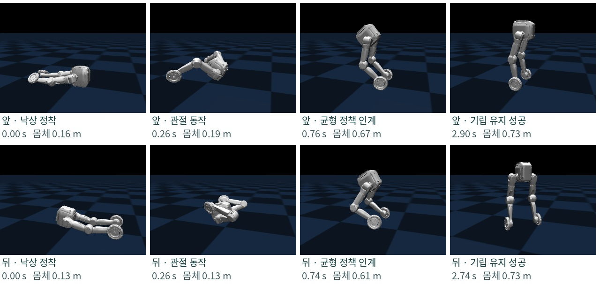
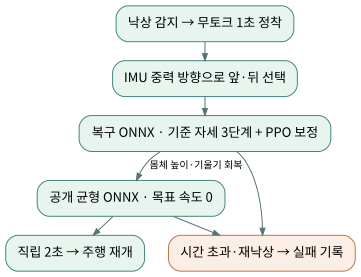

# TRON2 WF 실습 | 넘어진 자리에서 일어서기

다리와 바퀴로 몸체를 일으키는 구간과, 두 바퀴 위에서 균형을 잡는 구간에는 서로 다른 동작이 필요하다. 이번 실습에서는 앞·뒤로 넘어진 WF를 MuJoCo에서 일으키고, 균형 정책에 제어를 넘긴 후 2초간 서 있는지 측정한다.



**그림 1.** 각 행은 하나의 연속된 MuJoCo 시행이다. 위는 앞, 아래는 뒤로 넘어진 경우다. 각 칸 아래에 경과 시간과 몸체 기준점 높이를 표시했다. 초기 자세 정착 후 위치를 재설정하거나 외력을 가해 일으키는 과정은 없다.

### 두 화면에서 찾아볼 것

- 세 번째 칸에서 앞 낙상의 몸체 높이는 0.67 m다. 이 시점에 바퀴가 몸체 아래로 들어오면 균형 정책이 동작을 이어간다.
- 네 번째 칸에서야 성공을 기록한다. 높이만 잠시 올라갔다가 다시 넘어지는 사례를 구별하기 위해서다.
- 기본 자세에서 성공한 두 예시는 전체 평가의 일부다. 마지막 장에서 자세를 달리한 12회와 주행 중 낙상 결과를 함께 읽는다.

## 1장 | 제조사 주행 정책에 복구 동작을 더하는 방법

LimX의 WF 평지 과제는 Isaac Lab에서 직립 주행을 학습한다. 앞뒤 명령을 ±1 m/s 범위에서 뽑고, 몸체 기준점의 목표 높이는 0.73 m이며, 몸체의 바닥 접촉은 종료 조건이다. 넘어진 채로 시작해 일어나는 과제에는 초기 상태, 보상, 종료 조건을 새로 정의해야 한다. 이번 수업의 학습 엔진은 MuJoCo와 Stable-Baselines3 PPO다. 공식 Isaac 학습과 결과를 비교할 때에는 학습 엔진과 과제 정의를 모두 기록한다. [LimX 공식 학습 저장소](https://github.com/limxdynamics/tron2_rl_lab/tree/3ce61328d2e108fe3a6de361cd6b3c5b8638cabd)



**그림 2.** 초기화에서는 몸체를 앞·뒤로 기울인 뒤 1초간 무토크로 떨어뜨린다. 주행 중 낙상에서는 현재 위치와 속도를 그대로 이어서 1초간 정착시킨다.

| 단계 | 관측과 제어 |
|---|---|
| 낙상 방향 선택 | 몸체 좌표계 중력의 전후 성분 부호로 앞·뒤 기준 자세를 고른다. |
| 일으키기 | 기존 40차원 입력에 방향과 단계 번호를 더한다. 기준 궤적은 시뮬레이션 탐색으로 얻은 세 자세다. 50 Hz에서 각 17틱 뒤 다음 단계로 넘어가며 마지막 단계는 인계까지 유지한다. PPO가 엉덩이·무릎·바퀴·다리 벌림을 보정한다. |
| 균형 인계 | 몸체의 위 방향과 세계 수직축 내적이 0.74 초과이며 몸체 높이가 0.51 m 초과일 때 공개 주행 정책에 속도 0을 입력한다. |
| 성공과 실패 | 수직축 내적 0.93 초과와 높이 0.58 m 초과가 100틱 연속이면 성공이다. 81틱 안에 인계하지 못하거나 인계 후 재낙상하거나 전체 230틱을 소진하면 실패다. |

## 2장 | launch로 학습하고 재생하기

WSL의 ROS 2 Humble 터미널에서 시작한다. 학습은 화면 없이 진행하며 ROS launch가 별도 Python 프로세스를 시작한다. 한 시행의 시뮬레이터·관측·보상·PPO 갱신은 이 프로세스 안에 있다. ROS 토픽은 뒤의 재생 단계에서 관측한다.

```
cd ~/sainty/day5/locomotion
~/.local/bin/uv sync --locked
cd ../sainty_ws
source /opt/ros/humble/setup.bash
colcon build --symlink-install --packages-select tron2_bringup
source install/setup.bash
cd ..
R="$PWD/locomotion/results"
ros2 launch tron2_bringup locomotion_train.launch.py \
  task:=recovery steps:=16384 seed:=73 out:="$R/recovery_lab01"
```

학습은 매 에피소드마다 앞·뒤를 선택하고 초기 pitch와 yaw를 조금씩 바꾼다. 매 틱 몸체의 직립도와 전체 질량중심 높이에 보상을 주고, 성공에 +15, 실패에 −5를 더한다. PPO는 256스텝씩 수집하고 미니배치 64로 네 번 갱신한다. 각 출력 경로는 새 디렉터리여야 한다. 완료되면 학습 체크포인트 (ppo.zip), 추론 모델 (policy.onnx), 학습 기록 (training.json)이 생성된다. 내보낸 모델은 입력 32개에서 PyTorch와 ONNX Runtime 출력을 대조한다.

```
ros2 launch tron2_bringup policy_drive.launch.py \
  start_pose:=front recovery_onnx:="$R/recovery_lab01/policy.onnx" \
  rviz:=true
```

창을 닫은 후 같은 명령에서 앞 자세를 back으로 바꾸어 뒤 낙상을 확인한다. 수업에서 검증한 가중치를 쓰려면 recovery_lab01을 wf_recovery_s73으로 바꾼다. 복구 중에는 조이스틱 명령을 0으로 처리한다. 로그에 ‘Recovered: two seconds upright’가 나온 뒤 조작한다. 별도 터미널에서 몸체 높이와 관절 피드백을 확인할 수 있다.

```
ros2 topic echo /tron2/odom --field pose.pose.position
ros2 topic hz /tron2/joint_states
```

## 3장 | 성공률과 실패 사례 판독

각 방향에 기준 초기값 1개와 자세를 바꾼 초기값 5개를 사용했다. 모든 비교군에 같은 초기값을 사용했다. 기준 궤적과 PPO 보정의 기여를 분리하기 위해, 보정 4개를 모두 0으로 만든 조건도 재생했다.

| 제어 방법 | 앞 낙상 성공 | 뒤 낙상 성공 |
|---|---:|---:|
| 공개 WF 주행 ONNX에 속도 0만 입력 | 0 / 6 | 0 / 6 |
| 세 기준 자세 + 공개 균형 정책 | 4 / 6 | 5 / 6 |
| 세 기준 자세 + PPO 보정 + 공개 균형 정책 | 4 / 6 | 5 / 6 |

**판독.** 새 제어기는 9/12회 일어섰고, 기준 초기값 두 개를 제외하면 7/10회다. 이 표본에서는 기준 궤적에 PPO를 추가했을 때 성공 횟수가 늘지 않았다. 이번 개선을 설명하는 가장 직접적인 증거는 낙상 전용 기준 동작과 균형 인계다.

**ROS 통합 시험.** 앞·뒤 기본 자세를 각각 launch로 재생해 성공 로그와 /tron2/odom의 최종 몸체 높이 0.732 m를 확인했다. 반면 공개 주행 정책에 5 m/s를 입력해 실제로 넘어진 시행에서는 복구하지 못했고, 종료 직전 몸체 높이는 0.169 m였다. 초기 배치에서 성공한 비율을 이동 중 낙상의 복구율로 사용할 수 없다. 측면 낙상, 계단, 하드웨어는 이번 평가 범위 밖이다.

### 수강생 실험

1. 앞 방향에서 실패한 seed 203과 204를 원시 기록에서 찾는다. 초기 몸체 높이와 시험 종료 시간을 성공한 seed 201과 대조한다.
2. 아래 평가를 실행해 새 CSV를 만든다. 훈련에 사용한 seed 73과 평가에 사용한 seed를 구분한다. 낙상 시험은 전후 초기 기울기 ±0.06 rad, 방위각 ±0.5 rad 범위 안에서 수행한다.

```
cd ~/sainty/day5/locomotion
R="$PWD/results"
.venv/bin/python wf_task_evaluate.py --ablate \
  --recovery "$R/wf_recovery_s73/policy.onnx" \
  --speed "$R/wf_high_speed_s73/policy.onnx" \
  --straight "$R/wf_high_straight_s73/policy.onnx" \
  --csv "$R/evaluation_lab01.csv"
```

교안 폴더의 tron2_figures/wf_training_trials.csv에 개별 시험이, wf_training_ros.json에 ROS 통합 시험이 들어 있다. 구현을 따라갈 때는 locomotion의 wf_task_runtime.py에서 상태 전이를, wf_task_train.py에서 기준 궤적과 잔차 보정을 읽는다.
