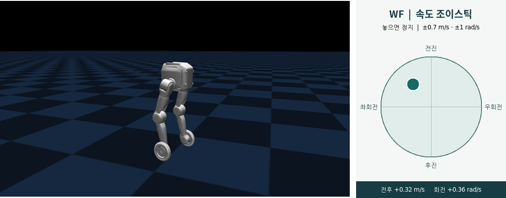
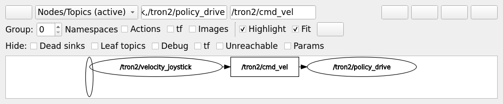
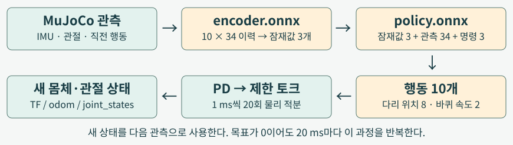
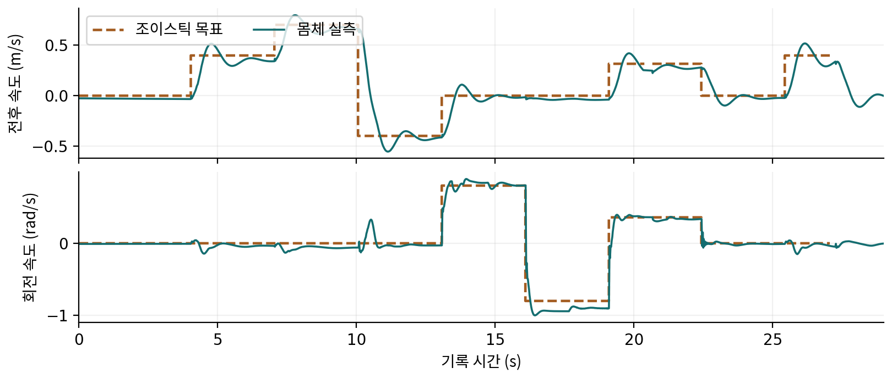
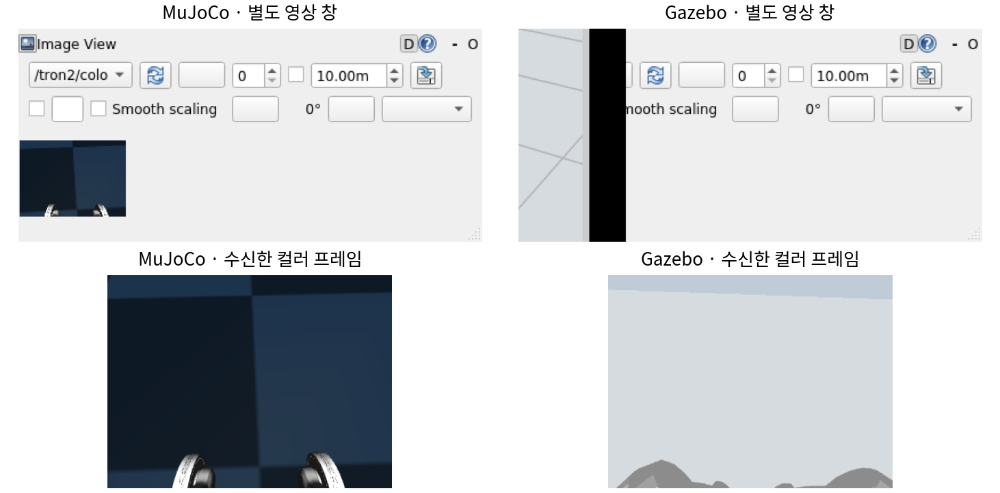

# TRON2 WF · 조이스틱으로 균형을 잡고 주행하기

두 바퀴로 선 WF_TRON2A에 전진 속도와 회전 속도를 보낸다. 손을 놓으면 목표 속도가 0으로 돌아오며, 정책은 넘어지지 않도록 관절과 바퀴를 계속 조절한다. 이 실습은 MuJoCo 한 대를 구동한다.



**실행 화면.** 원의 위·아래는 전진·후진, 왼쪽·오른쪽은 좌회전·우회전이다. 중심에서 멀어질수록 명령이 커진다. 대각선으로 끌면 전진하면서 회전한다. 상태 표시줄은 입력 목표를 표시한다.

### 처음 한 번 준비하기

```bash
cd ~/sainty/day5
git submodule update --init --depth 1 -- tron2_sdk/vendor/tron2_rl_deploy_python
(cd tron2_sdk && uv sync --locked && uv run --locked python fetch_models.py)
cd sainty_ws
source /opt/ros/humble/setup.bash
colcon build --symlink-install --packages-up-to tron2_bringup
source install/setup.bash
ros2 launch tron2_bringup policy_drive.launch.py
```

다음 실행부터는 새 터미널에서 워크스페이스의 `install/setup.bash`를 소싱하고 마지막 줄을 실행한다. RViz2도 보려면 `rviz:=true`를 붙인다. 기존 MuJoCo 또는 Gazebo 브링업을 먼저 종료한다. 조이스틱이나 뷰어를 닫으면 이 launch가 시작한 프로세스들이 종료된다.

**첫 관찰**   중심에서 손을 놓고 몸체가 서 있는지 확인한다. 원을 조금만 위로 민 다음, 끝까지 밀어 하단의 m/s 값이 어떻게 달라지는지 읽는다. MuJoCo 카메라는 몸체를 따라간다. 실제 이동량은 뒤의 `/tron2/odom` 실습에서 측정한다.

## 정책이 균형을 만드는 20 ms



**ROS 경계.** `velocity_joystick`이 `/tron2/cmd_vel`에 Twist를 20 Hz로 발행한다. `linear.x`는 m/s, `angular.z`는 rad/s이며 양의 회전은 왼쪽이다. 노드가 0.25초 동안 새 명령을 받지 못하면 다음 추론부터 두 목표를 0으로 사용한다.



같은 화면을 열려면 소싱한 터미널에서 `ros2 run rqt_graph rqt_graph`를 실행하고 Nodes/Topics (active) 보기에서 `/tron2/cmd_vel`을 찾는다.

**정책 내부.** `train_tron2_wf.py`의 `WheelDrive`와 `session()`을 재사용한다. 시작 때 CPU ONNX Runtime 세션 두 개를 열고, 매 틱에 관측 이력으로 인코더를 실행한 뒤 속도 명령을 포함한 40개 값을 액터에 넣는다. 앞의 이력과 직전 행동은 방향을 바꿀 때도 이어진다.

### RViz2가 읽는 값

`policy_drive`는 적분이 끝난 관절 10개의 상태를 `/tron2/joint_states`에 발행한다. `robot_state_publisher`가 URDF와 관절각으로 링크 TF를 만들고, 정책 노드는 몸체에서 읽은 `world → tron2/base_Link` TF와 오도메트리를 발행한다.

이 launch의 모터 명령 소유자는 정책이다. 앞 교안에서 쓰던 관절 슬라이더와 ros2_control 관절 브링업은 별도 실습에서 실행한다. 코드 진입점은 `tron2_bringup/launch/policy_drive.launch.py`, 추론은 `tron2_bringup/policy_drive.py`, 조이스틱은 `tron2_dashboard/velocity_joystick.py`다.

## 누가 속도를 정하는가 · 기립 자세에서 시작하는 이유

| 확인 대상 | 수치 또는 동작 | 실습에서의 의미 |
|---|---|---|
| LimX 휠형 제품 사양 | 최대 이동 속도 3–5 m/s | 제조사가 발표한 기체 성능 범위다. 영상 한 장면의 속도는 거리와 시간 계측이 필요하다. |
| 공개 WF 예제 | 전후 ±0.7 m/s, 좌우 이동 0, 회전 ±1.0 rad/s | `params.yaml`의 `commands.max`와 제조사 Python 컨트롤러의 스틱 처리 코드에서 확인한다. |
| 수업의 기본 모드 | `profile:=reference` | 시작할 때 설치된 WF YAML에서 위 값을 읽고, UI와 명령 수신 측에 같은 범위를 적용한다. |
| 수업의 확장 모드 | `profile:=experiment` | 기본 스틱 범위 ±5 m/s와 ±4 rad/s는 이번 시험 설계값이다. 두 축을 launch 인자로 각각 바꿀 수 있다. |

제조사 예제는 스틱을 정규화하고 `_process_joystick()`에서 설정값으로 스케일·클립한다. 해당 버전의 관측 생성 코드에는 명령을 한 번 더 스케일하는 단계도 있다. 수업은 사용자가 지정한 `test_wf_direction.py`의 입력 계약에 따라 액터 입력 마지막 세 칸에 `[vx, 0, wz]`를 직접 넣는다. 따라서 실습의 목표와 결과는 이 경로를 기준으로 읽는다. 공개 자료에서 모든 시뮬레이션에 0.7 m/s를 강제하는 지침은 확인하지 못했다. [제조사 휠형 사양](https://www.limxdynamics.com/ko/products/tron2/spec) · [WF 설정](https://github.com/limxdynamics/tron2_rl_deploy_python/blob/dc27d921df839c27f7ab47308af2e3e82ec9265e/controllers/model/WF_TRON2A/params.yaml) · [제조사 컨트롤러](https://github.com/limxdynamics/tron2_rl_deploy_python/blob/dc27d921df839c27f7ab47308af2e3e82ec9265e/controllers/WheelfootController.py)

### 같은 정책으로 다른 범위 시험하기

```bash
ros2 launch tron2_bringup policy_drive.launch.py profile:=experiment
# 위 세션을 종료한 후 전후 ±2 m/s, 회전 ±1.5 rad/s로 다시 실행
ros2 launch tron2_bringup policy_drive.launch.py profile:=experiment max_linear:=2.0 max_yaw:=1.5
```

바뀌는 것은 목표 속도의 범위다. 두 모드는 같은 가중치·질량·토크 한계·바닥을 사용한다. 고속 시험에서 넘어지면 마지막 상태를 발행하고 세션이 종료된다.

### 실기체의 낙상 복구와 공개 모델

제조사 사용자 매뉴얼에는 휠형의 낙상 감지 후 기립 기능이 명시돼 있다. 공식 GitHub·Hugging Face와 공개 검색에서 이 MuJoCo WF 모델에 적용 가능한 독립 복구 체크포인트는 확인하지 못했다. 공개 예제의 `handle_stand_mode()`는 초기·기본 관절각을 보간한다. 실습은 `WheelDrive.reset()`으로 기본 관절각과 몸체 방향을 설정하고 바퀴가 바닥에 닿게 높이를 맞춘다. 이 초기화는 쓰러진 로봇이 스스로 일어나는 능력을 검증하지 않는다. [실기체 매뉴얼](https://www.limxdynamics.com/en/documents/852949782845591552) · [공개 WF 파일](https://huggingface.co/limxdynamics/tron2-rl-locomotion-policies/tree/main/WF_TRON2A)

## 목표 속도와 실제 속도를 따로 측정하기

실제 조이스틱 위젯에 마우스 입력을 보내 정지, 전후진, 제자리 회전, 곡선, 해제를 연속 실행했다. 오른쪽 끝에서는 주행 중 조이스틱 발행을 2초간 중단해 입력 만료를 시험했다. 점선이 비어 있는 구간은 새 명령이 도착하지 않은 시간이다.



| 조작 | 전후 목표 / 실측 (m/s) | 회전 목표 / 실측 (rad/s) |
|---|---:|---:|
| 전진 | +0.397 / +0.357 | -0.000 / -0.032 |
| 최대 전진 | +0.700 / +0.666 | -0.000 / -0.058 |
| 후진 | -0.397 / -0.433 | -0.000 / -0.032 |
| 좌회전 | -0.000 / -0.010 | +0.802 / +0.827 |
| 우회전 | -0.000 / -0.038 | -0.802 / -0.916 |
| 전진과 좌회전 | +0.315 / +0.281 | +0.360 / +0.344 |
| 손 놓음 | -0.000 / -0.029 | -0.000 / -0.012 |

**검증 기준.** 각 동작을 약 3초 유지하고 초기 0.8초를 제외해 평균을 냈다. 최대 전진에서는 몸체의 월드 위치 변화량을 진행 방향에 투영해서도 속도를 계산했다. 관성 주축과 링크 좌표축이 다르므로 `Odometry.twist`는 MuJoCo의 `mjOBJ_XBODY`를 사용해 `tron2/base_Link` 축으로 표현한다.

기립과 방향 전환을 포함한 28.4초 동안 최저 높이는 0.712 m, 최대 몸체 기울기는 4.5°였다. 최대 전진에서 위치 기반 평균은 0.666 m/s였다. 발행을 중단한 뒤 1.25~2초 구간의 전후 속도는 -0.016 m/s였다.

```bash
source ~/sainty/day5/sainty_ws/install/setup.bash
cd ~/sainty/day5
python3 ros_lab/measure_wf_speed.py --seconds 3
```

다른 터미널에서 측정하는 동안 스틱을 일정하게 유지한다. 출력의 `pose rate`는 위치 변화 기반 속도, `mean twist`는 속도 메시지의 시간 평균이다. 정지 명령에서도 균형을 잡는 동안 작은 잔류 이동이 생긴다.

## 입력을 5 m/s까지 올리면 어디서 넘어지는가

같은 초기 자세에서 매 시험을 다시 시작했다. 첫 1초는 정지, 이후에는 목표를 즉시 주거나 2초 동안 선형으로 증가시킨다. 6초 또는 20초 유지한 뒤 마지막 2초의 평균을 계산한다. 걸린 시간은 시뮬레이션 시각이며 낙상 시간에는 첫 1초도 포함한다.

| 전진 목표 | 즉시 입력 | 2초 가속 입력 |
|---|---|---|
| 0.7 m/s · 6초 유지 | 0.662 m/s | 0.661 m/s |
| 2.0 m/s · 20초 유지 | 2.254 m/s | 2.254 m/s |
| 2.2 m/s · 20초 시도 | 9.24초에 낙상 | 6.90초에 낙상 |
| 2.6 m/s · 20초 시도 | 기립 유지, 1.313 m/s | 4.74초에 낙상 |
| 3.0 m/s · 20초 시도 | 4.82초에 낙상 | 4.62초에 낙상 |
| 4.0 m/s · 6초 시도 | 3.28초에 낙상 | 기립 유지, −0.098 m/s |
| 5.0 m/s · 6초 시도 | 2.24초에 낙상 | 4.36초에 낙상 |

**판독.** 2.0 m/s에서는 서 있었지만 목표보다 약 13% 빨랐다. 2.6 m/s 즉시 입력에서는 목표보다 느렸고, 4.0 m/s 가속 입력에서는 진행 방향까지 바뀌었다. 따라서 낙상 여부와 속도 오차를 함께 읽는다. 이산적으로 시험한 평지·초기 자세 한 종류의 결과이므로 2.0 m/s를 절대 임계속도로 해석할 수 없다.

**후진과 회전.** −2.0 m/s 즉시 입력에서는 −4.588 m/s까지 과속했다(마지막 2초 평균). +4.0 rad/s 회전은 +3.813 rad/s, −4.0 rad/s는 −3.108 rad/s였다. 독립 시뮬레이션 시험에 더해 실제 확장 launch에서도 스틱 끝이 +5.0 m/s를 발행하고 낙상 시 세션이 종료되는 것을 확인했다.

### 같은 46개 조건 재현하기

```bash
cd ~/sainty/day5
tron2_sdk/.venv/bin/python ros_lab/sweep_wf_policy.py > wf_sweep.csv
tron2_sdk/.venv/bin/python ros_lab/sweep_wf_policy.py --hold-seconds 20 \
  --linear 2 2.2 2.4 2.6 2.8 3 --yaw > wf_forward_20s.csv
```

시험 프로그램은 화면 없이 물리를 적분한다. `fallen`은 몸체의 위쪽 축과 세계 수직축의 내적이 0.65 미만이거나 높이가 0.40 m 미만일 때 참이다. `steady_rate`는 완주한 시험에서만 기록된다. CSV에는 최대 기울기와 최저 높이도 담았다. 측정 파일은 교안 폴더의 `tron2_figures/wf_policy_sweep.csv`다.

## 실습 | 시뮬레이터 옆에 허리 카메라 창 띄우기

기본 WF의 허리 카메라로 주행 방향의 바닥을 관찰한다. 시뮬레이터 창에서 시점을 회전해도 별도 Image View 창의 시점은 기체에 고정된다. 아래 두 명령 중 한 가지만 실행한다. 백엔드를 바꿀 때는 먼저 Ctrl+C로 실행 중인 launch를 종료한다.

```bash
cd ~/sainty/day5
source /opt/ros/humble/setup.bash
source sainty_ws/install/setup.bash
# MuJoCo 정책 주행과 카메라
ros2 launch tron2_bringup policy_drive.launch.py
# Gazebo 관절 조작 실습과 카메라
./panel_control.sh sim gz
```



**그림.** 위는 각 시뮬레이터와 동시에 열린 rqt 영상 창, 아래는 같은 시험에서 ROS 2로 받은 원본 크기의 컬러 프레임이다. 창에서는 /tron2/color가 자동 선택된다. /tron2/depth를 선택하면 같은 시점의 깊이를 볼 수 있다. 영상 창만 생략하려면 ROS launch 명령에 camera_view:=false를 추가한다.

## 실습 | 카메라의 위치와 데이터 검증하기

| 수업 파일 | 검사할 항목 |
|---|---|
| tron2_description/urdf/wf_tron2a.urdf | d435_Link의 고정 장착 위치와 wf_camera_optical 좌표계. ROS 광학축은 오른쪽 +X, 아래 +Y, 전방 +Z |
| WF_TRON2A/xml/robot.xml (MJCF) | d435_Link에 장착된 d435_depth. 주행 노드의 렌더러가 이 카메라로 컬러·깊이를 만든다. track은 외부 관찰 시점이다. |
| tron2_gz/urdf/wf_gz.urdf.xacro → 모델 SDF | wf_rgbd 센서, 320×240, 목표 15 Hz. 변환 시 고정 관절이 합쳐져 센서 위치가 base_Link 기준으로 표현된다. |
| tron2_gz/worlds/classroom.sdf | Sensors 시스템이 OGRE로 영상을 생성한다. ros_gz_bridge가 영상과 보정 정보를 ROS 2로 전달한다. |

두 모델에서 확인한 카메라 위치는 몸체 기준 (0.09680, 0.01759, −0.00409) m, 수직 화각은 70.841°다. 광축은 앞쪽 아래를 향한다. 이 값은 수업용 모델의 설정이다.

시뮬레이터가 실행 중일 때 새 WSL 터미널에서 아래를 실행한다. 검사기는 URDF의 TF와 MJCF·SDF의 광축을 같은 기준으로 변환해 비교한다. 이어서 서로 다른 시각의 컬러·깊이·보정 정보를 각각 3회 이상 받고, 몸체에서 광학 프레임까지 TF를 조회한다.

```bash
cd ~/sainty/day5
source /opt/ros/humble/setup.bash
source sainty_ws/install/setup.bash
tron2_sdk/.venv/bin/python ros_lab/check_wf_camera.py --live
```

| ROS 2 토픽 | 메시지와 읽는 법 |
|---|---|
| /tron2/color | sensor_msgs/Image, rgb8. 1픽셀을 빨강·초록·파랑 3바이트로 표현한다. |
| /tron2/depth | sensor_msgs/Image, 32FC1. 각 픽셀은 m 단위의 깊이다. 거리 계산에는 유한한 값만 사용한다. |
| /tron2/camera_info | sensor_msgs/CameraInfo. K 행렬과 영상 크기를 확인한다. 두 시뮬레이터에서 확인한 수평 초점거리는 약 168.73픽셀이다. |

실습 문제. 주행하거나 기체가 기울었을 때 같은 바닥 지점이 영상에서 어떻게 움직이는지 살펴본다. 검사 명령에서 --live를 빼면 시뮬레이터를 띄우기 전에도 세 형식의 파일을 비교할 수 있다.
